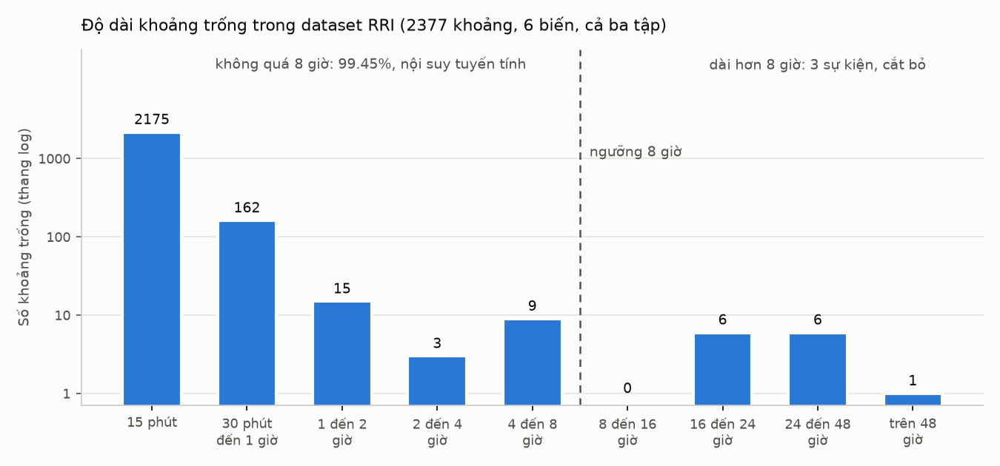

# Quy trình làm sạch dữ liệu dataset CEMP RRI

Phiên bản ngày 2026-11-13. Trạng thái: quy trình đã chốt, mã xử lý chưa được cài đặt.

Tài liệu mô tả cách làm sạch ba tập train, val, test trong thư mục splits/ (xem README.md) trước khi đưa vào mô hình dự báo oxy hòa tan (DO). Quy trình gồm ba bước: kiểm tra miền giá trị, sửa điểm DO bất thường và xử lý khoảng trống. Mã phân tích làm căn cứ nằm trong analysis/, kết quả trong analysis/results/.

## 1. Khái niệm

| Khái niệm | Nghĩa |
|---|---|
| Mốc | Một dòng dữ liệu; các mốc cách nhau 15 phút, mỗi mốc có sáu biến |
| Khoảng trống | Các ô không có giá trị (NA) nằm liền nhau của cùng một biến. Độ dài khoảng trống là số mốc liên tiếp bị trống |
| Thời điểm dự báo | Thời điểm hiện tại của một lần dự báo |
| Đầu vào | Đoạn dữ liệu quá khứ đưa cho mô hình, kết thúc ngay trước thời điểm dự báo. Ví dụ đầu vào 24 giờ là 96 mốc |
| Nhãn | DO đo thực tế trong khoảng cần dự báo, bắt đầu từ thời điểm dự báo; dùng để tính sai số |
| Cửa sổ | Một cặp đầu vào và nhãn, tức một mẫu học hoặc một mẫu đánh giá. Dời thời điểm dự báo mỗi lần 15 phút để tạo các cửa sổ liên tiếp |
| Biến phụ | Năm biến ngoài DO: nhiệt độ, pH, độ dẫn, độ đục, chlorophyll |

Ví dụ: với thời điểm dự báo 2019-07-15 12:00, đầu vào 24 giờ gồm các mốc từ 2019-07-14 12:00 đến 2019-07-15 11:45, nhãn 6 giờ gồm DO từ 12:00 đến 17:45.

Mô hình không nhận được ô trống. Mỗi ô trống trong đầu vào phải được điền, nếu không cửa sổ đó bị bỏ. Một ô trống nằm trong đầu vào của 96 cửa sổ liên tiếp (với đầu vào 24 giờ), nên bỏ mọi cửa sổ có ô trống sẽ mất rất nhiều dữ liệu (mục 5.6).

## 2. Nguyên tắc

1. Không sửa raw/ và splits/. Dữ liệu sau làm sạch là file mới; mọi giá trị bị thay hoặc được điền đều có cờ đánh dấu.
2. Mọi ngưỡng và lựa chọn phương pháp được rút ra từ train.
3. Mỗi tập được xử lý riêng, không dùng giá trị của tập khác để điền.
4. Sai số luôn được tính trên DO đo thực tế. Giá trị điền chỉ dùng làm đầu vào; mốc nhãn có DO được điền không được tính sai số (mục 6.3).
5. Phạm vi chỉ là làm sạch sáu biến quan trắc. Biến đổi thang, chuẩn hóa, tạo cửa sổ và tạo đặc trưng thuộc các giai đoạn sau; mục 7 chỉ ghi kết quả phân tích để tham khảo.

## 3. Bước 1: Kiểm tra miền giá trị

Giá trị nằm ngoài miền vật lý được coi là lỗi (sai đơn vị, cảm biến ở ngoài nước, mã lỗi của thiết bị). Giá trị lỗi được chuyển thành ô trống và xử lý như mọi ô trống khác (mục 5).

| Biến | Miền chấp nhận |
|---|---|
| DO | 0 đến 20 mg/L |
| Nhiệt độ | 0 đến 35 độ C |
| pH | 6 đến 10 |
| Độ dẫn | 20 đến 3000 uS/cm |
| Độ đục | 0 đến 1000 FNU |
| Chlorophyll | 0 đến 200 ug/L |

Dataset RRI không có giá trị nào ngoài miền. Bước này vẫn được giữ cho dữ liệu người dùng tải lên hệ thống web.

## 4. Bước 2: Sửa điểm DO bất thường

### 4.1. Điểm bất thường là gì

DO thay đổi liên tục và chậm, vì quang hợp, hô hấp và trao đổi khí không tạo ra bước nhảy lớn chỉ kéo dài đúng một mốc. Trong train, 99% số bước thay đổi giữa hai mốc liền kề nhỏ hơn 0.42 mg/L, 99.9% nhỏ hơn 0.90 mg/L.

Điểm nghi vấn là mốc mà DO lệch quá 0.8 mg/L so với mốc trước, rồi quay lại quá 0.8 mg/L ở mốc sau. Ví dụ ngày 2019-08-19: 23:45 là 8.89 mg/L, 00:00 là 7.72 mg/L, 00:15 là 8.80 mg/L. DO giảm 1.17 mg/L trong 15 phút rồi tăng lại ngay.

### 4.2. Phân loại

Mỗi điểm nghi vấn được xét theo thứ tự:

1. Nhiệt độ đổi từ 0.3 độ C hoặc pH đổi từ 0.05 tại cùng mốc: một khối nước khác đi qua cảm biến. Đây là hiện tượng thật, giữ nguyên.
2. Không có biến đổi đồng thời, và cảm biến khác trên cùng đầu đo bị trống trong vòng 1 giờ: lỗi thiết bị, thay giá trị.
3. Các trường hợp còn lại: chưa rõ nguyên nhân, thay giá trị.

Train có 21 điểm nghi vấn, trong đó 17 điểm thuộc loại 1. Val có 1 điểm, thuộc loại 1. Test không có.

### 4.3. Bốn điểm được thay

| Thời điểm | DO trước, tại điểm, sau (mg/L) | Căn cứ | Loại | Giá trị thay |
|---|---|---|---|---|
| 2019-08-19 00:00 | 8.89, 7.72, 8.80 | Nửa đêm, nhiệt độ và độ dẫn không đổi; cảm biến độ đục hỏng liên tục từ ngày 15 đến 19 tháng 8 năm 2019 | Lỗi thiết bị | 8.845 |
| 2023-07-11 08:45 | 6.64, 9.08, 6.92 | Bốn cảm biến khác cùng trống tại mốc này, dấu hiệu bảo trì | Lỗi thiết bị | 6.780 |
| 2021-09-08 22:15 | 8.71, 9.97, 8.84 | DO tăng ban đêm mà nhiệt độ và pH không đổi, phù hợp tác động của trạm sục khí gần đó | Chưa rõ | 8.775 |
| 2021-10-28 17:30 | 7.62, 8.63, 7.34 | Tương tự; tháng 10 là giai đoạn trạm sục khí thường vận hành | Chưa rõ | 7.480 |

Giá trị thay là trung bình của mốc trước và mốc sau. Ở cả bốn điểm, hai mốc lân cận chỉ chênh nhau 0.09 đến 0.28 mg/L. Với hai điểm chưa rõ nguyên nhân, mức DO trước và sau điểm vẫn được giữ; chỉ riêng mốc vọt lên bị thay, vì không biến nào trong dataset giải thích được mốc đó.

### 4.4. Các hiện tượng được giữ nguyên

- Đỉnh DO buổi chiều mùa hè, kèm pH tăng lên 8 đến 9 do quang hợp. Vì vậy không dùng bộ lọc loại cực trị (Hampel) cho DO.
- Bước nhảy độ dẫn trong đợt lũ tháng 1 năm 2019.
- Các đoạn pH không đổi vào mùa đông (độ phân giải của cảm biến là 0.01).
- Đỉnh đơn lẻ của độ đục và chlorophyll, là đặc trưng của cảm biến quang học.

## 5. Bước 3: Xử lý khoảng trống

### 5.1. Quy tắc

| Khoảng trống | Xử lý |
|---|---|
| Không quá 8 giờ (32 mốc) | Nội suy tuyến tính: nối thẳng giữa số đo ngay trước và số đo ngay sau khoảng trống |
| Dài hơn 8 giờ, ở bất kỳ biến nào | Không điền. Mọi cửa sổ có đầu vào hoặc nhãn chạm vào khoảng trống này bị bỏ |

Quy tắc áp dụng như nhau cho cả sáu biến và cả ba tập.

Ví dụ khoảng trống ngắn, DO ngày 2019-07-15:

| Mốc | DO đo được (mg/L) | Sau làm sạch | Cờ |
|---|---|---|---|
| 09:45 | 7.10 | 7.10 | Đo thật |
| 10:00 | trống | 7.20 | Nội suy |
| 10:15 | trống | 7.29 | Nội suy |
| 10:30 | 7.39 | 7.39 | Đo thật |

Ví dụ khoảng trống dài: lần bảo trì ngày 2024-09-02 trong val, cả sáu biến trống từ 14:00 đến 11:00 hôm sau (21.25 giờ). Các ô này được để trống. Với đầu vào 24 giờ và nhãn 6 giờ, mọi cửa sổ có thời điểm dự báo từ 2024-09-02 08:15 đến 2024-09-04 11:00 đều chạm vào khoảng trống và bị bỏ.

Khoảng trống dài không được nối liền lại: xóa các mốc trống rồi ghép hai đầu sẽ làm mốc 13:45 ngày 2/9 đứng ngay trước mốc 11:15 ngày 3/9, như thể hai mốc chỉ cách nhau 15 phút. Các mốc và thời gian được giữ nguyên; chỉ cửa sổ bị bỏ.

### 5.2. Phân bố độ dài khoảng trống



Tính trên sáu biến và cả ba tập (2377 khoảng trống):

| Độ dài | Số khoảng trống | Tích lũy |
|---|---|---|
| 15 phút | 2175 | 91.50% |
| 30 phút đến 1 giờ | 162 | 98.32% |
| 1 đến 2 giờ | 15 | 98.95% |
| 2 đến 4 giờ | 3 | 99.07% |
| 4 đến 8 giờ | 9 | 99.45% |
| 8 đến 16 giờ | 0 | 99.45% |
| 16 đến 24 giờ | 6 | 99.71% |
| 24 đến 48 giờ | 6 | 99.96% |
| Trên 48 giờ | 1 | 100% |

Phân bố tách thành hai nhóm rõ rệt. 99.45% số khoảng trống không quá 8 giờ, dài nhất là 7.75 giờ. Sau đó không có khoảng trống nào cho đến 21.25 giờ. 13 khoảng trống dài hơn 8 giờ thuộc ba sự kiện:

| Tập | Thời gian trống | Độ dài | Biến | Bối cảnh |
|---|---|---|---|---|
| val | 2024-09-02 14:00 đến 2024-09-03 11:00 | 21.25 giờ | cả sáu biến | Bảo trì, giữa mùa nóng |
| val | 2025-02-14 03:30 đến 2025-02-18 06:30 | 99.25 giờ | độ dẫn | Đợt lũ sau mưa |
| test | 2025-09-10 09:30 đến 2025-09-11 09:45 | 24.5 giờ | cả sáu biến | Bảo trì, giữa mùa nóng |

Riêng DO, số ô trống theo tập:

| Tập | Số ô DO trống | Số khoảng trống | Số khoảng chỉ một mốc | Khoảng dài nhất |
|---|---|---|---|---|
| train | 300 | 278 | 267 | 1.25 giờ |
| val | 129 | 24 | 12 | 21.25 giờ |
| test | 114 | 14 | 10 | 24.5 giờ |

Khi DO trống, gần như cả đầu đo ngừng ghi: trong 543 ô DO trống của cả ba tập, 480 ô có cả năm biến phụ cùng trống, chỉ 10 ô còn đủ năm biến phụ.

### 5.3. So sánh các phương pháp điền

**Các phương pháp.** Gọi số đo ngay trước khoảng trống là "đầu trái", số đo ngay sau là "đầu phải". Độ lệch ngày tại một mốc là giá trị tại mốc đó trừ giá trị cùng giờ ngày hôm trước.

| Ký hiệu | Phương pháp | Cách tính giá trị điền |
|---|---|---|
| A | Giữ số trước | Lặp lại đầu trái |
| B | Cùng giờ hôm qua | Giá trị cùng giờ ngày hôm trước; nếu ô đó cũng trống thì lùi thêm một ngày |
| C | Hôm qua cộng độ lệch một đầu | B cộng độ lệch ngày tại đầu trái |
| D | Nội suy tuyến tính | Nối thẳng giữa đầu trái và đầu phải |
| E | PCHIP | Đường cong trơn đi qua 8 số đo trước và 8 số đo sau khoảng trống |
| F | Hôm qua cộng độ lệch hai đầu | B cộng một độ lệch thay đổi đều từ độ lệch ngày tại đầu trái đến độ lệch ngày tại đầu phải |
| G | MissForest | Rừng cây quyết định đoán ô trống từ các biến khác tại cùng mốc, cùng giờ trong ngày và ngày trong năm; lặp 5 vòng |
| H | SAITS | Mạng học sâu tự chú ý (self-attention), học trên các đoạn 3 ngày của 85% đầu train |

A, B, C chỉ dùng số đo trước khoảng trống. D, E, F dùng cả hai đầu. G, H là phương pháp học máy.

**Cách tính.** Đoạn chấm điểm là 15% cuối của train (2023-08-09 đến 2024-05-31, 28484 mốc); 85% đầu chỉ dùng để huấn luyện H. Tại các vị trí có đủ sáu biến trong khoảng 50 giờ trước và 37 giờ sau, xóa nhân tạo một đoạn với 9 độ dài từ 15 phút đến 24.5 giờ (100 đến 300 đoạn mỗi độ dài; hai độ dài cuối bằng hai lần bảo trì). Đoạn bị xóa ở cả sáu biến cùng lúc, giống thực tế khi DO trống. Mỗi phương pháp điền lại đúng các đoạn đó. Sai số là MAE, trung bình của độ lệch tuyệt đối giữa giá trị điền và giá trị thật.

**Kết quả cho DO** (MAE, mg/L; số in đậm là thấp nhất):

| Độ dài | A | B | C | D | E | F | G | H |
|---|---|---|---|---|---|---|---|---|
| 15 phút | 0.065 | 0.218 | 0.092 | **0.044** | 0.046 | 0.069 | 0.269 | 0.075 |
| 30 phút | 0.071 | 0.233 | 0.110 | **0.052** | 0.054 | 0.081 | 0.269 | 0.076 |
| 1 giờ | 0.100 | 0.223 | 0.137 | **0.066** | 0.067 | 0.100 | 0.244 | 0.085 |
| 2 giờ | 0.130 | 0.216 | 0.173 | **0.088** | 0.090 | 0.129 | 0.234 | 0.111 |
| 3 giờ | 0.137 | 0.207 | 0.158 | **0.088** | 0.090 | 0.126 | 0.215 | 0.115 |
| 6 giờ | 0.222 | 0.208 | 0.211 | **0.137** | 0.146 | 0.162 | 0.298 | 0.152 |
| 12 giờ | 0.244 | 0.206 | 0.206 | 0.173 | 0.174 | **0.162** | 0.290 | 0.185 |
| 21.25 giờ | 0.257 | 0.207 | 0.231 | 0.236 | 0.237 | **0.191** | 0.289 | 0.237 |
| 24.5 giờ | 0.259 | **0.219** | 0.227 | 0.235 | 0.241 | 0.231 | 0.284 | 0.253 |

Nhận xét:

- D là phương pháp chính xác nhất cho mọi khoảng trống đến 6 giờ. E gần như trùng D.
- Từ 12 giờ, F chính xác hơn D, rõ nhất ở 21.25 giờ. Ở 24.5 giờ, B, D và F chênh nhau không có ý nghĩa thống kê.
- G kém nhất vì khi cả sáu biến cùng trống, nó chỉ còn giờ trong ngày và ngày trong năm để dựa vào. H không vượt D ở độ dài nào.
- Về độ liền mạch: tỷ lệ khoảng trống có bước nhảy ở hai đầu lớn hơn 0.42 mg/L (mức 99% của bước thay đổi tự nhiên) không quá 0.3% với D và E, dưới 3.5% với F, 13% đến 32% với B và 17% đến 25% với G.

Khi chỉ một biến trống và năm biến kia còn đủ, G là phương pháp tốt nhất cho pH và chlorophyll ở mọi độ dài, cho nhiệt độ và độ đục ở khoảng trống dài. Trường hợp này hầu như không xảy ra với DO (10 trên 543 ô), nên không được dùng. Kết quả đầy đủ cho cả sáu biến và hai kiểu xóa nằm trong analysis/results/imputation_benchmark.csv.

### 5.4. Chọn ngưỡng 8 giờ

Ngưỡng được chọn từ hai căn cứ.

**Căn cứ 1: D còn là phương pháp tốt nhất cho DO đến 10 giờ.** Thử thêm trên toàn bộ train, 400 đoạn cho mỗi độ dài, so D với phương pháp tốt nhất trong các phương pháp còn lại (khoảng tin cậy 95% tính bằng lấy mẫu lại 4000 lần):

| Độ dài | D (mg/L) | Tốt nhất còn lại (mg/L) | Kết luận |
|---|---|---|---|
| 3 giờ | 0.093 | E: 0.093 | Ngang nhau |
| 6 giờ | 0.122 | E: 0.122 | Ngang nhau |
| 8 giờ | 0.141 | E: 0.145 | D tốt hơn |
| 10 giờ | 0.160 | F: 0.161 | Ngang nhau |
| 12 giờ | 0.183 | F: 0.168 | F tốt hơn |
| 16 giờ | 0.201 | F: 0.171 | F tốt hơn |

Với các biến phụ: D tốt nhất hoặc ngang tốt nhất cho độ đục và chlorophyll ở mọi độ dài; với độ dẫn, E tốt hơn D khoảng 3 đến 6%; nhiệt độ bắt đầu nghiêng về F từ khoảng 7 giờ. Các khoảng trống biến phụ thực tế từ 2 đến 8 giờ là 4 khoảng pH, 7 khoảng độ đục và 1 khoảng chlorophyll.

**Căn cứ 2: kết quả không đổi khi ngưỡng nằm trong khoảng 7.75 đến 21 giờ.** Số cửa sổ bị bỏ theo ngưỡng (đầu vào 24 giờ, nhãn 6 giờ):

| Ngưỡng | train | val | test |
|---|---|---|---|
| 2 giờ | 1030 | 862 | 349 |
| 4 giờ | 896 | 862 | 217 |
| 6 giờ | 392 | 720 | 217 |
| Từ 7.75 đến 21 giờ | 0 | 720 | 217 |

Do dataset không có khoảng trống nào dài từ 7.75 đến 21.25 giờ, mọi ngưỡng trong khoảng đó cho cùng một dữ liệu sau làm sạch. Ngưỡng 8 giờ nằm trong khoảng ổn định này và trong vùng D còn tốt nhất cho DO.

### 5.5. Kết quả

| | train | val | test |
|---|---|---|---|
| Ô được nội suy | 2457 (0.22% số ô) | 305 (0.19%) | 171 (0.11%) |
| Ô để trống (khoảng trống dài) | 0 | 907 | 588 |

Số cửa sổ bị bỏ trên số cửa sổ có thể tạo:

| Cấu hình | train | val | test |
|---|---|---|---|
| Đầu vào 24 giờ, dự báo 6 giờ | 0 trên 189769 | 720 trên 26185 (2.75%) | 217 trên 26377 (0.82%) |
| Đầu vào 7 ngày, dự báo 24 giờ | 0 trên 189121 | 2016 trên 26113 (7.72%) | 865 trên 26305 (3.29%) |

Đợt DO thấp là chuỗi DO dưới ngưỡng kéo dài ít nhất 1 giờ (hai chuỗi cách nhau không quá 1 giờ được gộp làm một). Không đợt DO dưới 5 mg/L nào bị mất (val có 18 đợt). Đợt DO dưới 6 mg/L bị mất khỏi đánh giá:

| Cấu hình | train | val | test |
|---|---|---|---|
| Đầu vào 24 giờ | 0 trên 152 | 2 trên 68 | 0 trên 100 |
| Đầu vào 7 ngày | 0 trên 152 | 2 trên 68 | 6 trên 100 |

Các đợt bị mất nằm trong vài ngày nóng ngay sau hai lần bảo trì, DO thấp nhất từ 5.6 đến 6.0 mg/L.

**Lưu ý về số đo sau thời điểm dự báo.** Nội suy tuyến tính dùng đầu phải của khoảng trống. Nếu thời điểm dự báo rơi vào giữa một khoảng trống ngắn, đầu phải là số đo tại hoặc sau thời điểm dự báo, tức là thông tin mô hình chưa có khi chạy thực tế. Điều này xảy ra ở 0.52% cửa sổ train, 0.71% val và 0.39% test (đầu vào 24 giờ). Mức này được chấp nhận vì các thí nghiệm so sánh đặc trưng trong đề tài dùng chung một dữ liệu nên chịu ảnh hưởng như nhau, và ô DO điền không bao giờ được dùng để tính sai số.

### 5.6. Các phương án khác đã xem xét

| Phương án | Kết quả | Lý do không chọn |
|---|---|---|
| Không điền, bỏ mọi cửa sổ có ô trống | Mất 19.5%, 34.9%, 20.7% cửa sổ (train, val, test); mất 23, 13, 5 đợt DO dưới 6 | Mất nhiều dữ liệu, gồm cả giai đoạn DO thấp |
| Chỉ điền bằng số đo trước khoảng trống (A, B, C) | Sai số cao hơn D ít nhất 37% với khoảng trống đến 6 giờ; gãy ở đầu phải | Kém chính xác và không liền mạch |
| Điền cả khoảng trống dài bằng F | Giữ thêm khoảng 630 cửa sổ val và 120 cửa sổ test | Giá trị tự tạo kéo dài gần một ngày; ở test khoảng trống dài hơn một ngày nên mọi giờ trong ngày đều phải tự tạo |
| MissForest (G) | Sai số gấp 2 đến 6 lần D với khoảng trống đến 6 giờ khi cả sáu biến cùng trống | Không dùng được cho kiểu trống phổ biến nhất của dataset |
| SAITS (H) | Không vượt D ở độ dài nào; cần huấn luyện mạng học sâu riêng | Phức tạp hơn mà không chính xác hơn |
| Ngưỡng 2 giờ | Bỏ thêm 1030 cửa sổ train, 142 val, 132 test | D vẫn tốt nhất ở các khoảng trống 2 đến 8 giờ |

## 6. Đầu ra và cờ đánh dấu

### 6.1. Đầu ra

Ba file train, val, test đã làm sạch, cùng cấu trúc với splits/. Ô thuộc khoảng trống ngắn đã được điền; ô thuộc khoảng trống dài vẫn để trống. Vì vậy ở bước tạo cửa sổ, quy tắc ở mục 5.1 trở thành: bỏ mọi cửa sổ có ô trống.

### 6.2. Cờ

Sau khi điền, chỉ nhìn giá trị thì không phân biệt được số đo thật với số tự điền. Mỗi biến có thêm một cột cờ, vì trong cùng một mốc có thể có biến đo thật và biến được điền (ví dụ từ 2021-12-01 10:30, chỉ pH trống 4.5 giờ):

| Giá trị cờ | Nghĩa |
|---|---|
| 0 | Đo thật |
| 1 | Nội suy tuyến tính |
| 2 | Sửa điểm bất thường (4 điểm DO ở mục 4.3) |
| trống | Thuộc khoảng trống dài, giá trị cũng để trống |

### 6.3. Cách dùng cờ

Cùng một ô có thể nằm trong đầu vào của cửa sổ này và trong nhãn của cửa sổ khác:

| Ô được điền nằm ở | Cách dùng |
|---|---|
| Đầu vào | Mô hình đọc giá trị điền |
| Nhãn | Nếu cờ DO là 1, mốc đó không được tính sai số |

Sai số của một cửa sổ là trung bình trên các mốc nhãn có cờ DO là 0 hoặc 2. Trong mã, cờ DO được chuyển thành một dãy mặt nạ (1 với mốc tính sai số, 0 với mốc bỏ qua); sai số tại mỗi mốc được nhân với mặt nạ rồi chia cho tổng mặt nạ. Hàm mất mát khi huấn luyện được tính theo cùng cách, nên mô hình không học theo giá trị điền.

Ví dụ với ô DO lúc 2019-07-15 10:00 (đầu vào 24 giờ, dự báo 6 giờ):

| Nhóm cửa sổ | Số cửa sổ | Vị trí ô 10:00 | Cách dùng |
|---|---|---|---|
| Thời điểm dự báo 10:15 đến 10:00 hôm sau | 96 | Đầu vào | Mô hình đọc giá trị điền 7.20 |
| Thời điểm dự báo 04:15 đến 10:00 | 24 | Nhãn | Mốc 10:00 không được tính sai số |

Giá trị điền làm đầu vào đầy đủ để giữ được cửa sổ, còn cờ bảo đảm sai số chỉ được tính trên DO đo thật.

## 7. Tham khảo cho giai đoạn sau

Các nội dung dưới đây chưa được quyết định; chỉ ghi kết quả phân tích trên train.

### 7.1. Biến đổi thang và chuẩn hóa

| Biến | Biến đổi | Trung bình train | Độ lệch chuẩn train |
|---|---|---|---|
| do_mg_l | không | 8.300 | 1.236 |
| water_temp_c | không | 17.777 | 5.717 |
| ph | không | 7.541 | 0.222 |
| spc_us_cm | không | 494.627 | 250.209 |
| turbidity_fnu | log1p | 1.790 | 0.608 |
| chl_fluor_ug_l | log1p | 1.334 | 0.372 |

log1p là log tự nhiên của (1 cộng giá trị). Độ đục và chlorophyll lệch phải mạnh (hệ số lệch 4.26 và 3.00), sau log1p còn 0.93 và 0.60. Độ dẫn chỉ lệch nhẹ (0.53), log1p làm lệch ngược mạnh hơn (âm 0.69). Chuẩn hóa z-score (trừ trung bình, chia độ lệch chuẩn) phù hợp hơn đưa về đoạn 0 đến 1, vì val có giá trị vượt miền train (DO nhỏ nhất 4.12 so với 5.22 mg/L của train; nhiệt độ lớn nhất 30.16 so với 28.79 độ C).

### 7.2. Tạo cửa sổ

Các số cửa sổ ở mục 5 được tính với giả định sau:

1. Dời thời điểm dự báo mỗi lần 15 phút trong từng tập. Nhãn nằm trọn trong tập; đầu vào được phép lấy dữ liệu cuối của tập liền trước.
2. Bỏ mọi cửa sổ có ô trống trong đầu vào hoặc nhãn (sau làm sạch, chỉ còn ô thuộc khoảng trống dài).
3. Mốc nhãn có DO được nội suy không được tính sai số (mục 6.3); cửa sổ được giữ nếu nhãn còn ít nhất một mốc DO đo thật.

## 8. Các xử lý không thực hiện

| Xử lý | Lý do |
|---|---|
| Làm trơn DO | Làm mất đỉnh và đáy trong ngày, là thông tin cần dự báo và cảnh báo |
| Xóa cực trị bằng ngưỡng thống kê | Phần lớn cực trị là hiện tượng thật (quang hợp, lũ, nắng nóng) |
| Điền khoảng trống dài hơn 8 giờ | Giá trị tự tạo kéo dài gần một ngày (mục 5.6) |
| Tính sai số trên DO được điền | Mô hình sẽ được chấm bằng số do quy trình tự tạo |
| Sửa điểm bất thường trong val và test | Làm sai lệch kết quả đánh giá |

## 9. Tái lập

Chạy từ thư mục dataset:

```
python analysis/cleaning_study.py           # mien gia tri, diem DO nghi van (pandas, numpy, scipy)
python analysis/window_scaler_study.py      # phan loai diem DO bat thuong, thong so chuan hoa
python analysis/gap_distribution_study.py   # phan bo khoang trong theo bien va buoc thay doi tu nhien tren train
python analysis/imputation_benchmark.py     # muc 5.3: tam phuong phap A den H (them scikit-learn; torch, pypots cho H, khoang 35 phut)
python analysis/threshold_study.py          # muc 5.2, 5.4: bang tan suat, diem chuyen, do nhay theo nguong
python analysis/gap_histogram_figure.py     # bieu do muc 5.2 (matplotlib)
```

Thêm `--no-saits` vào lệnh imputation_benchmark.py để bỏ qua H khi không có GPU hoặc thư viện học sâu.
