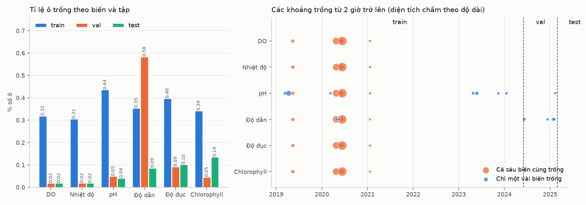
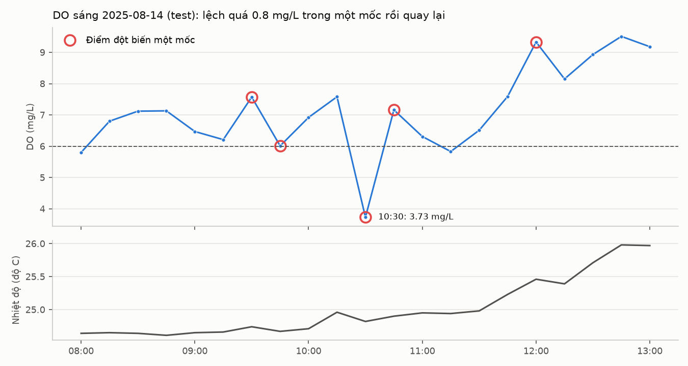

# Quy trình làm sạch dữ liệu dataset CEMP MSD

Phiên bản ngày 2026-11-15. Trạng thái: quy trình đã chốt và đã cài đặt trong scripts/build_base_splits.py; kết quả nằm trong base_splits/.

Tài liệu mô tả cách làm sạch ba tập train, val, test (ranh giới ở README.md, mục 5) trước khi đưa vào mô hình dự báo oxy hòa tan (DO). Quy trình có hai bước, cả hai chỉ dùng quá khứ:
1. loại giá trị ngoài miền vật lý (mục 3);
2. điền mọi ô trống bằng số đo thật gần nhất phía trước và gắn cờ 1 (mục 4).

## 1. Khái niệm

| Khái niệm | Nghĩa |
|---|---|
| Mốc | Một dòng dữ liệu; các mốc cách nhau 15 phút, mỗi mốc có sáu biến |
| Khoảng trống | Các ô không có giá trị (NA) nằm liền nhau của cùng một biến |
| Thời điểm dự báo | Thời điểm hiện tại của một lần dự báo |
| Đầu vào | Đoạn dữ liệu quá khứ đưa cho mô hình, kết thúc ngay trước thời điểm dự báo; đầu vào 24 giờ là 96 mốc |
| Nhãn | DO đo thực tế trong khoảng cần dự báo, bắt đầu từ thời điểm dự báo; dùng để tính sai số |
| Cửa sổ | Một cặp đầu vào và nhãn, tức một mẫu học hoặc một mẫu đánh giá; thời điểm dự báo dời 15 phút một lần |
| Nhân quả | Giá trị tại một mốc chỉ được tính từ số đo tại chính mốc đó và các mốc trước nó |

## 2. Nguyên tắc

1. Không sửa raw/. Dữ liệu sau làm sạch ghi vào base_splits/; mọi ô được điền đều có cờ (mục 5).
2. Nhân quả: không dùng số đo phía sau khoảng trống. Nếu dùng, cửa sổ có thời điểm dự báo nằm trong khoảng trống sẽ gián tiếp thấy tương lai; và khi hệ thống web chạy thật, số đo phía sau chưa tồn tại. Nhờ vậy quy trình chạy y hệt khi huấn luyện, khi đánh giá và khi dùng thật.
3. Một quy trình cho cả ba tập, chạy liền mạch qua ranh giới: đầu val được điền từ số đo cuối của train, đầu test từ số đo cuối của val.
4. Sai số chỉ tính trên DO đo thật; giá trị điền chỉ dùng làm đầu vào (mục 5).

## 3. Kiểm tra miền giá trị

Giá trị nằm ngoài miền dưới đây được coi là lỗi (sai đơn vị, cảm biến ở ngoài nước, mã lỗi thiết bị) và xử lý như một ô trống ở mục 4.

| Biến | DO | Nhiệt độ | pH | Độ dẫn | Độ đục | Chlorophyll |
|---|---|---|---|---|---|---|
| Miền chấp nhận | 0 đến 20 mg/L | 0 đến 35 độ C | 6 đến 10 | 20 đến 3000 uS/cm | 0 đến 1000 FNU | 0 đến 200 ug/L |

Trong ba tập không có giá trị nào ngoài miền. Bước này vẫn được giữ để chặn số đo vô lý khi hệ thống web nhận dữ liệu mới.

## 4. Điền khoảng trống

### 4.1. Khoảng trống trong dữ liệu




- Mỗi biến thiếu dưới 0.6% số ô ở mọi tập.
- Theo số lượng, khoảng trống gần như luôn ngắn: 90% không quá 1 giờ. Theo thời gian, 56% thời gian trống thuộc 12 khoảng dài hơn 1 ngày.
- Các khoảng trống dài là năm lần cả đầu đo ngừng ghi (dài nhất 64.25 giờ, từ 2020-06-12 13:45), đều trong train. Khoảng trống dài nhất của val là 6.5 giờ (chỉ độ dẫn), của test là 1.5 giờ.
- Khi DO trống thì gần như cả đầu đo cùng ngừng ghi: 591 trong 618 ô DO trống có cả năm biến còn lại cùng trống.

Danh sách mọi khoảng trống từ 2 giờ: artifacts/dataset/gap_events.csv.

### 4.2. Quy tắc điền

Mỗi ô trống, kể cả ô bị loại ở mục 3, được điền bằng số đo thật gần nhất phía trước của cùng biến, dù khoảng trống dài bao nhiêu, và gắn cờ 1. Ô số đo thật giữ nguyên, cờ 0.


- Hình trái: cả đầu đo trống lúc 10:30 và 10:45; hai ô nhận giá trị 8.54 mg/L của lần đo 10:15.
- Hình phải: lần ngừng ghi 64.25 giờ; cả sáu biến được chép từ lần đo 13:30 (DO 11.21 mg/L) thành một đường phẳng. Vùng xám là các thời điểm dự báo mà cả 6 giờ nhãn đều là DO điền, nên không có DO thật để tính sai số; các cửa sổ này bị bỏ (mục 4.3).

Lý do chọn quy tắc này:
- Khi DO trống thì gần như cả đầu đo ngừng ghi (mục 4.1). Chép lần đo trước đó là chép một lần đo thật của cả sáu biến, nên các biến vẫn khớp nhau như khi đo.
- Không có tham số, nhân quả, hệ thống web làm y hệt.
- Ô được điền rất ít (dưới 0.4% số ô, mục 4.3), mô hình biết ô nào là ô điền qua cờ, và không bị tính sai số trên giá trị điền.
- Dùng chung cho mọi thí nghiệm so sánh (dữ liệu gốc, thêm đặc trưng miền, thêm đặc trưng ngữ nghĩa), nên không làm lệch phép so sánh.

Nếu ô trống nằm ngay đầu chuỗi (chưa có số đo nào phía trước), scripts/build_base_splits.py báo lỗi; dataset này không có trường hợp đó.

### 4.3. Kết quả trên ba tập

| | train | val | test |
|---|---|---|---|
| Ô được điền (cờ 1) | 4098 (0.36%) | 212 (0.13%) | 107 (0.07%) |
| Cửa sổ bị bỏ, đầu vào 24 giờ, dự báo 6 giờ | 424 trên 189769 (0.22%) | 0 trên 26185 | 0 trên 26377 |
| Cửa sổ bị bỏ, đầu vào 7 ngày, dự báo 24 giờ | 225 trên 189121 (0.12%) | 0 trên 26113 | 0 trên 26305 |

Cửa sổ chỉ bị bỏ khi nhãn không có mốc DO đo thật nào (vùng xám ở hình mục 4.2); điều này chỉ xảy ra trong các lần ngừng ghi dài của train. Các cửa sổ này không có mốc nào để tính hàm mất mát, nên giữ lại cũng không đóng góp gì vào việc học.

Giới hạn: trên khoảng trống dài, giá trị chép lại là đường phẳng, không theo nhịp ngày đêm. Val và test không có khoảng trống nào dài hơn 6.5 giờ, nên chất lượng dự báo khi đầu vào chứa đoạn chép phẳng dài không được đo trong dataset này.

## 5. Cờ đánh dấu

base_splits/ gồm train.csv, val.csv, test.csv. Mỗi file có cột datetime_pst, sáu biến và sáu cột cờ flag_<tên biến>, ví dụ flag_do_mg_l. Cờ tách theo biến vì trong cùng một mốc có thể có biến đo thật và biến được điền (ví dụ từ 2025-01-25 10:30, chỉ độ dẫn trống 6.5 giờ).

| Cờ | Nghĩa | Giá trị trong file |
|---|---|---|
| 0 | Số đo thật | Chép nguyên văn từ nguồn |
| 1 | Ô trống hoặc ngoài miền, đã điền | Chép nguyên văn số đo thật gần nhất phía trước |

Cách mô hình dùng cờ, ví dụ ô DO lúc 2025-04-08 10:30 (đầu vào 24 giờ, dự báo 6 giờ):

| Cửa sổ có thời điểm dự báo | Số cửa sổ | Ô 10:30 nằm ở | Cách dùng |
|---|---|---|---|
| 10:45 đến 10:30 hôm sau | 96 | Đầu vào | Mô hình đọc giá trị 8.54 kèm cờ 1, như một trong 12 cột đầu vào (6 biến, 6 cờ) |
| 04:45 đến 10:30 | 24 | Nhãn | Mốc 10:30 không được tính sai số |

Sai số của một cửa sổ là trung bình trên các mốc nhãn có cờ DO bằng 0. Hàm mất mát khi huấn luyện tính theo cùng cách, nên mô hình học dự báo DO đo thật, không học theo giá trị điền.

## 6. Điểm DO đột biến một mốc

Điểm DO đột biến một mốc là mốc mà DO lệch quá 0.8 mg/L so với mốc trước rồi quay lại quá 0.8 mg/L ở mốc sau. Bước nhảy như vậy hiếm: 99% bước thay đổi 15 phút của DO trong train không quá 0.40 mg/L.



- Có 212 điểm (train 63, val 28, test 121), gần như tất cả trong tháng 6 đến 9, lúc tảo nở hoa.
- Không xác định được điểm nào là lỗi: 136 điểm có nhiệt độ hoặc pH đổi cùng lúc, có thể là một khối nước khác đi qua cảm biến; nhưng một trục trặc làm cả đầu đo lệch theo cũng cho dấu hiệu như vậy.
- Ảnh hưởng đến DO thấp của test: 8 trên 9 mốc DO dưới 5 mg/L và 17 trên 34 mốc dưới 6 mg/L là điểm đột biến, như mốc 3.73 mg/L ở hình.

Cả 212 điểm được giữ là số đo thật (cờ 0): muốn nhận ra một điểm đột biến phải có số đo ở mốc sau, nên phép phát hiện không nhân quả và không dùng được cho số đo mới nhất khi chạy thật. Danh sách và phân loại: artifacts/dataset/do_reversal_points.csv, reversal_effect.csv.

## 7. Tái lập

Môi trường Python khai báo trong pyproject.toml ở gốc repo. Cài một lần bằng `uv sync`, rồi chạy từ gốc repo:

```
uv run python scripts/build_base_splits.py   # tạo dataset/base_splits/ từ dataset/raw/
uv run python scripts/cleaning_study.py      # mục 3, 6: miền giá trị, bước thay đổi 15 phút, điểm DO đột biến
uv run python scripts/gap_study.py           # mục 4.1: histogram khoảng trống, danh sách khoảng trống dài
uv run python scripts/figures.py             # các hình (cần thêm describe_dataset.py, xem README.md mục 6)
uv run python scripts/verify_dataset.py      # kiểm chứng, gồm cả các số liệu ở mục 4.3
```
