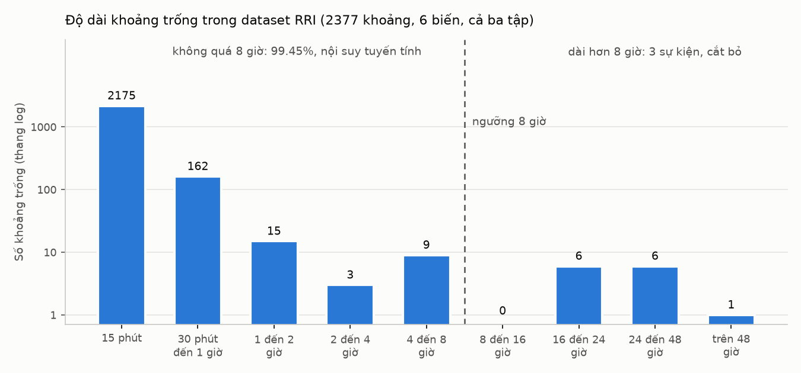

# Quy trình làm sạch dữ liệu dataset CEMP RRI

Phiên bản ngày 2026-11-14. Trạng thái: quy trình đã chốt và đã cài đặt trong scripts/build_base_splits.py; kết quả nằm trong base_splits/.

Tài liệu mô tả cách làm sạch ba tập train, val, test (ranh giới ở README.md, mục 5) trước khi đưa vào mô hình dự báo oxy hòa tan (DO). Quy trình gồm ba bước: kiểm tra miền giá trị, sửa điểm DO bất thường và xử lý khoảng trống. Mã phân tích làm căn cứ nằm trong thư mục scripts/ ở gốc repo, kết quả trong artifacts/dataset/.

## 1. Khái niệm

| Khái niệm | Nghĩa |
|---|---|
| Mốc | Một dòng dữ liệu; các mốc cách nhau 15 phút, mỗi mốc có sáu biến |
| Khoảng trống | Các ô không có giá trị (NA) nằm liền nhau của cùng một biến. Độ dài khoảng trống là số mốc liên tiếp bị trống |
| Thời điểm dự báo | Thời điểm hiện tại của một lần dự báo |
| Đầu vào | Đoạn dữ liệu quá khứ đưa cho mô hình, kết thúc ngay trước thời điểm dự báo. Ví dụ đầu vào 24 giờ là 96 mốc |
| Nhãn | DO đo thực tế trong khoảng cần dự báo, bắt đầu từ thời điểm dự báo; dùng để tính sai số |
| Cửa sổ | Một cặp đầu vào và nhãn, tức một mẫu học hoặc một mẫu đánh giá. Dời thời điểm dự báo mỗi lần 15 phút để tạo các cửa sổ liên tiếp |
| Biến phụ | Năm biến ngoài DO: nhiệt độ, pH, độ dẫn, độ đục, chlorophyll |

Ví dụ: với thời điểm dự báo 2019-07-15 12:00, đầu vào 24 giờ gồm các mốc từ 2019-07-14 12:00 đến 2019-07-15 11:45, nhãn 6 giờ gồm DO từ 12:00 đến 17:45.

Mô hình không nhận ô trống: ô trống trong đầu vào phải được điền, nếu không cửa sổ bị bỏ. Với đầu vào 24 giờ, mỗi ô nằm trong đầu vào của 96 cửa sổ liên tiếp.

## 2. Nguyên tắc

1. Không sửa raw/. Dữ liệu sau làm sạch được ghi vào base_splits/; mọi giá trị bị thay hoặc được điền đều có cờ đánh dấu (mục 6).
2. Mọi ngưỡng và lựa chọn phương pháp được rút ra từ train.
3. Mỗi tập được xử lý riêng, không dùng giá trị của tập khác để điền.
4. Sai số luôn được tính trên DO đo thực tế. Giá trị điền chỉ dùng làm đầu vào; mốc nhãn có DO được điền hoặc bị thay không được tính sai số (mục 6.3).
5. Phạm vi chỉ là làm sạch sáu biến quan trắc. Biến đổi thang, chuẩn hóa và tạo đặc trưng thuộc các giai đoạn sau. Quy tắc tạo cửa sổ ở README.md, mục 5.2.

## 3. Bước 1: Kiểm tra miền giá trị

Giá trị nằm ngoài miền vật lý được coi là lỗi (sai đơn vị, cảm biến ở ngoài nước, mã lỗi của thiết bị). Giá trị lỗi bị loại, được đánh cờ 2 và điền như một ô trống (mục 5): nội suy nếu đoạn lỗi cùng các ô trống liền kề không quá 8 giờ, để trống nếu dài hơn.

| Biến | Miền chấp nhận |
|---|---|
| DO | 0 đến 20 mg/L |
| Nhiệt độ | 0 đến 35 độ C |
| pH | 6 đến 10 |
| Độ dẫn | 20 đến 3000 uS/cm |
| Độ đục | 0 đến 1000 FNU |
| Chlorophyll | 0 đến 200 ug/L |

Dataset RRI không có giá trị nào ngoài miền. Bước này vẫn được giữ cho dữ liệu người dùng tải lên hệ thống web.

## 4. Bước 2: Sửa điểm DO bất thường

### 4.1. Điểm bất thường là gì

DO thay đổi liên tục và chậm, vì quang hợp, hô hấp và trao đổi khí không tạo ra bước nhảy lớn chỉ kéo dài đúng một mốc. Trong train, 99% số bước thay đổi giữa hai mốc liền kề nhỏ hơn 0.42 mg/L, 99.9% nhỏ hơn 0.90 mg/L.

Điểm nghi vấn là mốc mà DO lệch quá 0.8 mg/L so với mốc trước, rồi quay lại quá 0.8 mg/L ở mốc sau. Ví dụ ngày 2019-08-19: 23:45 là 8.89 mg/L, 00:00 là 7.72 mg/L, 00:15 là 8.80 mg/L. DO giảm 1.17 mg/L trong 15 phút rồi tăng lại ngay.

### 4.2. Phân loại

Mỗi điểm nghi vấn được xét theo thứ tự:

1. Nhiệt độ đổi từ 0.3 độ C hoặc pH đổi từ 0.05 tại cùng mốc: một khối nước khác đi qua cảm biến. Đây là hiện tượng thật, giữ nguyên.
2. Không có biến đổi đồng thời, và cảm biến khác trên cùng đầu đo bị trống trong vòng 1 giờ: lỗi thiết bị, thay giá trị.
3. Các trường hợp còn lại: chưa rõ nguyên nhân, thay giá trị.

Train có 21 điểm nghi vấn, trong đó 17 điểm thuộc loại 1. Val có 1 điểm, thuộc loại 1. Test không có.

### 4.3. Bốn điểm được thay

| Thời điểm | DO trước, tại điểm, sau (mg/L) | Căn cứ | Loại | Giá trị thay |
|---|---|---|---|---|
| 2019-08-19 00:00 | 8.89, 7.72, 8.80 | Nửa đêm, nhiệt độ và độ dẫn không đổi; cảm biến độ đục hỏng liên tục từ ngày 15 đến 19 tháng 8 năm 2019 | Lỗi thiết bị | 8.845 |
| 2023-07-11 08:45 | 6.64, 9.08, 6.92 | Bốn cảm biến khác cùng trống tại mốc này, dấu hiệu bảo trì | Lỗi thiết bị | 6.780 |
| 2021-09-08 22:15 | 8.71, 9.97, 8.84 | DO tăng ban đêm mà nhiệt độ và pH không đổi, phù hợp tác động của trạm sục khí gần đó | Chưa rõ | 8.775 |
| 2021-10-28 17:30 | 7.62, 8.63, 7.34 | Tương tự; tháng 10 là giai đoạn trạm sục khí thường vận hành | Chưa rõ | 7.480 |

Giá trị thay là trung bình của mốc trước và mốc sau, tức nội suy tuyến tính qua một mốc như ở mục 5. Ở cả bốn điểm, hai mốc lân cận chỉ chênh nhau 0.09 đến 0.28 mg/L. Với hai điểm chưa rõ nguyên nhân, mức DO trước và sau điểm vẫn được giữ; chỉ riêng mốc vọt lên bị thay, vì không biến nào trong dataset giải thích được mốc đó.

### 4.4. Các hiện tượng được giữ nguyên

- Đỉnh DO buổi chiều mùa hè, kèm pH tăng lên 8 đến 9 do quang hợp. Vì vậy không dùng bộ lọc loại cực trị (Hampel) cho DO.
- Bước nhảy độ dẫn trong đợt lũ tháng 1 năm 2019.
- Các đoạn pH không đổi vào mùa đông (độ phân giải của cảm biến là 0.01).
- Đỉnh đơn lẻ của độ đục và chlorophyll, là đặc trưng của cảm biến quang học.

## 5. Bước 3: Xử lý khoảng trống

### 5.1. Quy tắc

| Khoảng trống | Xử lý |
|---|---|
| Không quá 8 giờ (32 mốc) | Nội suy tuyến tính: nối thẳng giữa số đo ngay trước và số đo ngay sau khoảng trống |
| Dài hơn 8 giờ, ở bất kỳ biến nào | Không điền. Mọi cửa sổ có đầu vào hoặc nhãn chạm vào khoảng trống này bị bỏ |
| Nằm ở đầu hoặc cuối tập (thiếu số đo ở một đầu) | Xử lý như khoảng trống dài, vì không lấy số đo của tập khác để nội suy. RRI không có trường hợp này |

Quy tắc áp dụng như nhau cho sáu biến và ba tập. Ví dụ khoảng trống ngắn, DO ngày 2019-07-15:

| Mốc | DO đo được (mg/L) | Sau làm sạch | Cờ |
|---|---|---|---|
| 09:45 | 7.10 | 7.10 | 0 (đo thật) |
| 10:00 | trống | 7.1967 | 1 (nội suy) |
| 10:15 | trống | 7.2933 | 1 (nội suy) |
| 10:30 | 7.39 | 7.39 | 0 (đo thật) |

Ví dụ khoảng trống dài: lần bảo trì trong val, cả sáu biến trống từ 2024-09-02 14:00 đến 11:00 hôm sau (21.25 giờ). Với đầu vào 24 giờ và nhãn 6 giờ, mọi cửa sổ có thời điểm dự báo từ 2024-09-02 08:15 đến 2024-09-04 11:00 bị bỏ. Các mốc trống được giữ nguyên, không xóa rồi ghép hai đầu, vì như vậy mốc 13:45 ngày 2/9 sẽ đứng ngay trước mốc 11:15 ngày 3/9 như thể chỉ cách nhau 15 phút.

### 5.2. Phân bố độ dài khoảng trống



Tính trên sáu biến và cả ba tập (2377 khoảng trống):

| Độ dài | Số khoảng trống | Tích lũy |
|---|---|---|
| 15 phút | 2175 | 91.50% |
| 30 phút đến 1 giờ | 162 | 98.32% |
| 1 đến 2 giờ | 15 | 98.95% |
| 2 đến 4 giờ | 3 | 99.07% |
| 4 đến 8 giờ | 9 | 99.45% |
| 8 đến 16 giờ | 0 | 99.45% |
| 16 đến 24 giờ | 6 | 99.71% |
| 24 đến 48 giờ | 6 | 99.96% |
| Trên 48 giờ | 1 | 100% |

Phân bố tách thành hai nhóm: 99.45% số khoảng trống không quá 8 giờ (dài nhất 7.75 giờ), rồi không có khoảng trống nào cho đến 21.25 giờ. 13 khoảng trống dài hơn 8 giờ thuộc ba sự kiện:

| Tập | Thời gian trống | Độ dài | Biến | Bối cảnh |
|---|---|---|---|---|
| val | 2024-09-02 14:00 đến 2024-09-03 11:00 | 21.25 giờ | cả sáu biến | Bảo trì, giữa mùa nóng |
| val | 2025-02-14 03:30 đến 2025-02-18 06:30 | 99.25 giờ | độ dẫn | Đợt lũ sau mưa |
| test | 2025-09-10 09:30 đến 2025-09-11 09:45 | 24.5 giờ | cả sáu biến | Bảo trì, giữa mùa nóng |

Riêng DO có 543 ô trống (train 300, val 129, test 114); khoảng trống DO dài nhất trong train là 1.25 giờ. Khi DO trống, gần như cả đầu đo ngừng ghi: 480 trong 543 ô có cả năm biến phụ cùng trống, chỉ 10 ô còn đủ năm biến phụ.

### 5.3. So sánh các phương pháp điền

**Các phương pháp.** Gọi số đo ngay trước khoảng trống là "đầu trái", số đo ngay sau là "đầu phải". Độ lệch ngày tại một mốc là giá trị tại mốc đó trừ giá trị cùng giờ ngày hôm trước.

| Ký hiệu | Phương pháp | Cách tính giá trị điền |
|---|---|---|
| A | Giữ số trước | Lặp lại đầu trái |
| B | Cùng giờ hôm qua | Giá trị cùng giờ ngày hôm trước; nếu ô đó cũng trống thì lùi thêm một ngày |
| C | Hôm qua cộng độ lệch một đầu | B cộng độ lệch ngày tại đầu trái |
| D | Nội suy tuyến tính | Nối thẳng giữa đầu trái và đầu phải |
| E | PCHIP | Đường cong trơn đi qua 8 số đo trước và 8 số đo sau khoảng trống |
| F | Hôm qua cộng độ lệch hai đầu | B cộng một độ lệch thay đổi đều từ độ lệch ngày tại đầu trái đến độ lệch ngày tại đầu phải |
| G | MissForest | Rừng cây quyết định đoán ô trống từ các biến khác tại cùng mốc, cùng giờ trong ngày và ngày trong năm; lặp 5 vòng |
| H | SAITS | Mạng học sâu tự chú ý (self-attention), học trên các đoạn 3 ngày của 85% đầu train |

A, B, C chỉ dùng số đo trước khoảng trống. D, E, F dùng cả hai đầu. G, H là phương pháp học máy.

**Cách tính.** Đoạn chấm điểm là 15% cuối của train (2023-08-09 đến 2024-05-31, 28484 mốc); 85% đầu chỉ dùng để huấn luyện H. Tại các vị trí có đủ sáu biến trong khoảng 50 giờ trước và 37 giờ sau, xóa nhân tạo một đoạn với 9 độ dài từ 15 phút đến 24.5 giờ (100 đến 300 đoạn mỗi độ dài; hai độ dài cuối bằng hai lần bảo trì). Đoạn bị xóa ở cả sáu biến cùng lúc, giống thực tế khi DO trống. Mỗi phương pháp điền lại đúng các đoạn đó. Sai số là MAE, trung bình của độ lệch tuyệt đối giữa giá trị điền và giá trị thật.

**Kết quả cho DO** (MAE, mg/L; số in đậm là thấp nhất):

| Độ dài | A | B | C | D | E | F | G | H |
|---|---|---|---|---|---|---|---|---|
| 15 phút | 0.065 | 0.218 | 0.092 | **0.044** | 0.046 | 0.069 | 0.269 | 0.075 |
| 30 phút | 0.071 | 0.233 | 0.110 | **0.052** | 0.054 | 0.081 | 0.269 | 0.076 |
| 1 giờ | 0.100 | 0.223 | 0.137 | **0.066** | 0.067 | 0.100 | 0.244 | 0.085 |
| 2 giờ | 0.130 | 0.216 | 0.173 | **0.088** | 0.090 | 0.129 | 0.234 | 0.111 |
| 3 giờ | 0.137 | 0.207 | 0.158 | **0.088** | 0.090 | 0.126 | 0.215 | 0.115 |
| 6 giờ | 0.222 | 0.208 | 0.211 | **0.137** | 0.146 | 0.162 | 0.298 | 0.152 |
| 12 giờ | 0.244 | 0.206 | 0.206 | 0.173 | 0.174 | **0.162** | 0.290 | 0.185 |
| 21.25 giờ | 0.257 | 0.207 | 0.231 | 0.236 | 0.237 | **0.191** | 0.289 | 0.237 |
| 24.5 giờ | 0.259 | **0.219** | 0.227 | 0.235 | 0.241 | 0.231 | 0.284 | 0.253 |

Ngoài sai số, hai đầu khoảng trống cần liền mạch với số đo thật. Tỷ lệ khoảng trống có bước nhảy ở đầu trái hoặc đầu phải lớn hơn 0.42 mg/L (mức 99% của bước thay đổi tự nhiên, mục 4.1) là: không quá 0.3% với D và E, dưới 3.5% với F, 13% đến 32% với B, 17% đến 25% với G.

**Kết luận: chọn D (nội suy tuyến tính).**
- D chính xác nhất cho DO với khoảng trống đến 6 giờ, nhóm chứa 99.45% số khoảng trống thực tế (mục 5.2).
- D liền mạch ở cả hai đầu, không cần huấn luyện và áp dụng như nhau cho sáu biến.

Lý do không chọn các phương pháp còn lại:

| Phương pháp | Lý do |
|---|---|
| A, B, C (chỉ dùng số đo trước khoảng trống) | Sai số cao hơn D từ 37% trở lên với khoảng trống đến 6 giờ; gãy ở đầu phải vì không dùng số đo sau khoảng trống |
| E (PCHIP) | Gần như trùng D nhưng phức tạp hơn |
| F (hôm qua cộng độ lệch hai đầu) | Chỉ tốt hơn D với khoảng trống từ 12 giờ, là độ dài không được điền (mục 5.4) |
| G (MissForest) | Kém nhất, sai số gấp 2 đến 6 lần D: khi cả sáu biến cùng trống, nó chỉ còn giờ trong ngày và ngày trong năm để dựa vào. G chỉ tốt nhất khi một biến trống riêng lẻ (pH, chlorophyll), trường hợp hầu như không xảy ra với DO (10 trên 543 ô) |
| H (SAITS) | Không vượt D ở độ dài nào, lại cần huấn luyện một mạng học sâu riêng |

Kết quả đầy đủ cho sáu biến: artifacts/dataset/imputation_benchmark.csv.

### 5.4. Chọn ngưỡng 8 giờ

Ngưỡng chia khoảng trống làm hai nhóm: không quá ngưỡng thì nội suy bằng D; dài hơn ngưỡng thì để trống (cờ 3), và mọi cửa sổ chạm vào bị bỏ. Ngưỡng quá cao thì phải điền cả những đoạn mà D không còn chính xác; ngưỡng quá thấp thì bỏ cửa sổ không cần thiết. Hai căn cứ dưới đây cho giới hạn trên và giới hạn dưới.

**Căn cứ 1, giới hạn trên: D còn tốt nhất cho DO đến khoảng 10 giờ.** Thử lại trên toàn bộ train với 400 đoạn xóa nhân tạo cho mỗi độ dài, so D với phương pháp tốt nhất trong các phương pháp còn lại. "Ngang nhau" nghĩa là khoảng tin cậy 95% của chênh lệch sai số (lấy mẫu lại 4000 lần) chứa 0.

| Độ dài | D (mg/L) | Tốt nhất còn lại (mg/L) | Kết luận |
|---|---|---|---|
| 3 giờ | 0.093 | E: 0.093 | Ngang nhau |
| 6 giờ | 0.122 | E: 0.122 | Ngang nhau |
| 8 giờ | 0.141 | E: 0.145 | D tốt hơn |
| 10 giờ | 0.160 | F: 0.161 | Ngang nhau |
| 12 giờ | 0.183 | F: 0.168 | F tốt hơn |
| 16 giờ | 0.201 | F: 0.171 | F tốt hơn |

Từ 12 giờ, F tốt hơn D rõ rệt, nên ngưỡng không nên vượt 10 giờ. Với 12 khoảng trống thực tế từ 2 đến 8 giờ của các biến phụ (pH, độ đục, chlorophyll), D cũng tốt nhất hoặc ngang tốt nhất.

**Căn cứ 2, giới hạn dưới: khoảng trống thực tế có một khoảng hở từ 7.75 đến 21.25 giờ.** Khoảng trống ngắn dài nhất là 7.75 giờ (độ đục, tháng 8 năm 2019); khoảng trống dài ngắn nhất là 21.25 giờ (bảo trì trong val), không có khoảng trống nào ở giữa (mục 5.2). Vì vậy mọi ngưỡng từ 7.75 đến dưới 21.25 giờ chia dữ liệu RRI thành đúng hai nhóm như nhau: 2364 khoảng trống được nội suy và 13 khoảng trống để trống, nên dữ liệu sau làm sạch giống hệt nhau. Ngưỡng thấp hơn 7.75 giờ chuyển thêm các khoảng trống 2 đến 7.75 giờ sang nhóm để trống, làm bỏ thêm cửa sổ, kể cả trong train, trong khi căn cứ 1 cho thấy D vẫn điền tốt các khoảng trống này:

| Ngưỡng | Số khoảng trống để trống | Cửa sổ bị bỏ: train | val | test |
|---|---|---|---|---|
| 2 giờ | 25 | 1030 | 862 | 349 |
| 4 giờ | 22 | 896 | 862 | 217 |
| 6 giờ | 16 | 392 | 720 | 217 |
| Từ 7.75 đến 21 giờ | 13 | 0 | 720 | 217 |

Số cửa sổ tính cho cấu hình đầu vào 24 giờ, dự báo 6 giờ; cấu hình 7 ngày, 24 giờ cho cùng kết luận (artifacts/dataset/threshold_sensitivity.csv).

**Chọn 8 giờ.** Hai căn cứ cho khoảng 7.75 đến 10 giờ. 8 giờ là số tròn trong khoảng này: với RRI, kết quả giống mọi ngưỡng trong khoảng; với dữ liệu mới tải lên hệ thống web, khoảng trống dài hơn 8 giờ sẽ không bị điền ở vùng D kém chính xác.

**Hai cách xử lý khoảng trống dài khác đã xem xét:**

| Cách | Kết quả | Lý do không chọn |
|---|---|---|
| Không điền gì, bỏ mọi cửa sổ có ô trống | Mất 19.5%, 34.9%, 20.7% cửa sổ (train, val, test) và 23, 13, 5 đợt DO dưới 6 mg/L | Mất nhiều dữ liệu, gồm cả các giai đoạn DO thấp cần đánh giá |
| Điền cả khoảng trống dài bằng F | Giữ thêm khoảng 630 cửa sổ val và 120 cửa sổ test | Giá trị tự tạo kéo dài gần một ngày; ở test khoảng trống dài hơn một ngày nên mọi giờ trong ngày đều là giá trị tự tạo |

### 5.5. Kết quả trên ba tập

**Số ô theo cờ** (tỉ lệ trên tổng số ô của tập):

| Cờ | train | val | test |
|---|---|---|---|
| 1: nội suy | 2457 (0.22%) | 305 (0.19%) | 171 (0.11%) |
| 2: số đo sai, đã thay | 4 | 0 | 0 |
| 3: để trống | 0 | 907 (0.58%) | 588 (0.37%) |

**Số cửa sổ bị bỏ** trên số cửa sổ có thể tạo. Chỉ val và test mất cửa sổ, vì ba khoảng trống dài đều nằm trong hai tập này:

| Cấu hình | train | val | test |
|---|---|---|---|
| Đầu vào 24 giờ, dự báo 6 giờ | 0 trên 189769 | 720 trên 26185 (2.75%) | 217 trên 26377 (0.82%) |
| Đầu vào 7 ngày, dự báo 24 giờ | 0 trên 189121 | 2016 trên 26113 (7.72%) | 865 trên 26305 (3.29%) |

**Ảnh hưởng đến đánh giá cảnh báo.** Đợt DO thấp là chuỗi DO dưới ngưỡng kéo dài ít nhất 1 giờ; hai chuỗi cách nhau không quá 1 giờ được gộp. Một đợt bị mất khỏi đánh giá khi không còn mốc nào của nó nằm trong nhãn của cửa sổ được giữ. Trong số các đợt DO dưới 6 mg/L (train 152, val 68, test 100):
- cấu hình 24 giờ, 6 giờ mất 2 đợt ở val, không mất đợt nào ở test;
- cấu hình 7 ngày, 24 giờ mất 2 đợt ở val và 6 đợt ở test, vì cửa sổ dài hơn nên chạm khoảng trống nhiều hơn.

Các đợt bị mất nằm trong vài ngày nóng ngay sau hai lần bảo trì, DO thấp nhất 5.6 đến 6.0 mg/L. Không đợt DO dưới 5 mg/L nào bị mất.

**Hạn chế được chấp nhận.** Nội suy dùng số đo sau khoảng trống, có thể là số đo ở thời điểm mô hình chưa được biết. Ví dụ ở mục 5.1: ô DO lúc 10:00 ngày 2019-07-15 được điền 7.1967 từ số đo 10:30. Cửa sổ có thời điểm dự báo 10:15 có đầu vào kết thúc ở ô 10:00, nên gián tiếp dùng số đo 10:30, sau thời điểm dự báo. Trường hợp này chiếm 0.52% cửa sổ train, 0.71% val, 0.39% test (đầu vào 24 giờ). Hạn chế được chấp nhận vì tỉ lệ nhỏ, mọi thí nghiệm so sánh đặc trưng dùng chung dữ liệu nên chịu ảnh hưởng như nhau, và DO điền không bao giờ được dùng để tính sai số.

## 6. Đầu ra và cờ đánh dấu

### 6.1. Đầu ra

Thư mục base_splits/ gồm ba file train.csv, val.csv, test.csv, sinh bởi scripts/build_base_splits.py. Mỗi file có cột datetime_pst, sáu biến và sáu cột cờ flag_<tên biến>, ví dụ flag_do_mg_l. Ô cờ 0 chép nguyên văn từ nguồn; ô cờ 1 và 2 làm tròn 4 chữ số thập phân; ô cờ 3 ghi NA. Ở bước tạo cửa sổ chỉ cần bỏ mọi cửa sổ có ô cờ 3.

### 6.2. Cờ

Mỗi biến có một cột cờ để phân biệt số đo thật với số điền. Cờ tách theo biến vì trong cùng một mốc có thể có biến đo thật và biến được điền (ví dụ từ 2021-12-01 10:30, chỉ pH trống 4.5 giờ):

| Giá trị cờ | Nghĩa |
|---|---|
| 0 | Đo thật, giữ nguyên |
| 1 | Ô trống trong nguồn, đã nội suy tuyến tính |
| 2 | Số đo sai (ngoài miền ở mục 3 hoặc điểm DO bất thường ở mục 4.3), đã bị loại và nội suy |
| 3 | Thuộc khoảng trống dài hơn 8 giờ hoặc ở đầu, cuối tập; giá trị để NA |

### 6.3. Cách dùng cờ

Ô được điền nằm trong đầu vào thì mô hình đọc giá trị điền. Nằm trong nhãn thì mốc đó không được tính sai số: sai số của một cửa sổ là trung bình trên các mốc nhãn có cờ DO bằng 0. Trong mã, cờ DO được chuyển thành một dãy mặt nạ (1 với mốc tính sai số, 0 với mốc bỏ qua); sai số tại mỗi mốc được nhân với mặt nạ rồi chia cho tổng mặt nạ. Hàm mất mát khi huấn luyện được tính theo cùng cách, nên mô hình không học theo giá trị điền.

Ví dụ với ô DO lúc 2019-07-15 10:00 (đầu vào 24 giờ, dự báo 6 giờ):

| Nhóm cửa sổ | Số cửa sổ | Vị trí ô 10:00 | Cách dùng |
|---|---|---|---|
| Thời điểm dự báo 10:15 đến 10:00 hôm sau | 96 | Đầu vào | Mô hình đọc giá trị điền 7.1967 |
| Thời điểm dự báo 04:15 đến 10:00 | 24 | Nhãn | Mốc 10:00 không được tính sai số |

## 7. Các xử lý không thực hiện

| Xử lý | Lý do |
|---|---|
| Làm trơn DO | Làm mất đỉnh và đáy trong ngày, là thông tin cần dự báo và cảnh báo |
| Xóa cực trị bằng ngưỡng thống kê | Phần lớn cực trị là hiện tượng thật (quang hợp, lũ, nắng nóng) |
| Sửa điểm bất thường trong val và test | Làm sai lệch kết quả đánh giá |

## 8. Tái lập

Môi trường Python khai báo trong pyproject.toml ở gốc repo. Cài một lần bằng `uv sync`, rồi chạy từ gốc repo. Tạo dữ liệu đã làm sạch và kiểm chứng:

```
uv run python scripts/build_base_splits.py         # tạo dataset/base_splits/ từ dataset/raw/
uv run python scripts/verify_dataset.py            # kiểm chứng, gồm cả các số liệu ở mục 5.5
```

Các phân tích làm căn cứ (đọc thẳng từ dataset/raw/, ghi vào artifacts/dataset/):

```
uv run python scripts/cleaning_study.py            # mục 3, 4: miền giá trị, bước thay đổi 15 phút, điểm DO đảo chiều
uv run python scripts/imputation_benchmark.py      # mục 5.3: tám phương pháp A đến H, khoảng 35 phút
uv run python scripts/gap_threshold_study.py       # mục 5.2, 5.4: bảng tần suất, điểm chuyển, độ nhạy theo ngưỡng
uv run python scripts/gap_histogram_figure.py      # biểu đồ mục 5.2, chạy sau gap_threshold_study.py
```

Phương pháp H (SAITS) cần thêm gói PyPOTS: cài bằng `uv sync --group benchmark`. Thêm `--no-saits` vào lệnh imputation_benchmark.py để bỏ qua H khi không có GPU hoặc PyPOTS.
