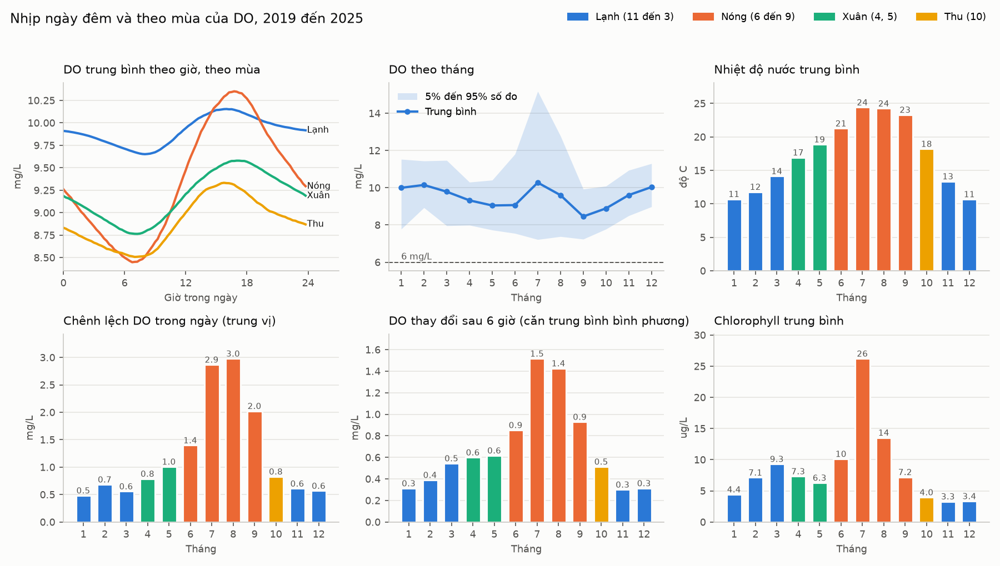
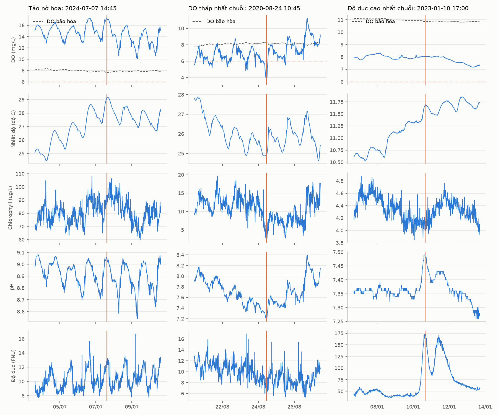
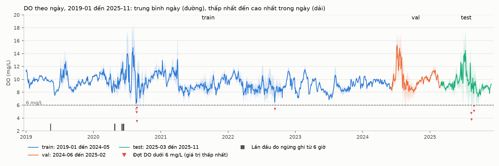

# Phân tích dataset

Tài liệu mô tả dữ liệu dùng trong đồ án: nguồn, các biến, đặc điểm biến động của oxy hòa tan (DO), và cách chia dữ liệu thành ba tập train, val, test dựa trên các đặc điểm đó. Làm sạch dữ liệu ở [02_DATA_CLEANING.md](02_DATA_CLEANING.md).

Điểm đặc biệt của dataset, chi tiết ở các mục dưới:
- Chuỗi đo dày và sạch: 15 phút một mốc liên tục gần 7 năm, mỗi biến thiếu dưới 0.4%, số liệu đã được cơ quan quan trắc thẩm định.
- DO có hai chế độ rất khác nhau: mùa lạnh gần như phẳng, mùa nóng dao động mạnh theo ngày đêm do tảo; biến động chủ yếu nằm trong ngày chứ không giữa các năm.
- Các sự kiện thật để thử mô hình: các mùa tảo nở hoa (DO vượt 200% bão hòa), các đợt DO dưới 6 mg/L sau đỉnh nở hoa, các đợt nước đục và nước lớn mùa mưa (mục 3.5).
- Năm test (2025) có mùa nở hoa mạnh và 5 đợt DO thấp, là năm khó dự báo nhất trong ba tập.

## 1. Nguồn dữ liệu

Dữ liệu là chuỗi quan trắc chất lượng nước đo tự động 15 phút một lần tại trạm Mossdale Bridge (MSD) trên sông San Joaquin, California, Hoa Kỳ (vĩ độ 37.786, kinh độ âm 121.306). Trạm nằm ở đoạn sông nước ngọt chịu ảnh hưởng của thủy triều, phía nam vùng châu thổ Sacramento và San Joaquin, thượng lưu thành phố Stockton. Số liệu do Chương trình Quan trắc Môi trường Liên tục (CEMP) của Sở Tài nguyên Nước California (DWR) thu thập, thẩm định và công bố trên kho dữ liệu EDI (gói edi.1177.9).

| Đặc điểm | Giá trị |
|---|---|
| Bước thời gian | 15 phút, không thiếu dòng nào |
| Múi giờ | Giờ chuẩn Thái Bình Dương (PST, UTC trừ 8), không đổi giờ mùa hè |
| Khoảng dùng cho mô hình | 2019-01-01 00:00 đến 2025-11-30 23:45: 242496 dòng, 2526 ngày |
| Dữ liệu gốc | 2007-12-26 đến 2025-12-31, 631735 dòng, giữ nguyên trong dataset/raw/ |

Thiết bị đo là đầu đo đa thông số YSI EXO2 (dùng tại trạm từ 2016-06-22). CEMP hiệu chuẩn thiết bị trước khi lắp, hiệu chỉnh sai lệch tích lũy khi đo ngoài hiện trường, kiểm tra sau khi thu hồi và rà soát số liệu hằng ngày, hằng tháng. Ô ghi NA trong file nguồn là giá trị bị CEMP loại khi thẩm định hoặc không đo được.

## 2. Các biến

| Cột | Tên trong nguồn | Đơn vị | Ý nghĩa |
|---|---|---|---|
| datetime_pst | date, time | PST | Thời điểm đo |
| do_mg_l | dissolvedoxygen | mg/L | Oxy hòa tan, biến cần dự báo |
| water_temp_c | watertemperature | độ C | Nhiệt độ nước |
| ph | ph | đơn vị pH | Độ pH |
| spc_us_cm | spc | uS/cm | Độ dẫn điện quy về 25 độ C, phản ánh lượng muối hòa tan |
| turbidity_fnu | turbidity | FNU | Độ đục, đo bằng ánh sáng hồng ngoại theo ISO 7027 |
| chl_fluor_ug_l | fluorescence | ug/L | Huỳnh quang chlorophyll, chỉ thị gián tiếp lượng tảo |

## 3. Đặc điểm dữ liệu

Các thống kê trong mục này tính trên dữ liệu trước làm sạch, 2019-01 đến 2025-11.

### 3.1. Thống kê mô tả

| Biến | Thiếu % | Trung bình | Độ lệch chuẩn | Nhỏ nhất | P01 | Trung vị | P99 | Lớn nhất |
|---|---|---|---|---|---|---|---|---|
| do_mg_l | 0.25 | 9.51 | 1.32 | 3.48 | 7.04 | 9.42 | 14.21 | 19.00 |
| water_temp_c | 0.24 | 17.45 | 5.36 | 7.57 | 8.73 | 17.15 | 27.84 | 30.34 |
| ph | 0.35 | 7.73 | 0.39 | 6.92 | 7.03 | 7.67 | 9.03 | 9.44 |
| spc_us_cm | 0.35 | 432.6 | 230.2 | 70 | 78 | 400 | 1005 | 1233 |
| turbidity_fnu | 0.33 | 10.10 | 9.81 | 0.01 | 0.42 | 8.17 | 48.85 | 173.7 |
| chl_fluor_ug_l | 0.29 | 8.62 | 12.09 | 0.10 | 0.54 | 4.48 | 64.73 | 123.5 |

P01 và P99 là phân vị 1% và 99%. Thống kê theo từng tập: artifacts/dataset/feature_stats.csv.

- DO thường gần mức bão hòa (lượng oxy tối đa nước giữ được khi cân bằng với không khí) và vượt xa mức này vào mùa hè: phần trăm bão hòa có trung vị 95.3%, P01 73.7%, P99 175.5%. Mức trên 150% là dấu hiệu tảo nở hoa: tảo quang hợp sinh oxy nhanh hơn lượng oxy thoát ra khí quyển.
- DO đi cùng chiều với hoạt động của tảo hơn là với nhiệt độ. Trên toàn chuỗi, hệ số tương quan của DO với chlorophyll là 0.58, với pH là 0.68 (tảo quang hợp vừa sinh oxy vừa lấy CO2 khỏi nước làm pH tăng), với nhiệt độ là âm 0.18; trong val và test, tương quan với nhiệt độ đổi sang dương (0.10 và 0.28), vì mùa nóng cũng là mùa tảo phát triển.
- Độ dẫn phản ánh lượng nước sông: thấp khi nước lớn (trung bình tháng 6 là 200 uS/cm), cao khi dòng chảy kiệt (tháng 12 và tháng 1, 640 đến 660 uS/cm). Độ đục thường thấp nhưng tăng vọt khi có lũ.

### 3.2. Dữ liệu khuyết

Mỗi biến thiếu 0.24 đến 0.35% số dòng. Phần lớn khoảng trống ngắn: 91.8% số khoảng trống không quá 1 giờ (khoảng trống ở đây là các dòng liền nhau có ít nhất một biến trống), nhưng phần lớn thời gian trống thuộc vài lần cả đầu đo ngừng ghi, đều trong train, dài nhất 64.25 giờ từ 2020-06-12 13:45. Khoảng trống dài nhất của val là 6.5 giờ (độ dẫn), của test là 1.5 giờ. Chi tiết và cách điền: [02_DATA_CLEANING.md](02_DATA_CLEANING.md) mục 4. Nguồn: artifacts/dataset/gap_stats.csv, feature_stats.csv.

### 3.3. Nhịp ngày đêm và theo mùa

Tài liệu dùng bốn giai đoạn mùa: lạnh (tháng 11 đến 3), xuân (tháng 4, 5), nóng (tháng 6 đến 9), thu (tháng 10).

- Trong ngày, DO thấp nhất khoảng 07:15 (sau một đêm sinh vật hô hấp, tiêu thụ oxy) và cao nhất khoảng 16:30 (sau nhiều giờ quang hợp). Chênh lệch giữa cao nhất và thấp nhất trong ngày có trung vị 0.96 mg/L; 10% số ngày chênh lệch trên 3.32 mg/L.
- Mùa nóng biến động mạnh nhất. Tháng 7 và 8 tảo nở hoa (chlorophyll trung bình tháng 7 là 26 ug/L) và DO dao động gần 3 mg/L mỗi ngày. Mức biến động sau 6 giờ (căn bậc hai của trung bình bình phương hiệu giữa DO 6 giờ sau và DO hiện tại) ở mùa nóng gấp khoảng 3 lần mùa lạnh.
- Trung bình từng tháng giải thích 51.5% phương sai của DO; phần còn lại chủ yếu là dao động trong ngày. Trung bình từng năm nằm trong khoảng 8.91 đến 10.13 mg/L, không có dấu hiệu cảm biến bị trôi dần.
- DO ghi với độ chính xác 0.01 mg/L. Mùa hè có 212 điểm DO lệch mạnh trong đúng một mốc 15 phút rồi quay lại ([02_DATA_CLEANING.md](02_DATA_CLEANING.md) mục 6).

Số liệu theo tháng: artifacts/dataset/monthly_dynamics.csv; theo tập: do_dynamics.csv.

### 3.4. Đợt DO thấp

Đợt DO thấp là khoảng DO dưới ngưỡng kéo dài ít nhất 1 giờ; hai khoảng cách nhau không quá 1 giờ được gộp thành một đợt. Từ 2019 đến 2025 có 13 đợt dưới 6 mg/L và 1 đợt dưới 5 mg/L, trong ba giai đoạn nắng nóng: tháng 8 năm 2020 (6 đợt, gồm đợt dưới 5 mg/L ngày 2020-08-24, DO thấp nhất 3.48 mg/L), tháng 9 năm 2022 (2 đợt) và tháng 8 năm 2025 (5 đợt). Các đợt đều vào ban đêm và buổi sáng, khi nước ấm 25 đến 27.5 độ C.

Mục tiêu chất lượng nước của Basin Plan vùng Central Valley cho vùng châu thổ là DO không dưới 5.0 mg/L; mức 6.0 mg/L từ tháng 9 đến 11 áp dụng cho đoạn sông qua Stockton, ở hạ lưu trạm (chưa đối chiếu với phiên bản hiện hành). Ngưỡng 6 mg/L dùng trong đồ án vì vậy là ngưỡng cảnh báo sớm, không phải mức pháp lý.

### 3.5. Diễn biến nhiều năm và các sự kiện

Hình trên vẽ trung bình ngày của năm biến; dải xanh ở khung DO là khoảng thấp nhất đến cao nhất trong ngày, vùng cam là các tháng tảo nở hoa (chlorophyll trung bình tháng từ 20 ug/L). Ba kiểu sự kiện lặp lại qua các năm:

| Sự kiện | Khi nào | Dấu hiệu trong dữ liệu (số theo tháng) |
|---|---|---|
| Tảo nở hoa | 6 đến 8/2020, 3/2021, 7/2024, 6 và 7/2025 | Chlorophyll trung bình tháng 22 đến 60 ug/L (tối đa 123.5 ug/L, 7/2025); DO cao nhất tháng 14 đến 19 mg/L, có lúc gấp hơn 2 lần mức bão hòa (bão hòa tối đa 243%, 8/2020); chênh lệch DO trong ngày trung vị 2.3 đến 5.5 mg/L; pH trung bình tháng 8.1 đến 8.9 |
| DO dưới 6 mg/L | 8/2020 (6 đợt, thấp nhất 3.48), 9/2022 (2 đợt, 5.34), 8/2025 (5 đợt, 3.73) | Nước nóng nhất năm (tối đa 29 đến 30 độ C). 2020 và 2025: ngay sau tháng có chlorophyll cao nhất năm. 2024 nở hoa mạnh vào tháng 7 nhưng tháng 8 chỉ xuống 5.24 mg/L, không thành đợt |
| Nước lớn, nước đục | Nước đục: 1/2023 (độ đục tối đa 173.7 FNU), 2/2024 (168.7). Độ dẫn thấp kéo dài: 5 và 6/2019, 5 và 6/2023 (90 đến 117 uS/cm) | Nước sông nhiều làm loãng muối (độ dẫn thấp) và mang phù sa (độ đục cao). Trong các tháng này DO gần như phẳng (chênh lệch trong ngày 0.1 đến 0.4 mg/L) và không vượt quá 104% bão hòa (1/2023 tối đa 83%); chlorophyll dưới 5 ug/L |

Các năm không có nở hoa (2021 từ tháng 4, 2022, 2023) vẫn có DO dao động mạnh khi nước nóng: tháng 7/2022 chênh lệch trong ngày trung vị 2.96 mg/L trong khi chlorophyll trung bình chỉ 3.4 ug/L. Huỳnh quang chlorophyll vì vậy không phản ánh hết hoạt động quang hợp ở trạm.

Cận cảnh 7 ngày quanh ba sự kiện, theo mốc 15 phút (đường đứt là DO bão hòa tính từ nhiệt độ và độ dẫn):
- Tảo nở hoa, quanh lúc DO cao nhất của val (2024-07-07 14:45): DO luôn cao gấp đôi mức bão hòa và lên xuống khoảng 4 mg/L mỗi ngày; pH đi cùng nhịp với DO; chlorophyll 60 đến 110 ug/L.
- DO thấp nhất chuỗi (2020-08-24 10:45): DO nằm dưới bão hòa nhiều ngày liền, chlorophyll và pH giảm dần, DO tụt xuống 3.48 mg/L rồi hồi lại trong vài giờ.
- Độ đục cao nhất chuỗi (2023-01-10 17:00): độ đục tăng từ khoảng 50 lên 174 FNU trong vài giờ; DO thấp hơn bão hòa khoảng 3 mg/L và gần như không có nhịp ngày đêm.

Ý nghĩa cho bài toán dự báo: cùng một mức nhiệt độ hay chlorophyll có thể đi với DO rất khác nhau tùy sự kiện, và các đợt DO thấp đến sau giai đoạn DO cao. Mô hình cần biết DO đang ở đâu so với bão hòa và chu kỳ ngày đêm đang mạnh hay yếu; đó là lý do các đặc trưng miền ở [03_DOMAIN_FEATURES_ANALYSIS.md](03_DOMAIN_FEATURES_ANALYSIS.md) tập trung vào bão hòa, chu kỳ ngày và quang hợp, hô hấp. Số liệu: artifacts/dataset/monthly_by_year.csv.

## 4. Chia train, val, test

Dữ liệu được chia theo thời gian, không xáo trộn. Nếu xáo trộn, hai đoạn dữ liệu chỉ cách nhau 15 phút (gần như giống hệt nhau) có thể rơi vào hai tập khác nhau, làm kết quả đánh giá tốt hơn thực tế. Ranh giới là 00:00 ngày đầu tháng.

| Tập | Từ | Đến | Số dòng | Tỉ lệ |
|---|---|---|---|---|
| train | 2019-01-01 | 2024-05-31 | 189888 | 78.3% |
| val | 2024-06-01 | 2025-02-28 | 26208 | 10.8% |
| test | 2025-03-01 | 2025-11-30 | 26400 | 10.9% |

DO biến động mạnh nhất vào mùa nóng và mọi đợt DO thấp đều rơi vào mùa này (mục 3.3, 3.4), nên val và test mỗi tập dài 9 tháng và chứa trọn mùa nóng cùng tháng chuyển mùa thu:

| Tập | Số tháng lạnh, xuân, nóng, thu | Số đợt DO dưới 6, dưới 5 | DO trung bình, độ lệch chuẩn | Dòng thiếu ít nhất một biến |
|---|---|---|---|---|
| train | 28, 12, 20, 5 | 8, 1 | 9.45, 1.23 | 0.62% |
| val | 4, 0, 4, 1 | 0, 0 | 10.07, 1.63 | 0.71% |
| test | 2, 2, 4, 1 | 5, 0 | 9.40, 1.48 | 0.30% |

Nguồn: artifacts/dataset/split_by_regime.csv (số tháng theo mùa), do_dynamics.csv (đợt DO thấp, DO trung bình), gap_stats.csv (dòng thiếu).

- train: năm năm đầy đủ, gồm năm nhiều nước (2019, 2023) và năm khô; chứa mọi lần đầu đo ngừng ghi dài. Dùng để mô hình học.
- val: mùa nóng 2024, tảo nở hoa mạnh (DO lên tới 17.29 mg/L), không có đợt DO thấp. Dùng để theo dõi quá khớp và chọn siêu tham số.
- test: năm gần nhất, đủ xuân, hè, thu, dao động DO trong ngày mạnh nhất trong ba tập (chênh lệch trong ngày có trung vị 1.54 mg/L, so với 1.06 của val và 0.90 của train), có 5 đợt DO dưới 6 mg/L vào tháng 8. Mô phỏng việc đưa mô hình vào dùng cho một năm chưa từng thấy; chỉ chấm một lần.

Cách dùng từng tập khi huấn luyện và đánh giá: [04_MODEL_TRAINING_EVALUATION.md](04_MODEL_TRAINING_EVALUATION.md) mục 6.

## 5. Hạn chế

- Không có số liệu thủy văn (lưu lượng, mực nước) và khí tượng (bức xạ mặt trời, gió).
- Đợt DO thấp hiếm: val không có đợt nào dưới 6 mg/L, test có 5 đợt và không có đợt nào dưới 5 mg/L. Nhiều mốc DO thấp nhất của test là điểm đột biến một mốc ([02_DATA_CLEANING.md](02_DATA_CLEANING.md) mục 6).
- Val và test không có khoảng trống nào dài hơn 6.5 giờ, nên chất lượng dự báo khi đầu vào chứa đoạn điền dài (như các lần ngừng ghi trong train) không được đo.
- Độ đục ghi theo đơn vị FNU từ năm 2021, trước đó là NTU; theo nhà sản xuất, hai đơn vị tương đương. Metadata nguồn ghi nhầm đơn vị độ dẫn ở phần định nghĩa; đơn vị đúng là uS/cm.
