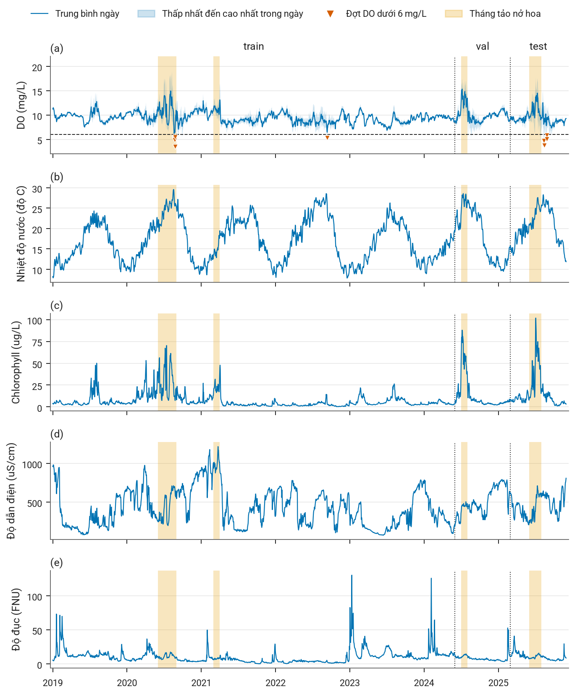

# Phân tích dữ liệu

Tài liệu này mô tả dữ liệu dùng trong đồ án: nguồn, các biến, đặc điểm biến động của oxy hòa tan (DO), và cách chia dữ liệu thành ba tập train, val, test dựa trên các đặc điểm đó. Làm sạch dữ liệu ở [02_DATA_CLEANING.md](02_DATA_CLEANING.md); thuật ngữ chung ở [README.md](README.md) mục 2.

Điểm chính:
- Chuỗi đo dày và sạch: 15 phút một mốc, liên tục gần 7 năm, mỗi biến thiếu dưới 0.4%, số liệu đã được cơ quan quan trắc thẩm định.
- DO có hai chế độ: mùa lạnh gần như phẳng, mùa nóng dao động mạnh theo ngày đêm do tảo. Phần lớn biến động nằm trong ngày, không nằm giữa các năm.
- Dữ liệu chứa các sự kiện thật để thử mô hình: các đợt tảo nở hoa (có lúc DO vượt 200% bão hòa), các đợt DO dưới 6 mg/L sau đỉnh nở hoa, các đợt độ đục tăng vọt vào mùa đông.
- Năm test (2025) có mùa tảo nở hoa mạnh và 5 đợt DO thấp, là năm khó dự báo nhất trong ba tập.

## 1. Nguồn dữ liệu

Dữ liệu là chuỗi quan trắc chất lượng nước đo tự động 15 phút một lần tại trạm Mossdale Bridge (MSD) trên sông San Joaquin, California, Hoa Kỳ (vĩ độ 37.786, kinh độ -121.306). Trạm nằm ở đoạn sông nước ngọt chịu ảnh hưởng của thủy triều (loại Tidal River Channel (freshwater) trong metadata của trạm), phía nam vùng châu thổ Sacramento và San Joaquin, thượng lưu thành phố Stockton. Số liệu do Chương trình Quan trắc Môi trường Liên tục (CEMP) của Sở Tài nguyên Nước California (DWR) thu thập, thẩm định và công bố trên kho dữ liệu EDI (gói edi.1177.9, Nelson và Tran 2026). Thông tin về trạm, thiết bị, quy trình thẩm định và đơn vị trong tài liệu này lấy từ metadata của gói dữ liệu.

**Bảng 1.** Thông tin chung của chuỗi dữ liệu.

| Đặc điểm | Giá trị |
|---|---|
| Bước thời gian | 15 phút, không thiếu dòng nào |
| Múi giờ | Giờ chuẩn Thái Bình Dương (PST, UTC trừ 8), không đổi giờ mùa hè |
| Khoảng dùng cho mô hình | 2019-01-01 00:00 đến 2025-11-30 23:45: 242496 dòng, 2526 ngày |
| Dữ liệu gốc | 2007-12-26 đến 2025-12-31, 631735 dòng, giữ nguyên trong dataset/raw/ |
| Thiết bị | Đầu đo đa thông số YSI EXO2, dùng tại trạm từ 2016-06-22 |

Nguồn: dataset/metadata/cemp_station_metadata.csv, dòng station = MSD (cột latitude, longitude, start_date, end_date, EXO2_start_date); số dòng của dữ liệu gốc: dataset/metadata/cemp_edi_1177_9_eml.xml, bảng dữ liệu MSD, thẻ numberOfRecords; số dòng và số ngày của khoảng dùng cho mô hình: artifacts/dataset/gap_stats.csv, dòng split = all, cột rows và days.

CEMP hiệu chuẩn thiết bị trước khi lắp, hiệu chỉnh sai lệch tích lũy khi đo ngoài hiện trường, kiểm tra sau khi thu hồi và rà soát số liệu hằng ngày, hằng tháng. Ô ghi NA trong file nguồn là giá trị bị CEMP loại khi thẩm định hoặc không đo được.

## 2. Các biến

**Bảng 2.** Sáu biến đo. Tên chuẩn ở cột đầu được dùng thống nhất trong mọi tài liệu và hình.

| Tên chuẩn | Cột | Tên trong nguồn | Đơn vị | Ý nghĩa |
|---|---|---|---|---|
| DO | do_mg_l | dissolvedoxygen | mg/L | Oxy hòa tan, biến cần dự báo |
| Nhiệt độ nước | water_temp_c | watertemperature | độ C | Nhiệt độ của nước |
| pH | ph | ph | đơn vị pH | Độ pH |
| Độ dẫn điện | spc_us_cm | spc | uS/cm | Độ dẫn điện quy về 25 độ C, phản ánh lượng muối hòa tan |
| Độ đục | turbidity_fnu | turbidity | FNU | Độ đục, đo bằng ánh sáng hồng ngoại theo ISO 7027 |
| Chlorophyll | chl_fluor_ug_l | fluorescence | ug/L | Huỳnh quang chlorophyll, chỉ thị gián tiếp lượng tảo |

Nguồn: tên trong nguồn là tiêu đề cột của dataset/raw/cemp_MSD_2007_2025_source.csv; đơn vị và ý nghĩa theo metadata dataset/metadata/cemp_edi_1177_9_eml.xml (bảng dữ liệu MSD, phần mô tả từng cột).

## 3. Đặc điểm dữ liệu

Các thống kê trong mục này tính trên dữ liệu trước làm sạch, 2019-01 đến 2025-11.

### 3.1. Thống kê mô tả

**Bảng 3.** Thống kê mô tả của sáu biến.

| Biến | Ô trống (%) | Trung bình | Độ lệch chuẩn | Nhỏ nhất | Trung vị | Lớn nhất |
|---|---|---|---|---|---|---|
| DO (mg/L) | 0.25 | 9.51 | 1.32 | 3.48 | 9.42 | 19.00 |
| Nhiệt độ nước (độ C) | 0.24 | 17.45 | 5.36 | 7.57 | 17.15 | 30.34 |
| pH | 0.35 | 7.73 | 0.39 | 6.92 | 7.67 | 9.44 |
| Độ dẫn điện (uS/cm) | 0.35 | 432.6 | 230.2 | 70 | 400 | 1233 |
| Độ đục (FNU) | 0.33 | 10.10 | 9.81 | 0.01 | 8.17 | 173.7 |
| Chlorophyll (ug/L) | 0.29 | 8.62 | 12.09 | 0.10 | 4.48 | 123.5 |

Ô trống là số dòng mà biến không có giá trị trong file nguồn, chia tổng 242496 dòng của 2019 đến 2025, nhân 100; các cột còn lại tính trên các giá trị có trong nguồn. Nguồn: artifacts/dataset/feature_stats.csv, các dòng split = all (cột missing_pct là ô trống); file có thêm các phân vị và thống kê theo từng tập.

- DO thường gần mức bão hòa (lượng oxy tối đa nước giữ được khi cân bằng với không khí) và vượt xa mức này vào mùa hè. Phần trăm bão hòa bằng 100 nhân DO chia DO bão hòa, với DO bão hòa tính từ nhiệt độ nước và độ dẫn điện cùng mốc ([03_DOMAIN_FEATURES_ANALYSIS.md](03_DOMAIN_FEATURES_ANALYSIS.md) mục 4.1). Trên mọi mốc 2019 đến 2025 có đủ ba số đo, phần trăm bão hòa có trung vị 95.3%, phân vị 1% là 73.7%, phân vị 99% là 175.5%. Mức trên 150% nghĩa là oxy được sinh ra nhanh hơn lượng oxy thoát ra không khí, dấu hiệu của quang hợp mạnh.
- DO đi cùng chiều với hoạt động của tảo hơn là với nhiệt độ nước. Trên toàn chuỗi, hệ số tương quan của DO với chlorophyll là 0.58, với pH là 0.68 (tảo quang hợp vừa sinh oxy vừa lấy CO2 khỏi nước làm pH tăng, [03_DOMAIN_FEATURES_ANALYSIS.md](03_DOMAIN_FEATURES_ANALYSIS.md) mục 4.6), với nhiệt độ nước là -0.18. Trong val và test, tương quan với nhiệt độ nước đổi sang dương (0.10 và 0.28), vì mùa nóng cũng là mùa tảo phát triển.
- Độ dẫn điện (lượng muối hòa tan) thay đổi mạnh theo mùa: trung bình tháng thấp nhất vào tháng 6 (200 uS/cm), cao nhất vào tháng 12 và tháng 1 (640 đến 660 uS/cm). Độ đục thường thấp nhưng tăng vọt trong vài đợt ngắn vào mùa đông (cao nhất 173.7 FNU, ngày 2023-01-10). Dataset không có số liệu lưu lượng (mục 5), nên tài liệu không gán các thay đổi này cho một nguyên nhân thủy văn cụ thể.

Nguồn các số ở các ý trên: artifacts/dataset/do_dynamics.csv, dòng split = all (cột sat_pct_median, sat_pct_p01, sat_pct_p99 cho phần trăm bão hòa; corr_chl, corr_ph, corr_temp là hệ số tương quan Pearson giữa DO và từng biến tại cùng mốc; các dòng val, test cho từng tập); artifacts/dataset/monthly_dynamics.csv, mỗi dòng một tháng trong năm (cột spc_mean); event_windows.csv, dòng su_kien = do_duc_cao_nhat (cột duc_max và thoi_diem cho độ đục cao nhất).

### 3.2. Dữ liệu khuyết

Mỗi biến thiếu 0.24 đến 0.35% số dòng. Một khoảng trống là các ô trống liền nhau của cùng một biến. Phần lớn khoảng trống ngắn: 90.0% không quá 1 giờ. Phần lớn thời gian trống thuộc hai lần cả đầu đo ngừng ghi, đều trong train, dài nhất 64.25 giờ từ 2020-06-12 13:45. Khoảng trống dài nhất của val là 6.5 giờ (độ dẫn điện), của test là 1.5 giờ. Chi tiết và cách điền ở [02_DATA_CLEANING.md](02_DATA_CLEANING.md) mục 3. Nguồn: artifacts/dataset/feature_stats.csv, dòng split = all, cột missing_pct (phần trăm thiếu); gap_length_histogram.csv, dòng can_tren_gio = 1, cột pct_so_khoang_cong_don (90.0%); gap_stats.csv, dòng split = all (cột longest_all_na_h, longest_all_na_start là lần cả đầu đo ngừng ghi dài nhất), dòng split = val và split = test (cột maxgap_h_<tên cột biến> là khoảng trống dài nhất của từng biến).

### 3.3. Chu kỳ ngày đêm và theo mùa

Tài liệu dùng bốn giai đoạn mùa: lạnh (tháng 11 đến 3), xuân (tháng 4, 5), nóng (tháng 6 đến 9), thu (tháng 10). Các giai đoạn được chia theo nhiệt độ nước trung bình tháng, tính chỉ trên train. Mười hai tháng tách thành ba cụm:
- 10.5 đến 13.9 độ C: tháng 11 đến 3;
- 16.7 đến 18.8 độ C: tháng 4, 5, 10;
- 21.3 đến 23.8 độ C: tháng 6 đến 9.

Giữa các cụm cách nhau 2.8 và 2.5 độ C, nên mọi ngưỡng đặt trong hai khoảng cách này đều cho cùng một cách chia. Cụm giữa gồm hai giai đoạn chuyển tiếp ở hai thời điểm trong năm: xuân, khi nước đang ấm lên, và thu, khi nước đang nguội đi. Nguồn: artifacts/dataset/monthly_dynamics.csv, cột temp_mean_train.

**Hình 1.** Chu kỳ ngày đêm và theo mùa, 2019 đến 2025. (a) DO trung bình theo giờ trong ngày của từng giai đoạn mùa; (b) biên độ DO trong ngày (cao nhất trừ thấp nhất của một ngày), trung vị theo tháng; (c) nhiệt độ nước trung bình theo tháng; (d) chlorophyll trung bình theo tháng. Nguồn: (a) artifacts/dataset/diel_profile.csv (cột mua, gio, do_tb); (b), (c), (d) artifacts/dataset/monthly_dynamics.csv, mỗi dòng một tháng (cột diel_range_median, temp_mean, chl_mean).

- Trong ngày, DO thấp nhất khoảng 07:15 (sau một đêm sinh vật hô hấp, tiêu thụ oxy) và cao nhất khoảng 16:30 (sau nhiều giờ quang hợp). Biên độ DO trong ngày có trung vị 0.96 mg/L; 10% số ngày có biên độ trên 3.32 mg/L.
- Mùa nóng biến động mạnh nhất. Tháng 7 tảo phát triển mạnh nhất (chlorophyll trung bình 26.3 ug/L, gần gấp đôi tháng 8 với 13.6 ug/L); biên độ DO trong ngày của tháng 7 và tháng 8 là 2.87 và 2.98 mg/L.
- Nếu thay mỗi số đo DO bằng trung bình của tháng chứa nó (83 tháng, từ 2019-01 đến 2025-11), phần chênh lệch còn lại bằng 48.5% phương sai của DO; nói cách khác, trung bình từng tháng giải thích 51.5% phương sai ($R^2$ = 0.515). Phần còn lại chủ yếu là dao động trong ngày. Trung bình từng năm nằm trong khoảng 8.91 đến 10.13 mg/L, không có dấu hiệu cảm biến bị trôi dần.
- DO ghi đến 0.01 mg/L (hai chữ số thập phân, theo metadata). Có 208 điểm DO lệch mạnh trong đúng một mốc 15 phút rồi quay lại, gần như tất cả vào mùa nóng ([02_DATA_CLEANING.md](02_DATA_CLEANING.md) mục 5).

Nguồn các số ở các ý trên: artifacts/dataset/do_dynamics.csv, dòng split = all; cột diel_min_hour và diel_max_hour (giờ có DO trung bình thấp nhất, cao nhất), diel_range_median và diel_range_p90 (trung vị và phân vị 90% của biên độ DO trong ngày), month_var_explained_pct (phần trăm phương sai giải thích bởi trung bình tháng), year_mean_min và year_mean_max (trung bình năm nhỏ nhất, lớn nhất). Các dòng train, val, test cho cùng các số trên từng tập. Số của tháng 7 và tháng 8: monthly_dynamics.csv, dòng month = 7 và month = 8, cột chl_mean và diel_range_median.

### 3.4. Đợt DO thấp

Một đợt DO thấp là khoảng DO dưới ngưỡng kéo dài ít nhất 1 giờ (4 mốc), để một điểm đột biến một mốc hay một cú tụt ngắn không tạo thành đợt; hai khoảng cách nhau không quá 1 giờ được gộp thành một đợt, để một đợt bị ngắt quãng ngắn vẫn tính là một. Từ 2019 đến 2025 có 13 đợt dưới 6 mg/L và 1 đợt dưới 5 mg/L, trong ba giai đoạn nắng nóng: tháng 8 năm 2020 (6 đợt, gồm đợt dưới 5 mg/L ngày 2020-08-24 với DO thấp nhất 3.48 mg/L), tháng 9 năm 2022 (2 đợt) và tháng 8 năm 2025 (5 đợt). Mọi đợt bắt đầu trong khoảng 02:45 đến 10:30 và kết thúc muộn nhất lúc 12:30, tức vào ban đêm và buổi sáng; nhiệt độ nước trong các đợt từ 24.82 đến 27.85 độ C. Nguồn: artifacts/dataset/low_do_episodes.csv, mỗi dòng một đợt; cột nguong (6 hoặc 5 mg/L), tap, bat_dau, ket_thuc, do_thap_nhat, nhiet_do_min, nhiet_do_max.

Hai ngưỡng lấy từ mục tiêu chất lượng nước về DO của sông San Joaquin ở đoạn quanh Stockton, phía hạ lưu trạm: 5 mg/L quanh năm theo Basin Plan của vùng Central Valley, và 6 mg/L từ tháng 9 đến tháng 11 cho đoạn từ Turner Cut đến Stockton theo Bay-Delta Plan 1995 (SWRCB 1996, trang 2 và 3). Đồ án dùng 6 mg/L, mức nghiêm hơn, làm ngưỡng cảnh báo sớm cho cả năm: DO xuống dưới 6 mg/L là dấu hiệu tiến gần mức tối thiểu 5 mg/L. Ngưỡng 5 mg/L chỉ dùng để đếm các đợt nặng hơn. Đồ án dùng hai mức này làm mốc tham chiếu, không đánh giá việc tuân thủ tại trạm.

### 3.5. Diễn biến nhiều năm và các sự kiện

**Hình 2.** Trung bình ngày của năm biến từ 2019-01 đến 2025-11: (a) DO, kèm dải thấp nhất đến cao nhất trong ngày, đường ngưỡng 6 mg/L và DO thấp nhất của từng đợt DO dưới 6 mg/L (tam giác); (b) nhiệt độ nước; (c) chlorophyll; (d) độ dẫn điện; (e) độ đục. Vùng vàng là các tháng tảo nở hoa; đường chấm đứng là ranh giới train, val, test. Nguồn: artifacts/dataset/daily_series.csv, mỗi dòng một ngày (cột <tên cột biến>_tb là trung bình ngày; do_mg_l_min, do_mg_l_max); monthly_by_year.csv (tháng tảo nở hoa: cột chl_mean từ 20); low_do_episodes.csv, dòng nguong = 6 (cột thoi_diem_thap_nhat, do_thap_nhat).

Trong mọi tài liệu của đồ án, tháng tảo nở hoa là tháng có chlorophyll trung bình từ 20 ug/L. Ngưỡng lấy từ chỉ số trạng thái dinh dưỡng của Carlson (1977), $\mathrm{TSI} = 9.81 \ln(Chl) + 30.6$ với $Chl$ tính bằng ug/L. Chlorophyll 20 ug/L ứng với TSI 60, đầu của khoảng 60 đến 70 mà Carlson và Simpson (1996) mô tả là tảo lam chiếm ưu thế và có váng tảo. Chỉ số được xây dựng cho hồ và cho chlorophyll-a chiết xuất, trong khi trạm đo huỳnh quang chlorophyll tại chỗ, nên ngưỡng chỉ dùng để đánh dấu tháng, không dùng làm đầu vào của mô hình. Tháng 7/2019 có chlorophyll trung bình 19.95 ug/L, ngay dưới ngưỡng, nên không được tính.

Bảng 4 liệt kê mọi tháng thỏa một trong hai quy tắc đã nêu: tháng tảo nở hoa (đoạn trên) và tháng có đợt DO dưới 6 mg/L (mục 3.4).

**Bảng 4.** Các tháng tảo nở hoa và các tháng có đợt DO dưới 6 mg/L, 2019 đến 2025; mỗi dòng một tháng, các số là thống kê của tháng đó.

| Tháng | Chlorophyll trung bình (ug/L) | Biên độ DO trong ngày, trung vị (mg/L) | DO thấp nhất (mg/L) | Số đợt DO dưới 6 mg/L |
|---|---|---|---|---|
| 6/2020 | 24.8 | 2.77 | 8.05 | 0 |
| 7/2020 | 32.1 | 5.02 | 6.54 | 0 |
| 8/2020 | 29.8 | 5.50 | 3.48 | 6 |
| 3/2021 | 21.6 | 2.31 | 8.70 | 0 |
| 9/2022 | 4.6 | 2.09 | 5.34 | 2 |
| 7/2024 | 59.5 | 4.50 | 8.63 | 0 |
| 6/2025 | 22.2 | 3.09 | 6.27 | 0 |
| 7/2025 | 57.3 | 5.13 | 4.07 | 0 |
| 8/2025 | 14.8 | 4.78 | 3.73 | 5 |

Nguồn: artifacts/dataset/monthly_by_year.csv, các dòng có chl_mean từ 20 hoặc episodes_lt6 lớn hơn 0; cột thang, chl_mean, diel_range_median, DO_min, episodes_lt6.

- Tháng nở hoa có biên độ DO trong ngày trung vị 2.31 đến 5.50 mg/L, so với 0.96 mg/L của cả chuỗi (mục 3.3). DO cao nhất trong các tháng này từ 14.11 đến 19.00 mg/L, phần trăm bão hòa cao nhất tới 243% (8/2020) (cùng file, cột DO_max và sat_pct_max).
- Đợt DO thấp đến cùng hoặc ngay sau tháng nở hoa ở năm 2020 (tháng 8, chính là tháng nở hoa thứ ba liên tiếp) và năm 2025 (tháng 8, sau hai tháng nở hoa 6 và 7). Năm 2024 nở hoa mạnh vào tháng 7 nhưng không có đợt DO thấp; DO thấp nhất của tháng 8/2024 là 5.24 mg/L (cùng file, dòng thang = 2024-08, cột DO_min).
- Tháng 9/2022 có 2 đợt DO thấp và biên độ DO trong ngày 2.09 mg/L dù chlorophyll trung bình chỉ 4.6 ug/L. Huỳnh quang chlorophyll vì vậy không phản ánh hết hoạt động quang hợp ở trạm.

**Hình 3.** Bảy ngày quanh ba cực trị của cả chuỗi 2019 đến 2025 (từ 4 ngày trước đến 3 ngày sau), theo mốc 15 phút; đường đỏ đứng là thời điểm cực trị, đường đứt là DO bão hòa tính từ nhiệt độ nước và độ dẫn điện. (a) DO cao nhất (19.00 mg/L, 2020-08-09 16:30, trong tháng tảo nở hoa); (b) DO thấp nhất (3.48 mg/L, 2020-08-24 10:45); (c) độ đục cao nhất (173.7 FNU, 2023-01-10 17:00). Nguồn: artifacts/dataset/event_windows.csv, mỗi dòng một cực trị (cột su_kien, thoi_diem); các số ở ba ý dưới là các cột do_min, do_max, bao_hoa_min, bao_hoa_max, bien_do_do_trung_vi, ph_min, ph_max, chl_min, chl_max, duc_min, duc_max của dòng tương ứng.

- DO cao nhất (a): trong bảy ngày, DO luôn trên mức bão hòa (103% đến 243% bão hòa) và biên độ DO trong ngày có trung vị 7.98 mg/L; pH (8.13 đến 9.22) đi cùng nhịp với DO; chlorophyll 18 đến 68 ug/L.
- DO thấp nhất (b), khoảng 15 ngày sau (a): DO phần lớn thời gian dưới mức bão hòa, lúc thấp nhất chỉ còn 42% bão hòa; chlorophyll (2.3 đến 19.7 ug/L) và pH (7.20 đến 8.40) thấp hơn hẳn (a); DO tụt xuống 3.48 mg/L rồi hồi lại trong vài giờ.
- Độ đục cao nhất (c): độ đục tăng lên 173.7 FNU trong vài giờ, từ mức thấp nhất 36.5 FNU của bảy ngày; DO luôn dưới mức bão hòa (66% đến 75%) và gần như không có chu kỳ ngày đêm (biên độ trong ngày trung vị 0.39 mg/L).

Ý nghĩa cho bài toán dự báo: cùng một mức nhiệt độ nước hay chlorophyll có thể đi với DO rất khác nhau tùy sự kiện, và các đợt DO thấp đến sau giai đoạn DO cao (Hình 3a, 3b; Bảng 4). Mô hình cần biết DO đang ở đâu so với mức bão hòa và chu kỳ ngày đêm đang mạnh hay yếu; đó là lý do các đặc trưng miền ([03_DOMAIN_FEATURES_ANALYSIS.md](03_DOMAIN_FEATURES_ANALYSIS.md)) tập trung vào bão hòa oxy, chu kỳ ngày đêm, quang hợp và hô hấp.

## 4. Chia train, val, test

Dữ liệu được chia theo thời gian, không xáo trộn. Nếu xáo trộn, hai đoạn dữ liệu chỉ cách nhau 15 phút (gần như giống hệt nhau) có thể rơi vào hai tập khác nhau, làm kết quả đánh giá tốt hơn thực tế. Ranh giới là 00:00 ngày đầu tháng (Hình 2). DO biến động mạnh nhất vào mùa nóng và mọi đợt DO thấp đều rơi vào mùa này (mục 3.3, 3.4), nên val và test mỗi tập dài 9 tháng và chứa trọn một mùa nóng.

**Bảng 5.** Ba tập.

| Tập | Khoảng thời gian | Số dòng (phần trăm của 242496 dòng) | Số đợt DO dưới 6 mg/L | Biên độ DO trong ngày, trung vị (mg/L) |
|---|---|---|---|---|
| Train | 2019-01-01 đến 2024-05-31 | 189888 (78.3%) | 8 | 0.90 |
| Val | 2024-06-01 đến 2025-02-28 | 26208 (10.8%) | 0 | 1.06 |
| Test | 2025-03-01 đến 2025-11-30 | 26400 (10.9%) | 5 | 1.54 |

Nguồn: artifacts/dataset/gap_stats.csv, mỗi dòng một tập (cột rows; phần trăm là rows chia 242496 của dòng split = all); do_dynamics.csv, mỗi dòng một tập (cột episodes_lt6 và diel_range_median). Val và test đều chứa đủ 4 tháng mùa nóng: split_by_regime.csv, dòng regime = nong, cột months. DO lớn nhất của val: feature_stats.csv, dòng split = val, feature = do_mg_l, cột max.

- Train: năm năm đầy đủ, gồm cả các năm có độ dẫn điện thấp kéo dài vào mùa xuân (2019, 2023, Bảng 4), chứa mọi lần đầu đo ngừng ghi dài. Dùng để mô hình học.
- Val: mùa nóng 2024, tảo nở hoa mạnh (DO lên tới 17.29 mg/L), không có đợt DO thấp. Dùng để dừng sớm và chọn siêu tham số.
- Test: năm gần nhất, đủ xuân, hè, thu, biên độ DO trong ngày lớn nhất trong ba tập, có 5 đợt DO dưới 6 mg/L vào tháng 8. Mô phỏng việc đưa mô hình vào dùng cho một năm chưa từng thấy; chỉ chấm một lần.

Cách dùng từng tập khi huấn luyện và đánh giá: [04_MODEL_TRAINING_EVALUATION.md](04_MODEL_TRAINING_EVALUATION.md) mục 6.

## 5. Hạn chế

- Không có số liệu thủy văn (lưu lượng, mực nước) và khí tượng (bức xạ mặt trời, gió).
- Đợt DO thấp hiếm: val không có đợt nào dưới 6 mg/L, test có 5 đợt và không có đợt nào dưới 5 mg/L. Nhiều mốc DO thấp nhất của test là điểm DO đột biến một mốc ([02_DATA_CLEANING.md](02_DATA_CLEANING.md) mục 5).
- Val và test không có khoảng trống nào dài hơn 6.5 giờ, nên chất lượng dự báo khi đầu vào chứa đoạn điền dài (như các lần ngừng ghi trong train) không được đo.
- CEMP đo độ đục theo NTU trước năm 2021 và theo FNU từ năm 2021; gói dữ liệu ghi mọi giá trị theo FNU, không quy đổi, vì theo nhà sản xuất cảm biến hai đơn vị tương đương (metadata của Nelson và Tran 2026). Metadata nguồn ghi nhầm đơn vị độ dẫn điện ở phần định nghĩa; đơn vị đúng là uS/cm.

## 6. Tài liệu tham khảo

1. Carlson, R. E. (1977). A trophic state index for lakes. Limnology and Oceanography, 22, 361-369.
2. Carlson, R. E., and Simpson, J. (1996). A Coordinator's Guide to Volunteer Lake Monitoring Methods. North American Lake Management Society. Bảng trạng thái dinh dưỡng trích tại https://www.nalms.org/secchidipin/monitoring-methods/trophic-state-equations/
3. Nelson, M. M., and Tran, A. H. (2026). Sacramento-San Joaquin Bay-Delta Continuous (15 Minute) water quality monitoring data collected by the Continuous Environmental Monitoring Program, DWR, 2005-2025. Phiên bản 9 (edi.1177.9). Environmental Data Initiative. https://doi.org/10.6073/pasta/af06602f2547c66d9a8459f2dd7e4188
4. State Water Resources Control Board (1996). Order No. WQ 96-09: In the Matter of the Petition of City of Stockton, thông qua ngày 29/5/1996. https://www.waterboards.ca.gov/board_decisions/adopted_orders/water_quality/1996/wq1996_09.pdf
