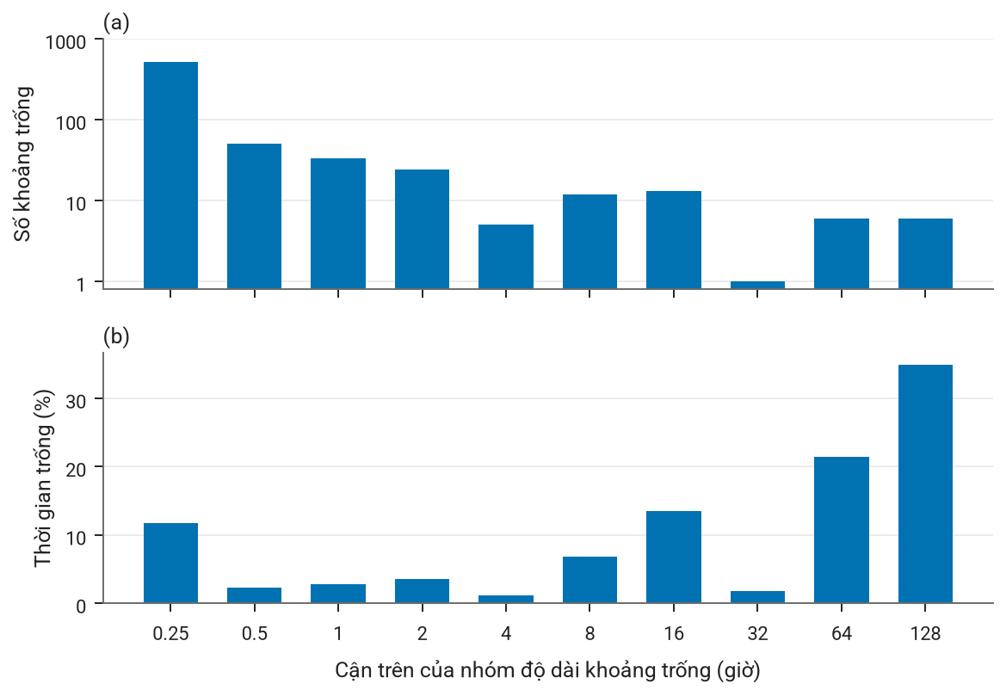
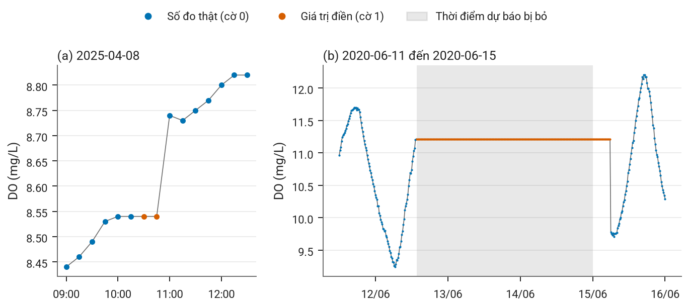
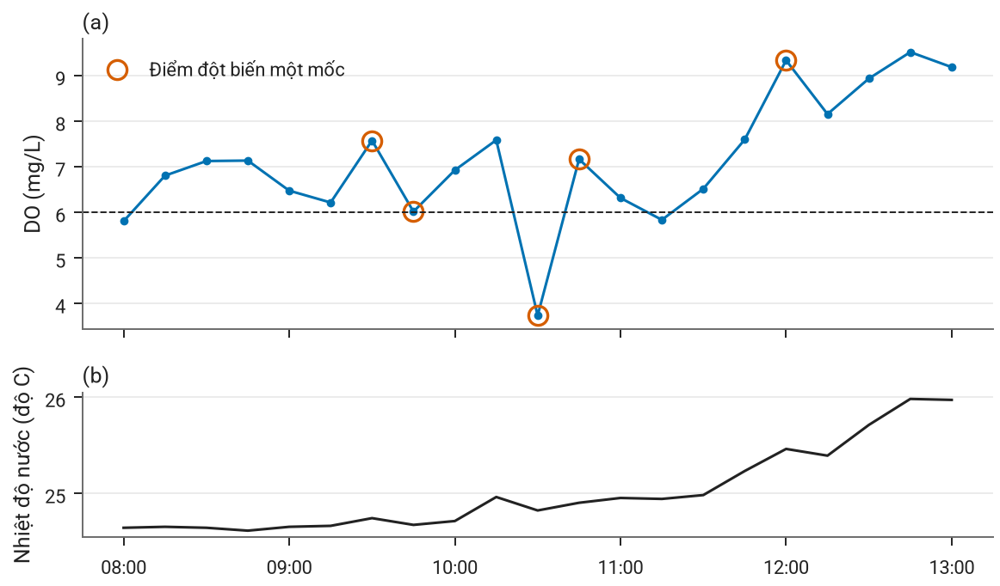

# Làm sạch dữ liệu

Tài liệu này mô tả cách làm sạch ba tập train, val, test ([01_DATASET_ANALYSIS.md](01_DATASET_ANALYSIS.md) mục 4) trước khi đưa vào mô hình. Quy trình gồm hai bước, cả hai đều nhân quả (chỉ dùng số đo tại mốc đang xét và các mốc trước):

1. coi giá trị ngoài miền vật lý là ô trống (mục 2);
2. điền mọi ô trống bằng số đo thật gần nhất phía trước của cùng biến và gắn cờ điền bằng 1 (mục 3, 4).

Quy trình cài đặt trong scripts/build_base_splits.py, kết quả ghi vào dataset/base_splits/. Thuật ngữ chung ở [README.md](README.md) mục 2.

## 1. Nguyên tắc

1. Không sửa dataset/raw/. Dữ liệu sau làm sạch ghi vào dataset/base_splits/, và mọi ô được điền đều được đánh dấu bằng cờ điền (mục 4).
2. Nhân quả: không dùng số đo phía sau một khoảng trống để điền khoảng trống đó. Nếu dùng, cửa sổ có thời điểm dự báo nằm trong khoảng trống sẽ gián tiếp thấy tương lai; và khi hệ thống web chạy thật, số đo phía sau chưa tồn tại. Nhờ vậy quy trình chạy y hệt khi huấn luyện, khi đánh giá và khi dùng thật.
3. Một quy trình cho cả ba tập, chạy liền mạch qua ranh giới: đầu val được điền từ số đo cuối của train, đầu test từ số đo cuối của val.
4. Sai số chỉ tính trên DO đo thật; giá trị điền chỉ được dùng làm đầu vào.

## 2. Kiểm tra miền giá trị

Giá trị nằm ngoài miền ở Bảng 1 được coi là lỗi (sai đơn vị, cảm biến ở ngoài nước, mã lỗi của thiết bị) và xử lý như một ô trống.

**Bảng 1.** Miền giá trị chấp nhận của sáu biến.

| Biến | DO | Nhiệt độ nước | pH | Độ dẫn điện | Độ đục | Chlorophyll |
|---|---|---|---|---|---|---|
| Miền chấp nhận | 0 đến 30 mg/L | 0 đến 35 độ C | 6 đến 10 | 20 đến 3000 uS/cm | 0 đến 1000 FNU | 0 đến 200 ug/L |

Mỗi miền rộng hơn mọi số đo đã thẩm định của cả file nguồn 2007 đến 2025, để không cắt số đo thật. Riêng DO, file nguồn có số đo tới 28.25 mg/L (trước 2019), cao hơn nhiều so với mức 19.00 mg/L lớn nhất của 2019 đến 2025, nên cận trên của DO là 30 mg/L. Đồng thời miền đủ hẹp để bắt các lỗi thường gặp: giá trị âm của cảm biến, hay ghi sai đơn vị (độ dẫn điện ghi theo mS/cm sẽ nhỏ hơn 20; nhiệt độ ghi theo độ F sẽ lớn hơn 35). Ba tập không có giá trị nào ngoài miền. Bước này vẫn được giữ để chặn số đo vô lý khi hệ thống web nhận dữ liệu mới. Nguồn: artifacts/dataset/cleaning_summary_train.csv, cột out_of_bounds_all (số giá trị ngoài miền), nguon_min, nguon_max (nhỏ nhất, lớn nhất của file nguồn).

## 3. Điền khoảng trống

### 3.1. Khoảng trống trong dữ liệu

Một khoảng trống là các ô trống liền nhau của cùng một biến. Từ 2019-01 đến 2025-11, sáu biến có tổng cộng 672 khoảng trống (4417 ô) (tổng cột so_khoang và so_o_trong của artifacts/dataset/gap_length_histogram.csv).



**Hình 1.** Khoảng trống của sáu biến theo độ dài, cả ba tập. Các nhóm độ dài có cận trên tăng gấp đôi từ 0.25 giờ (một mốc): nhóm 0.25 gồm các khoảng dài đúng một mốc, nhóm 1 gồm các khoảng dài hơn 0.5 giờ và không quá 1 giờ, tương tự cho các nhóm sau. (a) Số khoảng trống, thang logarit; (b) thời gian trống của các khoảng trống thuộc mỗi nhóm, tính bằng phần trăm tổng thời gian trống: số ô trống của nhóm chia tổng 4417 ô trống của sáu biến, nhân 100 (mỗi ô là 15 phút của một biến). Nguồn: artifacts/dataset/gap_length_histogram.csv; cột can_tren_gio (cận trên của nhóm), so_khoang (a), so_o_trong và pct_thoi_gian (b), pct_so_khoang_cong_don (phần trăm số khoảng trống không dài hơn cận trên, dùng ở ý đầu dưới đây).

- Theo số lượng, khoảng trống gần như luôn ngắn: 90.0% không quá 1 giờ.
- Theo thời gian, hai nhóm dài nhất (trên 32 giờ) chiếm 21.5% và 34.9% thời gian trống. Hai nhóm này gồm đúng 12 khoảng trống, là sáu biến của hai lần cả đầu đo ngừng ghi: 39.5 giờ từ 2020-04-25 14:30 và 64.25 giờ từ 2020-06-12 13:45, đều trong train. Khoảng trống dài nhất của val là 6.5 giờ (chỉ độ dẫn điện), của test là 1.5 giờ (artifacts/dataset/gap_events.csv, mọi khoảng trống từ 2 giờ trở lên; gap_stats.csv, dòng split = val và split = test, cột maxgap_h_<tên cột biến>).
- Khi DO trống thì gần như cả đầu đo cùng ngừng ghi: 591 trong 618 ô DO trống có cả năm biến còn lại cùng trống (gap_stats.csv, dòng split = all, cột do_na_ca_dau_do; số ô DO trống: feature_stats.csv, dòng split = all, feature = do_mg_l, cột missing).

### 3.2. Quy tắc điền

Mỗi ô trống, kể cả ô bị loại ở mục 2, được điền bằng số đo thật gần nhất phía trước của cùng biến, dù khoảng trống dài bao nhiêu, và gắn cờ điền bằng 1. Ô có số đo thật giữ nguyên giá trị, cờ điền bằng 0. Nếu ô trống nằm ngay đầu chuỗi (chưa có số đo nào phía trước), scripts/build_base_splits.py báo lỗi; dataset này không có trường hợp đó.



**Hình 2.** Điền khoảng trống ở hai lần cả đầu đo ngừng ghi. (a) Lần dài nhất của test (0.5 giờ): cả đầu đo trống lúc 10:30 và 10:45 ngày 2025-04-08; hai ô nhận giá trị 8.54 mg/L của lần đo 10:15. (b) Lần dài nhất của cả chuỗi (64.25 giờ, trong train); cả sáu biến được chép từ lần đo 13:30 ngày 2020-06-12 (DO 11.21 mg/L) thành một đường phẳng. Vùng xám là các thời điểm dự báo mà cả 6 giờ nhãn đều là giá trị điền; các cửa sổ này bị bỏ (mục 3.3). Nguồn: dataset/base_splits/test.csv và train.csv (cột do_mg_l, flag_do_mg_l); hai lần ngừng ghi được chọn theo artifacts/dataset/gap_stats.csv, dòng split = test và split = all, cột longest_all_na_start và longest_all_na_h.

Lý do chọn quy tắc này:
- Khi DO trống thì gần như cả đầu đo ngừng ghi (mục 3.1). Chép lần đo trước đó là chép một lần đo thật của cả sáu biến, nên các biến vẫn khớp nhau như khi đo.
- Không có tham số, nhân quả, và hệ thống web làm được y hệt.
- Ô được điền rất ít (dưới 0.4% số ô, Bảng 2), mô hình biết ô nào là ô điền qua cờ điền, và sai số không tính trên giá trị điền.
- Ba thí nghiệm E1, E2, E3 dùng chung dữ liệu đã làm sạch, nên quy tắc điền không làm lệch phép so sánh giữa chúng.

### 3.3. Kết quả trên ba tập

**Bảng 2.** Số ô được điền của từng tập.

| Tập | Số ô (số dòng nhân 6 biến) | Ô được điền (cờ điền bằng 1) | Phần trăm ô được điền (%) |
|---|---|---|---|
| Train | 1139328 | 4098 | 0.36 |
| Val | 157248 | 212 | 0.13 |
| Test | 158400 | 107 | 0.07 |

Phần trăm ô được điền là số ô được điền chia số ô của tập, nhân 100; ví dụ train: 100 x 4098 / 1139328 = 0.36%. Nguồn: artifacts/dataset/split_counts.csv, mỗi dòng một tập (cột so_o, o_dien, pct_o_dien); scripts/verify_dataset.py đếm lại độc lập từ dataset/base_splits/ và so với file này.

Một cửa sổ bị bỏ khi nhãn không có mốc DO đo thật nào (vùng xám ở Hình 2b), vì khi đó không có mốc nào để tính hàm mất mát. Điều này chỉ xảy ra trong các lần ngừng ghi dài của train: 424 trên 189769 cửa sổ (0.22%) với cấu hình 24 giờ, 6 giờ và 225 trên 189121 cửa sổ (0.12%) với cấu hình 7 ngày, 24 giờ; val và test không bỏ cửa sổ nào. Nguồn: split_counts.csv, dòng tap = train, cột cua_so_24h_6h, bo_24h_6h, cua_so_7d_24h, bo_7d_24h; số cửa sổ của cả ba tập ở [04_MODEL_TRAINING_EVALUATION.md](04_MODEL_TRAINING_EVALUATION.md) Bảng 3.

Trên khoảng trống dài, giá trị điền là một đường phẳng, không theo chu kỳ ngày đêm. Val và test không có khoảng trống nào dài hơn 6.5 giờ, nên chất lượng dự báo khi đầu vào chứa đoạn điền dài không được đo trong dataset này.

## 4. Cờ điền

dataset/base_splits/ gồm train.csv, val.csv, test.csv. Mỗi file có cột datetime_pst, sáu biến và sáu cột cờ điền flag_<tên cột biến>, ví dụ flag_do_mg_l; dấu thập phân là dấu chấm. Cờ điền tách theo biến vì trong cùng một mốc có thể có biến đo thật và biến được điền (ví dụ từ 2025-01-25 10:30, chỉ độ dẫn điện trống trong 6.5 giờ). Ba dòng liên tiếp của train.csv, dòng giữa có cả sáu biến trống trong nguồn và được điền bằng số đo của dòng đầu:

```
datetime_pst,do_mg_l,water_temp_c,ph,spc_us_cm,turbidity_fnu,chl_fluor_ug_l,flag_do_mg_l,flag_water_temp_c,flag_ph,flag_spc_us_cm,flag_turbidity_fnu,flag_chl_fluor_ug_l
2019-02-05 12:00:00,9.48,11.24,7.56,399,71.91,7.13,0,0,0,0,0,0
2019-02-05 12:15:00,9.48,11.24,7.56,399,71.91,7.13,1,1,1,1,1,1
2019-02-05 12:30:00,9.49,11.27,7.56,395,70.33,7.16,0,0,0,0,0,0
```

**Bảng 3.** Ý nghĩa của cờ điền.

| Cờ điền | Nghĩa | Giá trị trong file |
|---|---|---|
| 0 | Số đo thật | Chép nguyên văn từ nguồn |
| 1 | Ô trống hoặc ngoài miền, đã điền | Chép nguyên văn số đo thật gần nhất phía trước |

Cờ điền được dùng theo hai cách:
- Làm đầu vào: sáu cột cờ điền là sáu trong 12 cột đầu vào của E1, nên mô hình phân biệt được giá trị điền với số đo thật.
- Làm mặt nạ cho sai số: sai số của một cửa sổ là trung bình trên các mốc nhãn có cờ điền của DO bằng 0. Hàm mất mát khi huấn luyện tính theo cùng cách, nên mô hình học dự báo DO đo thật, không học theo giá trị điền.

## 5. Điểm DO đột biến một mốc

Một bước thay đổi 15 phút của một biến được coi là lớn bất thường khi độ lớn của nó vượt hai lần phân vị 99% của độ lớn các bước 15 phút của biến đó trên train. Với DO, 99% số bước không quá 0.40 mg/L, nên ngưỡng là 0.8 mg/L; với nhiệt độ nước là 0.28 độ C, với pH là 0.14 (artifacts/dataset/cleaning_summary_train.csv, cột step_p99 là phân vị 99%, buoc_lon là ngưỡng). Điểm DO đột biến một mốc là mốc mà cả bước vào (từ mốc trước) và bước ra (đến mốc sau) của DO đều lớn bất thường và ngược chiều nhau: DO lệch quá 0.8 mg/L rồi quay lại quá 0.8 mg/L.



**Hình 3.** DO (a) và nhiệt độ nước (b) sáng 2025-08-14, ngày có DO thấp nhất của test. Vòng đỏ là các điểm DO đột biến một mốc; điểm thấp nhất là 3.73 mg/L lúc 10:30. Đường đứt là ngưỡng 6 mg/L. Nguồn: dataset/raw/cemp_MSD_2007_2025_source.csv (số đo gốc); artifacts/dataset/do_reversal_points.csv (các điểm đột biến, cột time và value); ngày được chọn theo feature_stats.csv, dòng split = test, feature = do_mg_l, cột min.

- Có 208 điểm (train 61, val 27, test 120), gần như tất cả (207 điểm) trong mùa nóng (tháng 6 đến 9). Nguồn: artifacts/dataset/reversal_effect.csv, cột so_diem; tháng của từng điểm ở do_reversal_points.csv, cột time.
- Không xác định được điểm nào là lỗi: ở 57 điểm, bước của nhiệt độ nước hoặc pH tại cùng mốc cũng lớn bất thường, có thể là một khối nước khác đi qua cảm biến; nhưng một trục trặc làm cả đầu đo lệch theo cũng cho dấu hiệu như vậy. Nguồn: do_reversal_points.csv, số dòng có classification = tu_nhien_khoi_nuoc.
- Ảnh hưởng đến DO thấp của test: 8 trên 9 mốc DO dưới 5 mg/L và 17 trên 34 mốc DO dưới 6 mg/L là điểm đột biến. Nguồn: reversal_effect.csv, dòng tap = test, cột moc_DO_duoi_5_la_dot_bien, moc_DO_duoi_5, moc_DO_duoi_6_la_dot_bien, moc_DO_duoi_6.

Cả 208 điểm được giữ là số đo thật (cờ điền bằng 0): muốn nhận ra một điểm đột biến phải có số đo ở mốc sau, nên phép phát hiện không nhân quả và không áp dụng được cho số đo mới nhất khi chạy thật.
