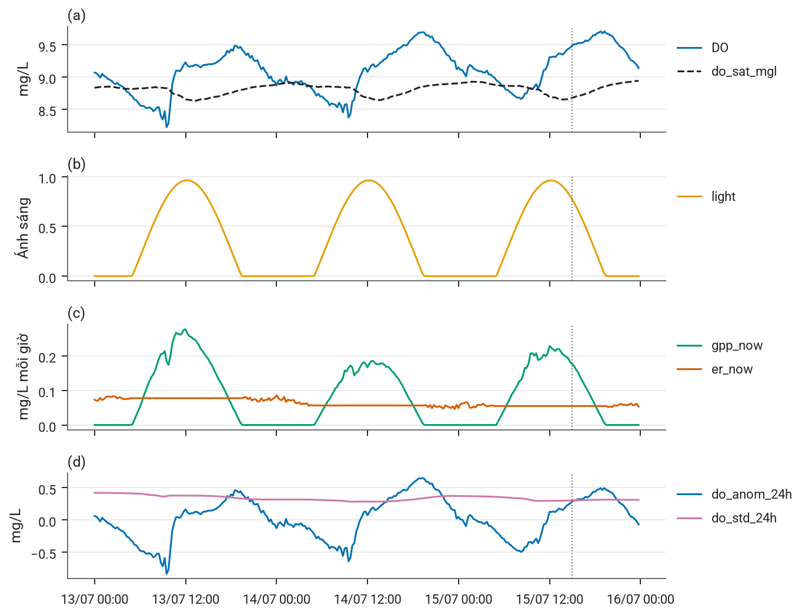

# Phân tích đặc trưng miền

Tài liệu này trình bày 24 đặc trưng miền thêm vào đầu vào của mô hình trong thí nghiệm E2. Mỗi đặc trưng là một đại lượng tính bằng công thức từ năm biến đo đã làm sạch (DO, nhiệt độ nước, pH, độ dẫn điện, chlorophyll) và thời điểm đo; độ đục không tham gia đặc trưng nào. Với mỗi nhóm đặc trưng, tài liệu nêu cơ sở lý thuyết, công thức và một ví dụ tính trên số đo thật. Cách mô hình sử dụng các đặc trưng này được phân tích ở [04_MODEL_TRAINING_EVALUATION.md](04_MODEL_TRAINING_EVALUATION.md) mục 8. Thuật ngữ chung (mốc, thời điểm dự báo, nhân quả, ...) ở [README.md](README.md) mục 2.

## 1. Ký hiệu

**Bảng 1.** Ký hiệu dùng trong các công thức.

| Ký hiệu | Nghĩa |
|---|---|
| $t$ | Mốc hiện tại. $t - n$ là mốc cách $t$ đúng $n$ bước 15 phút về trước: $t-4$ là 1 giờ trước, $t-12$ là 3 giờ trước, $t-96$ là 24 giờ trước |
| $\Delta t$ | Độ dài một bước, 0.25 giờ |
| $DO_t$, $T_t$, $pH_t$, $SpC_t$, $Chl_t$ | Giá trị đã làm sạch tại mốc $t$ của DO (mg/L), nhiệt độ nước (độ C), pH, độ dẫn điện (uS/cm), chlorophyll (ug/L) |
| $\mathcal{W}_t$ | 96 mốc gần nhất kết thúc ở $t$, tức 24 giờ qua: $t-95, \dots, t$ |
| $C^{*}_t$ | DO bão hòa (mg/L), cột do_sat_mgl |
| $D_t$ | Thiếu hụt oxy $C^{*}_t - DO_t$ (mg/L), cột do_deficit |
| $I_t$ | Ánh sáng, cột light |
| $k$ | Hệ số trao đổi khí qua mặt nước (mỗi giờ) |
| $ER_t$, $P_t$ | Hô hấp (cột er_now) và quang hợp hiện tại (cột gpp_now), mg/L mỗi giờ |

Mọi đặc trưng đều nhân quả: giá trị tại $t$ chỉ dùng số đo tại $t$ và các mốc trước, nên hệ thống web tính được y hệt khi chạy thật. Ở đầu chuỗi, khi chưa có mốc $t - n$, hiệu với mốc đó được ghi bằng 0. Đặc trưng E2 là đại lượng liên tục; các trạng thái rời rạc như "đang nở hoa" hay "nguy cơ thiếu oxy" thuộc E3 (đặc trưng ngữ nghĩa suy ra từ ontology), không thuộc E2.

## 2. Cơ sở: cân bằng oxy trong sông

DO tại trạm có hai chế độ ([01_DATASET_ANALYSIS.md](01_DATASET_ANALYSIS.md) mục 3.3): mùa lạnh gần như phẳng, mùa nóng dao động gần 3 mg/L mỗi ngày và có lúc vượt xa mức bão hòa. Biến động này do ba quá trình chi phối, viết thành phương trình cân bằng oxy của Odum (1956):

$$\frac{dDO}{dt} = GPP - ER + k\,D, \qquad D = C^{*} - DO \tag{1}$$

- $GPP$ (tổng sản lượng sơ cấp): oxy do tảo và thực vật thủy sinh tạo ra khi quang hợp, chỉ có khi có ánh sáng.
- $ER$ (hô hấp của hệ sinh thái): oxy bị tiêu thụ bởi hô hấp của sinh vật và quá trình phân hủy chất hữu cơ, cả ngày lẫn đêm.
- $k\,D$ (trao đổi khí): khi nước thiếu oxy ($D$ dương), oxy từ không khí hòa vào nước; khi nước thừa oxy ($D$ âm, thường do quang hợp mạnh), oxy thoát ra không khí. Tốc độ tỉ lệ với $D$ qua hệ số $k$.

Mô hình E1 chỉ thấy các biến đo nên phải tự suy ra các quá trình này. E2 đưa thẳng các thành phần của phương trình (1) vào đầu vào: mức bão hòa và thiếu hụt (trao đổi khí), ánh sáng, ước lượng quang hợp và hô hấp. Các nhóm còn lại mô tả kết quả của cân bằng trong 24 giờ qua (chu kỳ ngày đêm), tốc độ thay đổi hiện tại, bằng chứng gián tiếp về quang hợp (pH, chlorophyll), sự thay đổi khối nước (độ dẫn điện, thủy triều) và vị trí trong chu kỳ ngày, năm.

## 3. Tổng quan 24 đặc trưng

**Bảng 2.** Danh sách đặc trưng, theo 10 nhóm. Tên nhóm dùng thống nhất trong mọi tài liệu và hình; mã nhóm là giá trị của cột nhom trong các file artifacts/analysis/attr_*.csv.

| Nhóm (mục; mã) | Cột | Ý nghĩa | Biến đo dùng | Đơn vị |
|---|---|---|---|---|
| Bão hòa oxy (4.1; bao_hoa) | do_sat_mgl | DO bão hòa | Nhiệt độ nước, độ dẫn điện | mg/L |
| | do_sat_pct | Phần trăm bão hòa | DO, nhiệt độ nước, độ dẫn điện | % |
| | do_deficit | Thiếu hụt oxy | DO, nhiệt độ nước, độ dẫn điện | mg/L |
| Ánh sáng (4.2; anh_sang) | light | Ánh sáng thiên văn ở đỉnh khí quyển | Thời điểm | không có đơn vị, từ 0 đến 1 |
| Quang hợp và hô hấp (4.3; trao_doi_chat) | gpp_now | Quang hợp ước lượng tại mốc hiện tại | DO, nhiệt độ nước, độ dẫn điện, thời điểm | mg/L mỗi giờ |
| | er_now | Hô hấp ước lượng của đêm gần nhất | DO, nhiệt độ nước, độ dẫn điện, thời điểm | mg/L mỗi giờ |
| Thống kê DO 24 giờ (4.4; do_24h) | do_change_24h | DO so với cùng giờ hôm qua | DO | mg/L |
| | do_std_24h | Độ lệch chuẩn của DO trong 24 giờ qua | DO | mg/L |
| | do_anom_24h | DO so với trung bình 24 giờ qua | DO | mg/L |
| Biến thiên ngắn hạn (4.5; ngan_han) | do_change_1h | Thay đổi DO trong 1 giờ qua | DO | mg/L |
| | do_change_3h | Thay đổi DO trong 3 giờ qua | DO | mg/L |
| | temp_change_3h | Thay đổi nhiệt độ nước trong 3 giờ qua | Nhiệt độ nước | độ C |
| Biến thiên pH (4.6; bien_thien_ph) | ph_change_3h | Thay đổi pH trong 3 giờ qua | pH | đơn vị pH |
| | ph_change_24h | pH so với cùng giờ hôm qua | pH | đơn vị pH |
| Logarit chlorophyll (4.7; log_chl) | log_chl | Logarit tự nhiên của chlorophyll | Chlorophyll | không có đơn vị |
| Biến thiên độ dẫn điện (4.8; bien_thien_spc) | spc_change_24h | Độ dẫn điện so với cùng giờ hôm qua | Độ dẫn điện | uS/cm |
| Thủy triều M2 (4.9; trieu) | m2_sin, m2_cos | Pha của triều bán nhật M2 | Thời điểm | không có đơn vị, từ -1 đến 1 |
| Lịch (4.10; lich) | hour_sin, hour_cos | Giờ trong ngày, chu kỳ 24 giờ | Thời điểm | không có đơn vị, từ -1 đến 1 |
| | hour2_sin, hour2_cos | Giờ trong ngày, chu kỳ 12 giờ | Thời điểm | không có đơn vị, từ -1 đến 1 |
| | doy_sin, doy_cos | Ngày trong năm | Thời điểm | không có đơn vị, từ -1 đến 1 |

Cột Biến đo dùng ghi các biến đo mà công thức cần; Thời điểm nghĩa là đặc trưng chỉ tính từ ngày giờ của mốc. Đặc trưng không có đơn vị khi nó là một tỉ số, một logarit hoặc một giá trị sin, cos.

Mọi ví dụ trong mục 4 tính tại cùng một mốc train: **2021-07-15 15:00**. Mốc được chọn theo hai điều kiện: là buổi chiều mùa nóng, lúc quang hợp diễn ra, nên mọi nhóm đặc trưng đều có giá trị khác 0; và 24 giờ trước đó không có ô điền nào, nên mọi số trong ví dụ là số đo thật. Số đo tại mốc này và tại các mốc trước mà công thức dùng được liệt kê ở Bảng 3; mọi đại lượng trung gian, số ô điền trong 24 giờ trước (bằng 0) và giá trị 24 đặc trưng nằm trong artifacts/dataset/domain_example.csv.

**Bảng 3.** Số đo tại mốc ví dụ và tại các mốc trước dùng trong công thức (giá trị đã làm sạch).

| Mốc | DO (mg/L) | Nhiệt độ nước (độ C) | pH | Độ dẫn điện (uS/cm) | Chlorophyll (ug/L) |
|---|---|---|---|---|---|
| $t$ = 2021-07-15 15:00 | 9.49 | 22.37 | 7.75 | 144 | 2.88 |
| $t-4$ (14:00) | 9.38 | 22.52 | 7.72 | 142 | 2.49 |
| $t-12$ (12:00) | 9.31 | 22.31 | 7.72 | 141 | 2.41 |
| $t-96$ (2021-07-14 15:00) | 9.36 | 22.30 | 7.71 | 145 | 2.63 |

Nguồn: artifacts/dataset/domain_example.csv, các dòng ten = do, temp, ph, spc, chl (mốc $t$) và các dòng cùng tên có hậu tố _1h_truoc, _3h_truoc, _24h_truoc.

Hình 1 cho thấy các đặc trưng thay đổi theo giờ trong ngày ở ba ngày quanh mốc ví dụ: các thành phần của phương trình (1) (DO bão hòa, ánh sáng, quang hợp và hô hấp) và hai thống kê 24 giờ của DO. Các đặc trưng còn lại là hiệu giữa hai mốc hoặc hàm của thời điểm, đọc được trực tiếp từ công thức.

**Hình 1.** DO và các đặc trưng miền thay đổi theo giờ, từ 2021-07-13 đến 2021-07-15; đường chấm đứng là mốc ví dụ. (a) DO đo và DO bão hòa; (b) ánh sáng; (c) quang hợp và hô hấp ước lượng; (d) DO so với trung bình 24 giờ qua và độ lệch chuẩn của DO trong 24 giờ qua. Nguồn: dataset/base_domain_splits/train.csv, các dòng từ 2021-07-13 00:00 đến 2021-07-15 23:45; cột do_mg_l, do_sat_mgl (a), light (b), gpp_now, er_now (c), do_anom_24h, do_std_24h (d).

## 4. Cách tính từng nhóm

### 4.1. Bão hòa oxy: do_sat_mgl, do_sat_pct, do_deficit

**Cơ sở.** Khi nước cân bằng với không khí, nồng độ oxy hòa tan đạt một mức xác định gọi là DO bão hòa. Mức này giảm khi nước nóng lên hoặc mặn hơn, và tăng theo áp suất khí quyển. So DO đo với DO bão hòa cho biết nước đang thiếu hay thừa oxy, tức chiều và độ lớn của trao đổi khí trong phương trình (1). Đồ án dùng công thức của Benson và Krause (1980, 1984), được USGS chọn làm công thức chuẩn từ năm 2011 (USGS 2011).

**Công thức.** Độ mặn $S$ tính từ độ dẫn điện (đã quy về 25 độ C) theo công thức rút gọn của Schemel (2001):

$$R = \frac{SpC_t}{53087}, \qquad S = 0.0120 - 0.2174\,R^{1/2} + 25.3283\,R + 13.7714\,R^{3/2} - 6.4788\,R^{2} + 2.5842\,R^{5/2} \tag{2}$$

Với nhiệt độ tuyệt đối $T_K = T_t + 273.15$, DO bão hòa ở áp suất 1 atm là tích của DO bão hòa trong nước ngọt và hệ số hiệu chỉnh độ mặn (USGS 2011, phương trình 7 và 8), viết dưới dạng logarit:

$$\ln C^{*}_t = -139.34411 + \frac{1.575701 \times 10^{5}}{T_K} - \frac{6.642308 \times 10^{7}}{T_K^{2}} + \frac{1.243800 \times 10^{10}}{T_K^{3}} - \frac{8.621949 \times 10^{11}}{T_K^{4}} - S\left(0.017674 - \frac{10.754}{T_K} + \frac{2140.7}{T_K^{2}}\right) \tag{3}$$

Ba đặc trưng của nhóm:

$$\text{do\_sat\_mgl} = C^{*}_t, \qquad \text{do\_sat\_pct} = 100\,\frac{DO_t}{C^{*}_t}, \qquad \text{do\_deficit} = D_t = C^{*}_t - DO_t \tag{4}$$

**Ví dụ.** $R$ = 144 / 53087 = 0.002713, theo (2) $S$ = 0.0713. $T_K$ = 22.37 + 273.15 = 295.52, theo (3) $\ln C^{*}$ = 2.1608, nên $C^{*}$ = 8.678 mg/L. Khi đó do_sat_pct = 100 x 9.49 / 8.678 = 109.4% và do_deficit = 8.678 - 9.49 = -0.812 mg/L: nước thừa oxy, oxy đang thoát ra không khí.

**Giả định.** Áp suất lấy 1 atm vì trạm không đo áp suất khí quyển; trạm nằm gần mực nước biển. Nước ở trạm gần như ngọt (độ mặn lớn nhất 0.61), nên thay công thức (2) bằng công thức đổi độ dẫn điện sang độ mặn của USGS (2011, phương trình 4) chỉ làm DO bão hòa đổi tối đa 0.005 mg/L (artifacts/dataset/salinity_check.csv, cột sal_schemel_max và do_sat_diff_max).

### 4.2. Ánh sáng: light

**Cơ sở.** Quang hợp chỉ xảy ra khi có ánh sáng và tăng theo cường độ ánh sáng. Trạm không có cảm biến ánh sáng, nên đồ án dùng ánh sáng thiên văn: sin của độ cao mặt trời, tỉ lệ với bức xạ mặt trời chiếu lên mặt phẳng nằm ngang ở đỉnh khí quyển. Cách mô hình hóa ánh sáng từ vị trí mặt trời khi không có cảm biến cũng được dùng trong gói streamMetabolizer của USGS.

**Công thức.** Với $N$ là thứ tự ngày trong năm và $h$ là giờ PST dạng thập phân, các công thức (5) đến (9) lấy nguyên từ tài liệu tính vị trí mặt trời của Global Monitoring Division thuộc NOAA (NOAA GMD). Trong đó xích vĩ $\delta$ (radian) và phương trình thời gian $\mathrm{EoT}$ (phút) là chuỗi Fourier của Spencer (1971):

$$\gamma = \frac{2\pi}{365}\left(N - 1 + \frac{h - 12}{24}\right) \tag{5}$$

$$\delta = 0.006918 - 0.399912\cos\gamma + 0.070257\sin\gamma - 0.006758\cos 2\gamma + 0.000907\sin 2\gamma - 0.002697\cos 3\gamma + 0.00148\sin 3\gamma \tag{6}$$

$$\mathrm{EoT} = 229.18\,\left(0.000075 + 0.001868\cos\gamma - 0.032077\sin\gamma - 0.014615\cos 2\gamma - 0.040849\sin 2\gamma\right) \tag{7}$$

Giờ mặt trời thật $\tau$ (phút) và góc giờ $\omega$ (độ) tại kinh độ $\lambda$ = -121.306 độ, với giờ PST bằng giờ UTC trừ 8:

$$\tau = 60\,h + \mathrm{EoT} + 4\lambda + 480, \qquad \omega = \frac{\tau}{4} - 180 \tag{8}$$

Độ cao mặt trời $\alpha$ tại vĩ độ $\varphi$ = 37.786 độ và đặc trưng ánh sáng:

$$\sin\alpha = \sin\varphi\,\sin\delta + \cos\varphi\,\cos\delta\,\cos\omega, \qquad I_t = \text{light} = \max(0,\ \sin\alpha) \tag{9}$$

Hai chỗ khác với nguồn, cả hai đều rất nhỏ. Thứ nhất, NOAA dùng 366 thay cho 365 trong (5) ở năm nhuận; đồ án dùng 365 cho mọi năm, làm light lệch tối đa 0.004 trên 2019 đến 2025. Thứ hai, hằng số 0.000075 trong (7) giữ như NOAA, trong khi Spencer sau đó đính chính hằng số này là 0.0000075 (ghi chú của thư viện pvlib, hàm equation_of_time_spencer71); chênh lệch là 0.015 phút.

**Ví dụ.** Ngày 15 tháng 7 là ngày thứ $N$ = 196, $h$ = 15. Theo (5) đến (7): $\gamma$ = 3.3589 rad, $\delta$ = 0.3778 rad (21.6 độ), $\mathrm{EoT}$ = -5.80 phút. Theo (8): $\tau$ = 900 - 5.80 - 485.22 + 480 = 888.98 phút, $\omega$ = 42.25 độ. Theo (9): $\sin\alpha$ = 0.770, nên light = 0.770.

### 4.3. Quang hợp và hô hấp: gpp_now, er_now

**Cơ sở.** Hai đặc trưng ước lượng $GPP$ và $ER$ của phương trình (1) từ chính chuỗi DO, theo phương pháp cân bằng oxy ngày đêm (Odum 1956). Ban đêm không có quang hợp, nên phương trình (1) chỉ còn hô hấp và trao đổi khí; từ đó ước lượng được $k$ và $ER$. Biết $ER$ và $k$, phần thay đổi DO còn lại trong 24 giờ là quang hợp. Cách tính gồm bốn bước: ước lượng $k$ (một lần, trên train), tính er_now, tính gpp_now, rồi kiểm tra độ nhạy với $k$.

**Bước đêm.** Một bước từ mốc $s-1$ đến mốc $s$ là bước đêm khi mặt trời dưới chân trời ở cả hai mốc ($\sin\alpha$ âm) và DO ở cả hai mốc là số đo thật (cờ điền bằng 0). Với mỗi bước:

$$r_s = \frac{DO_s - DO_{s-1}}{\Delta t}, \qquad \bar{D}_s = \frac{D_s + D_{s-1}}{2} \tag{10}$$

trong đó $r_s$ là tốc độ thay đổi DO (mg/L mỗi giờ) và $\bar{D}_s$ là thiếu hụt trung bình của bước.

**Ước lượng k.** Trên các bước đêm, phương trình (1) thành $r = k\,\bar{D} - ER$. Lấy trung bình trên các bước của một đêm $n$ (đêm nối hai ngày mang nhãn ngày sau):

$$\bar{r}_n = k\,\bar{D}_n - ER \tag{11}$$

Một đêm chỉ được dùng khi có ít nhất 16 bước đêm, tức 4 giờ, để trung bình của đêm không dựa trên quá ít bước. Ở trạm, một đêm thiên văn dài 37 đến 58 bước; trên train, mọi đêm có số đo đều có từ 16 bước đêm trở lên (ít nhất 16, trung vị 47), nên ngưỡng này không loại đêm nào của train mà chỉ chặn những đêm bị khoảng trống cắt ngắn khi hệ thống chạy thật (artifacts/dataset/night_steps.csv; cột dem_thien_van_ngan_nhat, dem_thien_van_dai_nhat, buoc_min, buoc_trung_vi, so_dem_duoi_nguong).

Hồi quy tuyến tính bình phương tối thiểu của $\bar{r}_n$ theo $\bar{D}_n$ trên các đêm train cho độ dốc $k$ và giao điểm $-ER$ (Hình 2). Đây là phương pháp hồi quy ban đêm của Hornberger và Kelly (1975), với một khác biệt: các đêm được gộp vào một hồi quy chung thay vì ước lượng riêng từng đêm, nên $k$ là một giá trị đại diện cho cả giai đoạn train. $k$ là hằng số duy nhất của E2 ước lượng từ dữ liệu; chỉ dùng train để val và test không ảnh hưởng gián tiếp đến mô hình.

**Hình 2.** Hồi quy ban đêm trên 1973 đêm train: mỗi chấm xanh là một đêm; chấm đỏ là trung bình của từng thập phân vị thiếu hụt (các đêm xếp theo $\bar{D}_n$ rồi chia thành 10 nhóm, mỗi nhóm 10% số đêm); đường đen là đường hồi quy (11). Nguồn: artifacts/dataset/night_regression.csv, mỗi dòng một đêm (cột thieu_hut_tb là $\bar{D}_n$, toc_do_tb là $\bar{r}_n$); đường hồi quy: reaeration_k.csv (cột k, er).

**Bảng 4.** Kết quả hồi quy ban đêm.

| Đại lượng | Giá trị |
|---|---|
| $k$ | 0.0576 mỗi giờ |
| Khoảng tin cậy 95% của $k$ (bootstrap: bốc lại có lặp 1973 đêm, 2000 lần) | 0.0548 đến 0.0605 mỗi giờ |
| $ER$ trung bình | 0.0921 mg/L mỗi giờ |
| Hệ số tương quan $r$ giữa $\bar{D}_n$ và $\bar{r}_n$ của các đêm | 0.80 |

Nguồn: artifacts/dataset/reaeration_k.csv (cột k, er, r; số đêm ở cột n_nights) và reaeration_k_ci.csv (cột k_p2_5, k_p97_5).

**Hô hấp hiện tại, er_now.** Gọi $\mathcal{N}_t$ là tập các bước đêm nằm trong 24 giờ qua $\mathcal{W}_t$. Từ (11), hô hấp của đêm gần nhất là:

$$ER_t = \text{er\_now} = \frac{1}{|\mathcal{N}_t|} \sum_{s \in \mathcal{N}_t} \left(k\,\bar{D}_s - r_s\right) \tag{12}$$

Khi 24 giờ qua có ít hơn 16 bước đêm, er_now giữ giá trị của mốc trước.

**Quang hợp hiện tại, gpp_now.** Tích phân phương trình (1) trên 24 giờ qua, coi hô hấp không đổi trong ngày, cho tổng quang hợp của 24 giờ (mg/L):

$$GPP^{24}_t = \left(DO_t - DO_{t-96}\right) - k \sum_{s \in \mathcal{W}_t} \bar{D}_s\,\Delta t + 24\,ER_t \tag{13}$$

Số hạng đầu là thay đổi DO thực tế, số hạng giữa bỏ phần oxy do trao đổi khí, số hạng cuối cộng lại phần đã bị hô hấp tiêu thụ. Coi quang hợp tỉ lệ với ánh sáng, tổng quang hợp được phân bổ theo ánh sáng để có quang hợp tại mốc hiện tại:

$$P_t = \text{gpp\_now} = \frac{GPP^{24}_t}{\sum_{s \in \mathcal{W}_t} I_s\,\Delta t}\; I_t \tag{14}$$

Trong 24 giờ đầu chuỗi, gpp_now ghi 0.

**Ví dụ.** Trong 24 giờ trước 2021-07-15 15:00 có 37 bước đêm, với $\bar{D}$ trung bình -0.364116 mg/L và $r$ trung bình -0.075676 mg/L mỗi giờ. Theo (12): er_now = 0.057569 x (-0.364116) + 0.075676 = 0.0547 mg/L mỗi giờ. Tổng $\bar{D}_s\,\Delta t$ trên 96 mốc là -9.078, tổng $I_s\,\Delta t$ là 8.598. Theo (13): $GPP^{24}$ = (9.49 - 9.36) + 0.057569 x 9.078 + 24 x 0.0547 = 1.966 mg/L. Theo (14): gpp_now = 1.966 / 8.598 x 0.770 = 0.176 mg/L mỗi giờ.

**Độ ổn định và độ nhạy của k.** Hệ số trao đổi khí của một dòng sông phụ thuộc tốc độ dòng chảy và độ sâu (O'Connor và Dobbins 1958). Hai đại lượng này thay đổi theo lưu lượng sông, nên $k$ thực tế thay đổi theo thời gian (dataset không có số liệu lưu lượng). Ước lượng riêng từng giai đoạn của train cho thấy điều đó (Bảng 5, 6). Mỗi cách chia gồm các nhóm tương đương nhau: theo năm chỉ xét các năm có đủ 12 tháng trong train (2019 đến 2023; năm 2024 chỉ có tháng 1 đến 5 nên không ước lượng riêng), theo giai đoạn mùa xét đủ bốn giai đoạn (mọi đêm train, kể cả năm 2024).

**Bảng 5.** $k$ (mỗi giờ) ước lượng riêng theo từng năm đủ 12 tháng của train.

| Năm | 2019 | 2020 | 2021 | 2022 | 2023 |
|---|---|---|---|---|---|
| $k$ | 0.0603 | 0.0650 | 0.0452 | 0.0600 | 0.0260 |

**Bảng 6.** $k$ (mỗi giờ) ước lượng riêng theo giai đoạn mùa của train.

| Giai đoạn mùa | Lạnh | Xuân | Nóng | Thu |
|---|---|---|---|---|
| $k$ | 0.0299 | 0.0521 | 0.0617 | 0.0465 |

Nguồn của Bảng 5 và 6: artifacts/dataset/reaeration_k_by_period.csv, dòng nhom = nam (Bảng 5) và nhom = mua (Bảng 6); cột ky, k (số đêm ở cột n_nights).

Một giá trị $k$ chung vì vậy là một sự đơn giản hóa. $k$ chỉ đi vào er_now và gpp_now; để đo ảnh hưởng của nó, hai đặc trưng được tính lại với các giá trị $k$ khác và so tương quan với bản dùng $k$ = 0.0576 (Bảng 7). Các $k$ thử gồm hai đầu khoảng tin cậy (Bảng 4) và $k$ nhỏ nhất, lớn nhất trong các $k$ ước lượng riêng (Bảng 5 và 6: 0.0260 của năm 2023, 0.0650 của năm 2020), tức khoảng $k$ thực sự quan sát được trên train.

**Bảng 7.** Tương quan giữa đặc trưng tính với $k$ thử và đặc trưng tính với $k$ = 0.0576 (bằng 1 là không đổi).

| $k$ thử | 0.0260 | 0.0548 | 0.0605 | 0.0650 |
|---|---|---|---|---|
| er_now | 0.76 | 0.998 | 0.998 | 0.98 |
| gpp_now | 0.9993 | 1.000 | 1.000 | 1.000 |

Nguồn: artifacts/dataset/reaeration_k_sensitivity.csv, mỗi dòng một $k$ thử (cột k, corr_er_now, corr_gpp_now).

gpp_now gần như không phụ thuộc $k$: $k$ xuất hiện trong (13) hai lần với dấu ngược nhau (trực tiếp và qua $ER_t$ theo (12)) nên gần như triệt tiêu. er_now nhạy hơn: tương quan giữ 0.998 trong khoảng tin cậy của $k$ và còn 0.76 với $k$ nhỏ nhất quan sát được (0.0260).

Hô hấp không được quy đổi theo nhiệt độ: er_now là hô hấp của đêm gần nhất, và nhiệt độ hiện tại chỉ lệch nhiệt độ trung bình của các bước đêm đó trung vị 0.29 độ C (95% số mốc lệch không quá 1.04 độ C), nên phép quy đổi gần như không thay đổi giá trị (artifacts/dataset/er_temp_offset.csv, cột median và p95).

### 4.4. Thống kê DO 24 giờ: do_change_24h, do_std_24h, do_anom_24h

**Cơ sở.** Kết quả của cân bằng (1) trong một ngày là chu kỳ ngày đêm của DO: tăng khi quang hợp vượt hô hấp, giảm vào chiều tối và ban đêm. Biên độ chu kỳ lớn khi tảo hoạt động mạnh. Ba đặc trưng tóm tắt 24 giờ qua ngay tại mốc hiện tại: DO so với cùng giờ hôm qua (loại bỏ chu kỳ ngày đêm, chỉ còn xu hướng nhiều ngày), độ lớn của dao động, và vị trí của DO hiện tại so với mức trung bình của ngày.

**Công thức.** Với $\overline{DO}_t$ là trung bình DO trên $\mathcal{W}_t$:

$$\text{do\_change\_24h} = DO_t - DO_{t-96}, \qquad \text{do\_anom\_24h} = DO_t - \overline{DO}_t, \qquad \overline{DO}_t = \frac{1}{96}\sum_{s \in \mathcal{W}_t} DO_s \tag{15}$$

$$\text{do\_std\_24h} = \sqrt{\frac{1}{95}\sum_{s \in \mathcal{W}_t}\left(DO_s - \overline{DO}_t\right)^2} \tag{16}$$

**Ví dụ.** do_change_24h = 9.49 - 9.36 = 0.13 mg/L. $\overline{DO}_t$ = 9.204 mg/L, nên do_anom_24h = 9.49 - 9.204 = 0.286 mg/L: DO đang cao hơn mức trung bình của ngày, như thường thấy vào buổi chiều. do_std_24h = 0.302 mg/L.

### 4.5. Biến thiên ngắn hạn: do_change_1h, do_change_3h, temp_change_3h

**Cơ sở.** Thay đổi DO trong 1 giờ và 3 giờ qua là ước lượng trực tiếp của vế trái phương trình (1), tức tổng hiện tại của quang hợp, hô hấp và trao đổi khí. Thay đổi nhiệt độ nước trong 3 giờ qua phản ánh nước đang được làm ấm (ban ngày) hay nguội đi, và làm thay đổi DO bão hòa.

Hai thang thời gian được chọn trước, không dò trên dữ liệu. 1 giờ (4 mốc) là thang ngắn nhất cho tốc độ hiện tại mà vẫn ít nhiễu hơn hiệu giữa hai mốc liền nhau: độ lớn thay đổi 15 phút của DO trên train có trung vị 0.02 mg/L (artifacts/dataset/cleaning_summary_train.csv, cột step_p50), chỉ gấp đôi bước ghi số 0.01 mg/L của DO (metadata của Nelson và Tran 2026). 3 giờ là xu hướng gần đây, ngắn hơn pha DO tăng (khoảng 9 giờ) và pha DO giảm (khoảng 15 giờ) của chu kỳ ngày đêm ([01_DATASET_ANALYSIS.md](01_DATASET_ANALYSIS.md) mục 3.3), nên phần lớn thời gian nằm gọn trong một pha. Thang 24 giờ ở các mục 4.4, 4.6, 4.8 là một chu kỳ ngày đêm.

**Công thức.**

$$\text{do\_change\_1h} = DO_t - DO_{t-4}, \qquad \text{do\_change\_3h} = DO_t - DO_{t-12}, \qquad \text{temp\_change\_3h} = T_t - T_{t-12} \tag{17}$$

**Ví dụ.** do_change_1h = 9.49 - 9.38 = 0.11 mg/L; do_change_3h = 9.49 - 9.31 = 0.18 mg/L; temp_change_3h = 22.37 - 22.31 = 0.06 độ C.

### 4.6. Biến thiên pH: ph_change_3h, ph_change_24h

**Cơ sở.** Quang hợp lấy CO2 khỏi nước nên làm pH tăng, còn hô hấp sinh ion H+ nên làm pH giảm (U.S. EPA, CADDIS). Thay đổi của pH vì vậy là bằng chứng độc lập với DO về cân bằng giữa quang hợp và hô hấp. Trên toàn chuỗi, hệ số tương quan giữa DO và pH là 0.68 ([01_DATASET_ANALYSIS.md](01_DATASET_ANALYSIS.md) mục 3.1).

**Công thức.**

$$\text{ph\_change\_3h} = pH_t - pH_{t-12}, \qquad \text{ph\_change\_24h} = pH_t - pH_{t-96} \tag{18}$$

**Ví dụ.** ph_change_3h = 7.75 - 7.72 = 0.03; ph_change_24h = 7.75 - 7.71 = 0.04.

### 4.7. Logarit chlorophyll: log_chl

**Cơ sở.** Đo huỳnh quang tại chỗ là cách ước lượng liên tục nồng độ chlorophyll trong tảo sống (Lorenzen 1966), nên huỳnh quang chlorophyll là chỉ thị gián tiếp của lượng tảo, tức lượng sinh vật thực hiện quang hợp. Phân bố của chlorophyll lệch phải mạnh: trung vị 4.48 ug/L nhưng có lúc đến 123.5 ug/L khi tảo nở hoa ([01_DATASET_ANALYSIS.md](01_DATASET_ANALYSIS.md) mục 3.1). Lấy logarit nén các đợt nở hoa để mức thấp và mức cao cùng đọc được.

**Công thức.** Chlorophyll được chặn dưới ở 0.1 ug/L, giá trị nhỏ nhất có trong dữ liệu (artifacts/dataset/feature_stats.csv, dòng split = all, feature = chl_fluor_ug_l, cột min), nên không có ô nào bị chặn trong thực tế:

$$\text{log\_chl} = \ln\left(\max\left(Chl_t,\ 0.1\right)\right) \tag{19}$$

**Ví dụ.** log_chl = ln(2.88) = 1.058.

### 4.8. Biến thiên độ dẫn điện: spc_change_24h

**Cơ sở.** Phương trình (1) mô tả một khối nước không đổi. Độ dẫn điện đo lượng muối hòa tan, khác nhau giữa các nguồn nước: ở trạm, trung bình tháng thấp nhất vào tháng 6 (200 uS/cm) và cao nhất vào tháng 12, tháng 1 (640 đến 660 uS/cm) ([01_DATASET_ANALYSIS.md](01_DATASET_ANALYSIS.md) mục 3.1). Đồ án giả định quang hợp và hô hấp gần như không làm đổi độ dẫn điện, nên độ dẫn điện thay đổi nhanh là dấu hiệu một khối nước khác đang chảy tới trạm; khi đó DO thay đổi vì vận chuyển chứ không vì các quá trình của phương trình (1).

**Công thức.**

$$\text{spc\_change\_24h} = SpC_t - SpC_{t-96} \tag{20}$$

**Ví dụ.** spc_change_24h = 144 - 145 = -1 uS/cm.

### 4.9. Thủy triều M2: m2_sin, m2_cos

**Cơ sở.** Metadata của gói dữ liệu xếp trạm MSD vào loại Tidal River Channel (freshwater), định nghĩa là sông tự nhiên, chủ yếu nước ngọt, có lưu lượng và mực nước chịu ảnh hưởng của thủy triều (Nelson và Tran 2026; dataset/metadata/cemp_station_metadata.csv, dòng station = MSD, cột habitat_type). Thủy triều đẩy nước lên xuống theo chu kỳ, làm khối nước qua trạm thay đổi. M2 là thành phần triều bán nhật chính do mặt trăng (principal lunar semidiurnal constituent), tốc độ pha 28.984104 độ mỗi giờ, tức chu kỳ 360 / 28.984104 = 12.4206 giờ (NOAA CO-OPS). Tốc độ pha chỉ phụ thuộc chuyển động thiên văn nên như nhau ở mọi trạm; bảng của NOAA được tra tại trạm 9415102 (Martinez-Amorco Pier, California). Pha triều được biểu diễn bằng cặp sin và cos để hai pha gần nhau luôn có giá trị gần nhau.

**Công thức.** Với $H_t$ là số giờ từ 2019-01-01 00:00 PST đến mốc $t$:

$$\theta_t = \frac{2\pi\,H_t}{12.4206}, \qquad \text{m2\_sin} = \sin\theta_t, \qquad \text{m2\_cos} = \cos\theta_t \tag{21}$$

Gốc thời gian 2019-01-01 00:00 là tùy ý: đổi gốc chỉ cộng một hằng số vào $\theta_t$, tức xoay cặp (m2_sin, m2_cos) một góc cố định, nên thông tin về pha không đổi.

**Ví dụ.** $H_t$ = 22239 giờ, tức 1790.49 chu kỳ M2; phần lẻ 0.49 chu kỳ cho m2_sin = 0.043, m2_cos = -0.999.

### 4.10. Lịch: hour_sin, hour_cos, hour2_sin, hour2_cos, doy_sin, doy_cos

**Cơ sở.** Ánh sáng, nhiệt độ và hoạt động của tảo lặp lại theo ngày và theo năm. Mã hóa giờ và ngày bằng sin và cos để 23:45 nằm sát 00:00 và ngày 31 tháng 12 nằm sát ngày 1 tháng 1. Thành phần chu kỳ 12 giờ (họa tần bậc hai) cho phép biểu diễn đường DO trong ngày không đối xứng: DO tăng trong khoảng 9 giờ (từ khoảng 07:15 đến 16:30) và giảm trong khoảng 15 giờ còn lại ([01_DATASET_ANALYSIS.md](01_DATASET_ANALYSIS.md) mục 3.3).

**Công thức.** Với $u_t$ là phần ngày đã qua và $v_t$ là phần năm đã qua:

$$u_t = \frac{h}{24}, \qquad v_t = \frac{N - 1 + u_t}{365.25} \tag{22}$$

$$\text{hour\_sin} = \sin 2\pi u_t, \quad \text{hour\_cos} = \cos 2\pi u_t, \quad \text{hour2\_sin} = \sin 4\pi u_t, \quad \text{hour2\_cos} = \cos 4\pi u_t, \quad \text{doy\_sin} = \sin 2\pi v_t, \quad \text{doy\_cos} = \cos 2\pi v_t \tag{23}$$

**Ví dụ.** $u$ = 15 / 24 = 0.625, nên hour_sin = hour_cos = -0.707, hour2_sin = 1, hour2_cos = 0. $v$ = (195 + 0.625) / 365.25 = 0.5356, nên doy_sin = -0.222, doy_cos = -0.975.

## 5. Dữ liệu E2

- File: dataset/base_domain_splits/{train,val,test}.csv. Mỗi dòng là dòng tương ứng của base_splits (chép nguyên văn) nối thêm 24 cột theo thứ tự Bảng 2, ghi 6 chữ số thập phân. Tạo bằng scripts/build_domain_splits.py; $k$ ghi trong artifacts/dataset/reaeration_k.csv và được đọc lại nguyên giá trị đó (hệ thống web cũng đọc từ file này).
- Đặc trưng tính trên chuỗi nối ba tập, liên tục qua ranh giới tập, như khi hệ thống chạy liên tục.
- Đầu vào của mô hình E2 có 36 cột mỗi mốc: sáu biến đo, 24 đặc trưng miền, sáu cột cờ điền. Đặc trưng không có cờ riêng: trong khoảng trống, chúng được tính từ giá trị đã điền, và cờ điền của các biến đo cho mô hình biết điều đó.
- scripts/verify_dataset.py tính lại $k$ và cả 24 đặc trưng độc lập, chỉ bằng thư viện chuẩn Python, rồi so từng ô với file; độ lệch cho phép là 2e-6, do làm tròn 6 chữ số.

## 6. Hạn chế

- $k$ là một giá trị cho cả giai đoạn train trong khi $k$ thực tế thay đổi theo năm và mùa (Bảng 5, 6); không có số liệu lưu lượng để mô hình hóa sự thay đổi này.
- Ánh sáng là ánh sáng thiên văn ở đỉnh khí quyển, không tính sự hấp thụ của khí quyển, mây và độ đục.
- Chlorophyll là huỳnh quang đo tại chỗ, chỉ thị gián tiếp lượng tảo, không phải chlorophyll-a chiết xuất.
- DO bão hòa tính ở 1 atm, với độ mặn suy ra từ độ dẫn điện.

## 7. Tài liệu tham khảo

1. Benson, B. B., and Krause, D. (1980). The concentration and isotopic fractionation of gases dissolved in freshwater in equilibrium with the atmosphere. 1. Oxygen. Limnology and Oceanography, 25(4), 662-671.
2. Benson, B. B., and Krause, D. (1984). The concentration and isotopic fractionation of oxygen dissolved in freshwater and seawater in equilibrium with the atmosphere. Limnology and Oceanography, 29(3), 620-632.
3. Hornberger, G. M., and Kelly, M. G. (1975). Atmospheric reaeration in a river using productivity analysis. Journal of the Environmental Engineering Division, 101(5), 729-739.
4. Lorenzen, C. J. (1966). A method for the continuous measurement of in vivo chlorophyll concentration. Deep Sea Research and Oceanographic Abstracts, 13(2), 223-227. https://doi.org/10.1016/0011-7471(66)91102-8
5. Nelson, M. M., and Tran, A. H. (2026). Sacramento-San Joaquin Bay-Delta Continuous (15 Minute) water quality monitoring data collected by the Continuous Environmental Monitoring Program, DWR, 2005-2025. Phiên bản 9 (edi.1177.9). Environmental Data Initiative. https://doi.org/10.6073/pasta/af06602f2547c66d9a8459f2dd7e4188
6. NOAA Center for Operational Oceanographic Products and Services (CO-OPS). Harmonic Constituents, trạm 9415102 Martinez-Amorco Pier, CA. https://tidesandcurrents.noaa.gov/harcon.html?id=9415102 (dữ liệu: https://api.tidesandcurrents.noaa.gov/mdapi/prod/webapi/stations/9415102/harcon.json)
7. NOAA Global Monitoring Division (không ghi năm). General Solar Position Calculations. https://gml.noaa.gov/grad/solcalc/solareqns.PDF
8. O'Connor, D. J., and Dobbins, W. E. (1958). Mechanism of reaeration in natural streams. Transactions of the American Society of Civil Engineers, 123, 641-666. https://doi.org/10.1061/TACEAT.0007609
9. Odum, H. T. (1956). Primary production in flowing waters. Limnology and Oceanography, 1(2), 102-117.
10. pvlib python. Hàm pvlib.solarposition.equation_of_time_spencer71, phần ghi chú về hệ số của Spencer (1971). https://pvlib-python.readthedocs.io/en/latest/reference/generated/pvlib.solarposition.equation_of_time_spencer71.html
11. Schemel, L. E. (2001). Simplified conversions between specific conductance and salinity units for use with data from monitoring stations. Interagency Ecological Program Newsletter, 14(1), 17-18. https://pubs.usgs.gov/publication/70174311
12. Spencer, J. W. (1971). Fourier series representation of the position of the sun. Search, 2(5), 172.
13. U.S. Environmental Protection Agency. CADDIS Volume 2: pH (mục High pH và Low pH). https://www.epa.gov/caddis-vol2/pH
14. U.S. Geological Survey (2011). Change to solubility equations for oxygen in water. Office of Water Quality Technical Memorandum 2011.03. https://water.usgs.gov/water-resources/memos/documents/WQ.2011.03.pdf
15. U.S. Geological Survey. streamMetabolizer (gói R ước lượng trao đổi chất dòng sông), hàm calc_light. https://doi-usgs.github.io/streamMetabolizer/reference/calc_light.html
