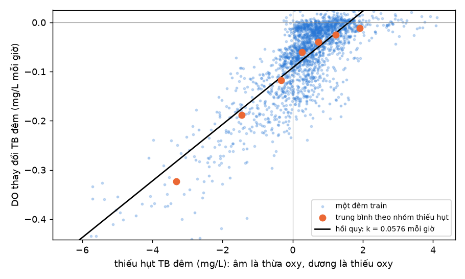

# Phân tích đặc trưng miền

Tài liệu mô tả 24 đặc trưng miền thêm vào đầu vào của mô hình trong thí nghiệm E2: mỗi đặc trưng đo cơ chế gì, tính thế nào, hằng số lấy từ đâu và đáng tin đến đâu. Mô hình dùng các đặc trưng này ra sao (nhóm nào ảnh hưởng nhiều, ở thời điểm nào, trong trạng thái nào của sông) ở [04_MODEL_TRAINING_EVALUATION.md](04_MODEL_TRAINING_EVALUATION.md) mục 8. Dữ liệu ở [01_DATASET_ANALYSIS.md](01_DATASET_ANALYSIS.md); mô hình, cách huấn luyện và chấm test ở [04_MODEL_TRAINING_EVALUATION.md](04_MODEL_TRAINING_EVALUATION.md).

## 1. Khái niệm

| Khái niệm | Nghĩa |
|---|---|
| Đặc trưng miền | Đại lượng tính bằng công thức từ kiến thức về oxy trong sông (hóa lý, sinh thái, thiên văn), từ sáu biến đo và thời điểm đo |
| E1, E2, E3 | Ba thí nghiệm dùng chung dữ liệu, chung mô hình và cách huấn luyện, chỉ khác cột đầu vào. E1: sáu biến đo và sáu cột cờ. E2: E1 cộng 24 đặc trưng miền. E3: E2 cộng đặc trưng ngữ nghĩa suy ra từ ontology |
| Nhân quả | Giá trị tại một mốc chỉ dùng số đo tại mốc đó và các mốc trước, nên hệ thống web tính được y hệt khi chạy thật |
| Trượt 24 giờ | Tính trên 96 mốc gần nhất, kết thúc ở mốc hiện tại |
| DO bão hòa | Lượng oxy tối đa nước giữ được khi cân bằng với không khí; giảm khi nước nóng lên hoặc mặn hơn |
| Thiếu hụt D | DO bão hòa trừ DO. D dương: nước thiếu oxy, hút oxy từ không khí. D âm: nước thừa oxy (thường do tảo quang hợp), oxy thoát ra không khí |
| Quang hợp GPP | Lượng oxy tảo và thực vật thủy sinh tạo ra, chỉ có khi có ánh sáng |
| Hô hấp ER | Lượng oxy sinh vật tiêu thụ, cả ngày lẫn đêm |
| Hệ số trao đổi khí k | Tốc độ oxy đi qua mặt nước (mỗi giờ), tùy độ sâu, tốc độ dòng chảy, gió; là tính chất của đoạn sông, không đo trực tiếp được |

Ranh giới với E3: đặc trưng E2 là đại lượng liên tục tính bằng công thức. Trạng thái rời rạc và khái niệm (ví dụ "đang nở hoa", "nguy cơ thiếu oxy") thuộc E3, suy ra từ luật của ontology. E2 không dùng ngưỡng hay nhãn trạng thái.

## 2. Cơ sở: cân bằng oxy trong sông

DO ở trạm có hai chế độ ([01_DATASET_ANALYSIS.md](01_DATASET_ANALYSIS.md) mục 3.3). Mùa lạnh DO gần như phẳng, biên độ trong ngày khoảng 0.5 mg/L. Tháng 7 và 8 nước trên 24 độ C, tảo nở hoa, DO lên xuống gần 3 mg/L mỗi ngày và có lúc vượt xa mức bão hòa. Biến động này do ba quá trình chi phối, viết thành phương trình cân bằng oxy của Odum (1956):

```
DO thay đổi mỗi giờ = GPP - ER + k x D
```

Quang hợp làm DO tăng ban ngày, hô hấp làm DO giảm cả ngày lẫn đêm, trao đổi khí kéo DO về mức bão hòa với tốc độ tỉ lệ với thiếu hụt. Mô hình E1 chỉ thấy sáu biến đo nên phải tự suy ra các quá trình này từ dữ liệu. E2 đưa thẳng các đại lượng của phương trình vào đầu vào: mức bão hòa và thiếu hụt (trao đổi khí), ánh sáng và quang hợp (GPP), hô hấp (ER), cùng các đại lượng mô tả chu kỳ ngày, thay đổi ngắn hạn, hóa học cacbonat, tảo, khối nước, triều và lịch.

## 3. Hằng số

Mọi hằng số thuộc một trong hai loại:
- Quy luật chung, tra công thức: công thức bão hòa oxy, công thức vị trí mặt trời, chu kỳ triều M2, tọa độ trạm.
- Tính chất riêng của đoạn sông, ước lượng từ dữ liệu train: chỉ có hệ số trao đổi khí k. Ước lượng chỉ dùng train để val và test không ảnh hưởng gián tiếp đến mô hình.

### 3.1. Ước lượng k

Ban đêm không có quang hợp, phương trình còn `DO thay đổi mỗi giờ = -ER + k x D`. Lấy trung bình trên các bước 15 phút của một đêm, mỗi đêm cho một cặp số đo được (thiếu hụt trung bình, DO thay đổi trung bình). Đặt các đêm lên đồ thị rồi kẻ đường thẳng khớp nhất (hồi quy bình phương tối thiểu): độ dốc là k, giao điểm với trục dọc là hô hấp trung bình với dấu âm. Đây là phương pháp hồi quy ban đêm của Hornberger và Kelly (1975), với một khác biệt: các đêm train được gộp vào một hồi quy chung thay vì ước lượng riêng từng đêm, nên k là một giá trị đại diện cho cả giai đoạn train.

Quy định:
- bước đêm: mặt trời dưới đường chân trời ở cả hai đầu bước, DO ở cả hai đầu là số đo thật (cờ 0);
- một đêm được dùng khi có ít nhất 16 bước (4 giờ); đêm nối hai ngày mang nhãn ngày sau;
- DO thay đổi tính bằng mg/L mỗi giờ (hiệu hai mốc chia 0.25 giờ), thiếu hụt lấy trung bình hai đầu bước.



| Đại lượng | Giá trị |
|---|---|
| k | 0.0576 mỗi giờ |
| Khoảng tin cậy 95% (bootstrap: bốc lại có lặp 1973 đêm, khớp lại, 2000 lần) | 0.0548 đến 0.0605 |
| Hô hấp trung bình ER | 0.0921 mg/L mỗi giờ |
| Hệ số tương quan r | 0.80 |
| Số đêm train | 1973 |

Nguồn: artifacts/dataset/reaeration_k.csv, reaeration_k_ci.csv.

### 3.2. Độ ổn định và độ nhạy

k thực tế thay đổi theo thời gian, vì độ sâu và tốc độ dòng chảy đổi theo lưu lượng sông (dataset không có số liệu lưu lượng). Ước lượng riêng từng giai đoạn:

| Năm | 2019 | 2020 | 2021 | 2022 | 2023 | 2024 (tháng 1 đến 5) |
|---|---|---|---|---|---|---|
| k (mỗi giờ) | 0.060 | 0.065 | 0.045 | 0.060 | 0.026 | 0.010 |

| Giai đoạn mùa | Lạnh | Xuân | Nóng | Thu |
|---|---|---|---|---|
| k (mỗi giờ) | 0.030 | 0.052 | 0.062 | 0.047 |

Một giá trị k chung vì vậy là một sự đơn giản hóa. Trên đồ thị, trung bình theo nhóm (chấm cam) cũng lệch khỏi đường thẳng ở hai đầu: hô hấp không hoàn toàn cố định mà đổi theo mùa cùng với thiếu hụt.

k chỉ đi vào hai đặc trưng er_now và gpp_now. Tính lại hai đặc trưng với k khác rồi đo tương quan với bản dùng k = 0.0576 (1 là không đổi):

| k thử | 0.010 | 0.030 | 0.040 | 0.0548 | 0.0605 | 0.080 |
|---|---|---|---|---|---|---|
| er_now | 0.60 | 0.81 | 0.91 | 0.998 | 0.998 | 0.89 |
| gpp_now | 0.998 | 0.9995 | 0.9998 | 1.000 | 1.000 | 0.9997 |

gpp_now gần như không phụ thuộc k, vì k xuất hiện hai lần với dấu ngược nhau trong công thức (mục 4.3) và gần như triệt tiêu. er_now nhạy hơn nhưng vẫn giữ tương quan 0.998 trong khoảng tin cậy. Nguồn: artifacts/dataset/reaeration_k_by_period.csv, reaeration_k_sensitivity.csv.

Hô hấp không được quy đổi theo nhiệt độ: er_now là hô hấp của đêm gần nhất, và nhiệt độ hiện tại chỉ lệch nhiệt độ trung bình của đêm đó trung vị 0.30 độ C (95% số mốc lệch không quá 1.04 độ C), nên phép quy đổi gần như không làm thay đổi giá trị (artifacts/dataset/er_temp_offset.csv).

## 4. Danh sách 24 đặc trưng

Ký hiệu: DO, T (nhiệt độ nước, độ C), pH, SpC (độ dẫn, uS/cm), chl (huỳnh quang chlorophyll, ug/L) là giá trị đã làm sạch tại mốc hiện tại; "hiệu h giờ" là giá trị hiện tại trừ giá trị h giờ trước (bằng 0 khi chưa có mốc đó ở đầu chuỗi). Mỗi tiểu mục là một nhóm cơ chế; ảnh hưởng của các đặc trưng lên dự báo được phân tích theo các nhóm này ở [04_MODEL_TRAINING_EVALUATION.md](04_MODEL_TRAINING_EVALUATION.md) mục 8.

### 4.1. Bão hòa: do_sat_mgl, do_sat_pct, do_deficit

| Cột | Công thức | Ý nghĩa |
|---|---|---|
| do_sat_mgl | DO bão hòa theo Benson và Krause (1984) | Nước nóng giữ ít oxy hơn: khoảng 11 mg/L ở 10 độ C, dưới 8 mg/L ở 28 độ C |
| do_sat_pct | 100 x DO / do_sat_mgl | Trên 100% là thừa oxy; trên 150% là dấu hiệu tảo nở hoa |
| do_deficit | do_sat_mgl - DO | Chiều và lực của trao đổi khí với không khí |

Công thức bão hòa (mg/L), với TK = T + 273.15 và độ mặn S tính gần đúng từ độ dẫn theo thang PSS-78 ở 25 độ C:

```
R = SpC / 53087
S = 0.0120 - 0.2174 R^0.5 + 25.3283 R + 13.7714 R^1.5 - 6.4788 R^2 + 2.5842 R^2.5
ln(DO bão hòa) = -139.34411 + 1.575701e5/TK - 6.642308e7/TK^2 + 1.243800e10/TK^3 - 8.621949e11/TK^4
                 - S x (0.017674 - 10.754/TK + 2140.7/TK^2)
```

Áp suất lấy 1 atm vì trạm không đo áp suất khí quyển; trạm nằm gần mực nước biển. USGS dùng công thức Benson và Krause làm chuẩn từ năm 2011 (USGS Office of Water Quality Technical Memorandum 2011.03).

### 4.2. Ánh sáng: light

Trạm không có cảm biến ánh sáng, nên dùng ánh sáng thiên văn: light = sin của độ cao mặt trời, bằng 0 khi mặt trời dưới chân trời. Độ cao mặt trời tính từ thời điểm (giờ PST) và tọa độ trạm; xích vĩ và phương trình thời gian theo chuỗi Fourier của Spencer (1971). Đây là ánh sáng khi trời quang, không tính mây; cách mô hình hóa ánh sáng từ vị trí mặt trời khi không có cảm biến cũng được dùng trong gói streamMetabolizer của USGS.

### 4.3. Quang hợp và hô hấp: gpp_now, er_now

Hai đặc trưng dùng phương trình cân bằng oxy (mục 2) và k (mục 3).

| Cột | Cách tính | Ý nghĩa |
|---|---|---|
| er_now | Trên các bước đêm trong 24 giờ qua: k x TB(thiếu hụt) - TB(DO thay đổi mỗi giờ). Khi 24 giờ qua chưa đủ 16 bước đêm thì giữ giá trị trước | Tốc độ tiêu thụ oxy của đêm gần nhất (mg/L mỗi giờ) |
| gpp_now | GPP 24 giờ qua chia tổng ánh sáng 24 giờ qua, nhân light hiện tại | Lượng oxy quang hợp kỳ vọng lúc này (mg/L mỗi giờ) |

GPP 24 giờ qua suy ra từ cân bằng oxy trên 24 giờ:

```
GPP 24 giờ = (DO hiện tại - DO 24 giờ trước) - k x tổng(thiếu hụt x 0.25 giờ) + 24 x er_now
```

Vế đầu là thay đổi DO thực tế, vế giữa bỏ phần oxy do trao đổi khí, vế cuối cộng lại phần đã bị hô hấp tiêu thụ. Vì er_now cũng chứa k với dấu dương, ảnh hưởng của k lên gpp_now gần như triệt tiêu (mục 3.2). Tổng ánh sáng là tổng light x 0.25 giờ trên 96 mốc. 24 giờ đầu chuỗi gpp_now ghi 0.

### 4.4. Chu kỳ ngày của DO: do_change_24h, do_std_24h, do_anom_24h

| Cột | Công thức | Ý nghĩa |
|---|---|---|
| do_change_24h | DO hiệu 24 giờ | So với cùng giờ hôm qua: xu hướng nhiều ngày, đã loại nhịp ngày đêm |
| do_std_24h | Độ lệch chuẩn mẫu của DO trượt 24 giờ | Biên độ dao động ngày đêm, cao khi tảo hoạt động mạnh |
| do_anom_24h | DO - trung bình DO trượt 24 giờ | DO đang ở trên hay dưới mức trung bình ngày |

### 4.5. Thay đổi ngắn hạn: do_change_1h, do_change_3h, temp_change_3h

DO hiệu 1 giờ, DO hiệu 3 giờ, T hiệu 3 giờ: DO và nhiệt độ đang tăng hay giảm và nhanh thế nào.

### 4.6. Cacbonat: ph_change_3h, ph_change_24h

pH hiệu 3 giờ và hiệu 24 giờ. Khi tảo quang hợp, chúng lấy CO2 khỏi nước làm pH tăng; khi hô hấp chiếm ưu thế, CO2 tăng làm pH giảm. pH vì vậy là bằng chứng độc lập về hoạt động của tảo (DO và pH tương quan 0.68 trên toàn chuỗi, [01_DATASET_ANALYSIS.md](01_DATASET_ANALYSIS.md) mục 3.1).

### 4.7. Tảo: log_chl

log_chl = ln(chl), chl chặn dưới ở 0.1 ug/L (giá trị nhỏ nhất có trong dữ liệu, nên không có ô nào bị chặn). Logarit nén các đợt nở hoa (chl đến 123.5 ug/L) để mức thấp và mức cao cùng đọc được.

### 4.8. Vận chuyển: spc_change_24h

SpC hiệu 24 giờ. Độ dẫn phản ánh nguồn nước (thấp khi nước lớn, cao khi dòng chảy kiệt), nên thay đổi nhanh của độ dẫn cho biết một khối nước khác đang chảy tới trạm.

### 4.9. Triều: m2_sin, m2_cos

sin và cos của 2 pi x (số giờ từ 2019-01-01 00:00 PST) / 12.4206. Trạm nằm ở đoạn sông chịu ảnh hưởng triều; M2 là thành phần triều bán nhật chính do mặt trăng, chu kỳ 12.4206 giờ.

### 4.10. Lịch: hour_sin, hour_cos, hour2_sin, hour2_cos, doy_sin, doy_cos

Với ngày = (giờ + phút / 60) / 24 và năm = (thứ tự ngày trong năm - 1 + ngày) / 365.25:

| Cột | Công thức | Ý nghĩa |
|---|---|---|
| hour_sin, hour_cos | sin, cos của 2 pi x ngày | Giờ trong ngày, chu kỳ 24 giờ; sin và cos để 23:45 nằm sát 00:00 |
| hour2_sin, hour2_cos | sin, cos của 4 pi x ngày | Họa tần 12 giờ: đường DO trong ngày không đối xứng (lên nhanh buổi chiều, xuống chậm cả đêm) |
| doy_sin, doy_cos | sin, cos của 2 pi x năm | Vị trí trong năm |

## 5. Ví dụ tính trên một dòng thật

Mốc 2021-07-15 15:00 (train, chiều mùa nóng): DO 9.49 mg/L, nhiệt độ 22.37 độ C, độ dẫn 144 uS/cm, chl 2.88 ug/L; k = 0.057569 mỗi giờ.

| Cột | Tính | Giá trị |
|---|---|---|
| do_sat_mgl | Công thức mục 4.1 với 22.37 độ C, 144 uS/cm | 8.678 mg/L |
| do_deficit | 8.678 - 9.49 | -0.812 mg/L (nước thừa oxy) |
| do_sat_pct | 100 x 9.49 / 8.678 | 109.4% |
| light | sin độ cao mặt trời lúc 15:00 ngày 15 tháng 7 | 0.770 |
| er_now | Đêm 14 sang 15 có 37 bước đêm, thiếu hụt TB -0.364116, DO thay đổi TB -0.075676 mỗi giờ: 0.057569 x (-0.364116) - (-0.075676) | 0.0547 mg/L mỗi giờ |
| gpp_now | DO 24 giờ trước 9.36; tổng(thiếu hụt x 0.25) = -9.078; GPP 24 giờ = 0.13 + 0.057569 x 9.078 + 24 x 0.0547 = 1.966 mg/L; tổng ánh sáng 24 giờ 8.598; 1.966 / 8.598 x 0.770 | 0.176 mg/L mỗi giờ |
| log_chl | ln(2.88) | 1.058 |

Đầy đủ 24 cột và các đại lượng trung gian của dòng này: artifacts/dataset/domain_example.csv.

## 6. Dữ liệu E2

- File: dataset/base_domain_splits/{train,val,test}.csv, mỗi dòng là dòng tương ứng của base_splits (chép nguyên văn) nối thêm 24 cột theo thứ tự mục 4, ghi 6 chữ số thập phân. Tạo bằng scripts/build_domain_splits.py; k ghi trong artifacts/dataset/reaeration_k.csv và được dùng lại nguyên giá trị đó (hệ thống web cũng đọc từ file này).
- Đặc trưng tính trên chuỗi nối ba tập, liên tục qua ranh giới tập, như khi hệ thống chạy liên tục.
- Đầu vào mô hình E2 có 36 cột: sáu biến và 24 đặc trưng (chuẩn hóa), rồi sáu cột cờ. Đặc trưng không có cột cờ riêng: trong khoảng trống chúng được tính từ giá trị đã điền, và cờ của sáu biến cho mô hình biết điều đó.
- scripts/verify_dataset.py tính lại k và cả 24 đặc trưng độc lập, chỉ bằng thư viện chuẩn Python, và so từng ô với file (lệch tối đa cho phép 2e-6, do làm tròn 6 chữ số).

## 7. Hạn chế

- k là một giá trị cho cả giai đoạn train trong khi k thực tế đổi theo năm và mùa (mục 3.2); không có số liệu lưu lượng để mô hình hóa sự thay đổi này.
- Ánh sáng là ánh sáng thiên văn khi trời quang, không tính mây và độ đục.
- chl là huỳnh quang đo tại chỗ, chỉ thị gián tiếp lượng tảo, không phải chlorophyll-a chiết xuất.
- DO bão hòa tính ở 1 atm, độ mặn gần đúng từ độ dẫn.

## 8. Tài liệu tham khảo

1. Benson, B. B., and Krause, D. (1984). The concentration and isotopic fractionation of oxygen dissolved in freshwater and seawater in equilibrium with the atmosphere. Limnology and Oceanography, 29(3), 620-632.
2. U.S. Geological Survey (2011). Change to solubility equations for oxygen in water. Office of Water Quality Technical Memorandum 2011.03. https://water.usgs.gov/water-resources/memos/documents/WQ.2011.03.pdf
3. Odum, H. T. (1956). Primary production in flowing waters. Limnology and Oceanography, 1(2), 102-117.
4. Hornberger, G. M., and Kelly, M. G. (1975). Atmospheric reaeration in a river using productivity analysis. Journal of the Environmental Engineering Division, 101(5), 729-739.
5. Spencer, J. W. (1971). Fourier series representation of the position of the sun. Search, 2(5), 172.
6. U.S. Geological Survey. streamMetabolizer (gói R ước lượng trao đổi chất dòng sông), hàm calc_light. https://doi-usgs.github.io/streamMetabolizer/reference/calc_light.html
