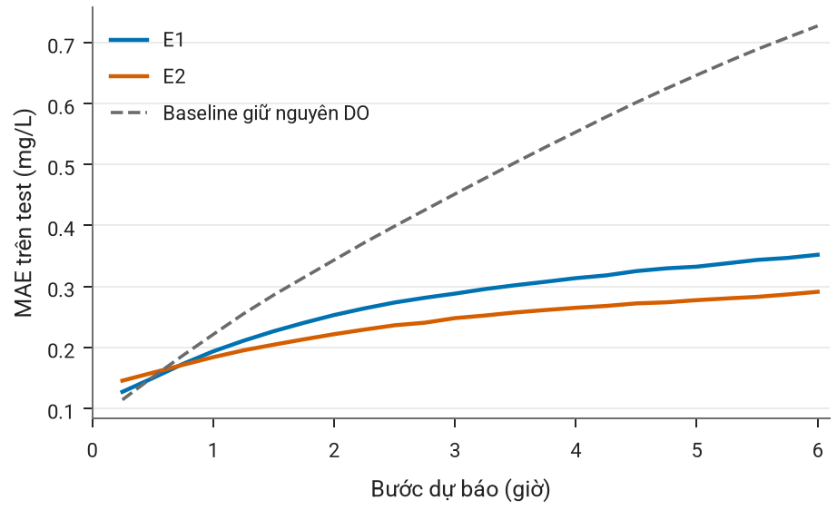
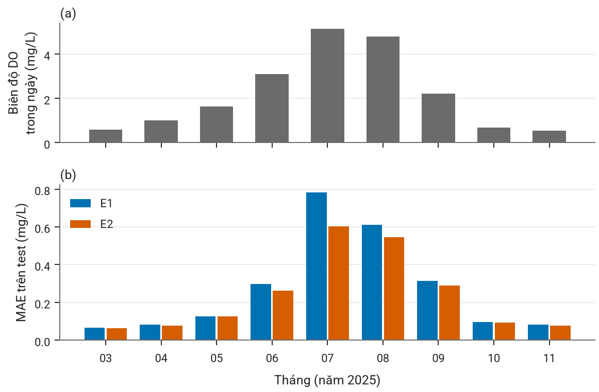
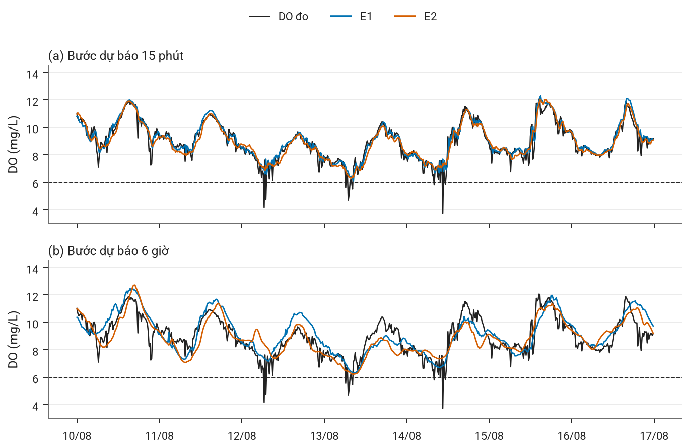
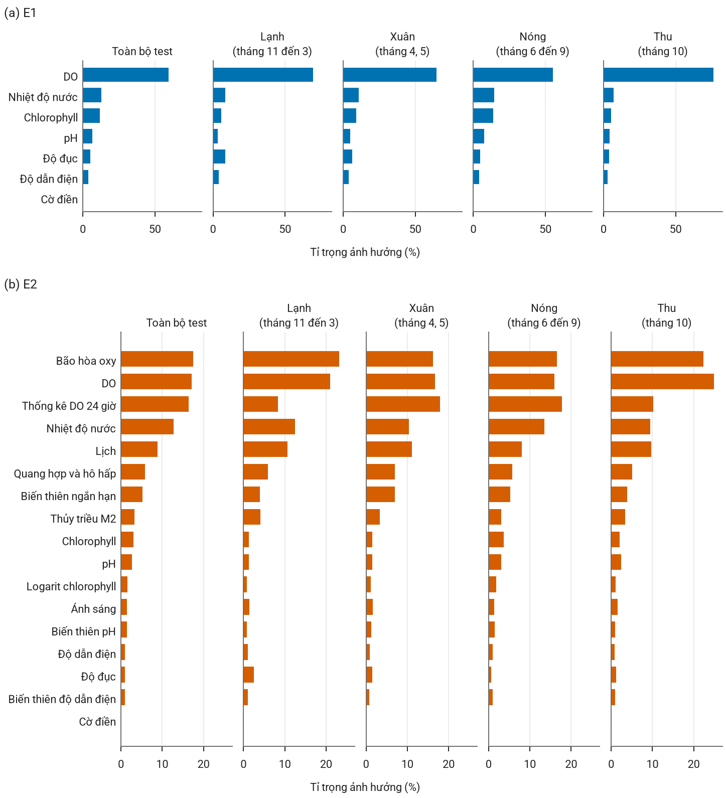

# Huấn luyện và đánh giá mô hình

Tài liệu này mô tả cách tạo mẫu học từ chuỗi đã làm sạch, mô hình dự báo, quy trình huấn luyện, chọn cấu hình và chấm test, kết quả trên test và phân tích ảnh hưởng của đầu vào lên dự báo. Ba thí nghiệm E1, E2, E3 dùng chung toàn bộ quy trình và chỉ khác cột đầu vào, nên chênh lệch kết quả giữa chúng là do đầu vào. Thuật ngữ chung (mốc, thời điểm dự báo, cửa sổ, bước dự báo, ...) ở [README.md](README.md) mục 2.

## 1. Khái niệm và chỉ số đánh giá

**Bảng 1.** Khái niệm về huấn luyện.

| Khái niệm | Nghĩa |
|---|---|
| Trọng số, siêu tham số | Trọng số là các số mô hình tự học từ dữ liệu; siêu tham số là thông số đặt trước khi học (số nơ-ron, tốc độ học, dropout) |
| Epoch | Một lượt học hết mọi cửa sổ train |
| Quá khớp | Mô hình học thuộc dữ liệu train: sai số trên train vẫn giảm nhưng sai số trên dữ liệu chưa thấy tăng lên |
| Dừng sớm | Sau mỗi epoch đo sai số trên val; giữ trọng số của epoch tốt nhất và dừng khi nhiều epoch liền không tốt hơn |
| Seed | Số khởi tạo ngẫu nhiên (trọng số ban đầu, thứ tự mẫu). Mỗi cấu hình chạy 3 seed và báo cáo trung bình |

Sai số tính trên các điểm đánh giá. Một điểm đánh giá là một bước dự báo của một cửa sổ mà tại đó DO là số đo thật (cờ điền bằng 0). Với $n$ điểm, DO đo $y_i$, DO dự báo $\hat{y}_i$ và $\bar{y}$ là trung bình của $y_i$:

$$\mathrm{MAE} = \frac{1}{n}\sum_{i=1}^{n}\left\lvert \hat{y}_i - y_i \right\rvert, \qquad \mathrm{RMSE} = \sqrt{\frac{1}{n}\sum_{i=1}^{n}\left(\hat{y}_i - y_i\right)^2}, \qquad R^2 = 1 - \frac{\sum_{i}\left(\hat{y}_i - y_i\right)^2}{\sum_{i}\left(y_i - \bar{y}\right)^2} \tag{1}$$

MAE và RMSE tính bằng mg/L; RMSE nặng hơn MAE với các lần sai lớn; $R^2$ bằng 1 khi dự báo đúng hoàn toàn.

Khi so hai thí nghiệm trên cùng một tập điểm, thay đổi MAE của E2 so với E1 (%) là:

$$\Delta\mathrm{MAE} = 100\left(\frac{\mathrm{MAE}_{E2}}{\mathrm{MAE}_{E1}} - 1\right) \tag{2}$$

$\Delta\mathrm{MAE}$ âm nghĩa là E2 sai ít hơn E1; ví dụ -13.2 nghĩa là MAE của E2 thấp hơn của E1 13.2%. Thay đổi RMSE tính cùng cách.

Khi chia các điểm đánh giá thành nhóm (theo giai đoạn mùa, theo trạng thái bão hòa, ...), hai tỉ lệ được dùng; trong một cách chia, mỗi tỉ lệ cộng lại bằng 100% trên các nhóm:
- Phần trăm số điểm của một nhóm: số điểm đánh giá thuộc nhóm chia tổng số điểm đánh giá của test, nhân 100.
- Phần trăm tổng sai số của một nhóm: tổng độ lệch tuyệt đối $\lvert \hat{y}_i - y_i \rvert$ trên các điểm thuộc nhóm chia tổng đó trên mọi điểm của test, nhân 100. Nhóm có phần trăm tổng sai số lớn hơn hẳn phần trăm số điểm là nơi mô hình yếu.

## 2. Cửa sổ và cấu hình dự báo

Với cấu hình chính (đầu vào 24 giờ, dự báo 6 giờ), cửa sổ có thời điểm dự báo 12:00 dùng dữ liệu từ 12:00 hôm trước đến 11:45 làm đầu vào và DO từ 12:00 đến 17:45 làm nhãn. Cửa sổ tiếp theo có thời điểm dự báo 12:15.

**Bảng 2.** Hai cấu hình dự báo.

| Cấu hình | Đầu vào | Nhãn | Vai trò |
|---|---|---|---|
| 24 giờ, 6 giờ | 96 mốc | 24 mốc | Chính: cảnh báo sớm trong vài giờ |
| 7 ngày, 24 giờ | 672 mốc | 96 mốc | Phụ: dự báo trọn một chu kỳ ngày đêm; chưa có kết quả |

Đầu vào 24 giờ chứa trọn một chu kỳ ngày đêm. Khoảng dự báo 6 giờ bằng một phần tư chu kỳ, đủ dài để DO thay đổi đáng kể so với số đo hiện tại. Ở các tháng mùa nóng, độ lớn điển hình của thay đổi DO sau 6 giờ (căn bậc hai của trung bình bình phương) là 0.85 đến 1.52 mg/L, khoảng một nửa biên độ DO trong ngày của chính các tháng đó (1.40 đến 2.98 mg/L). Nguồn: artifacts/dataset/monthly_dynamics.csv, cột do_change_6h_rms và diel_range_median. Vì vậy, trong khoảng này giữ nguyên số đo hiện tại sẽ sai đáng kể, và một cảnh báo được đưa ra trước tới 6 giờ. Dữ liệu không chỉ ra một độ dài duy nhất: 6 giờ là lựa chọn của đồ án trong các khoảng đủ dài như vậy, còn khoảng dài hơn (24 giờ) được xét ở cấu hình phụ.

Quy tắc tạo cửa sổ (scripts/common.py, hàm window_starts): nhãn nằm trọn trong một tập, còn đầu vào được lấy dữ liệu cuối của tập liền trước vì đó là quá khứ; cửa sổ mà nhãn không có mốc DO đo thật nào bị bỏ, vì không có gì để tính sai số ([02_DATA_CLEANING.md](02_DATA_CLEANING.md) mục 3.3).

**Bảng 3.** Số cửa sổ dùng được trên số cửa sổ có thể tạo. Cửa sổ dùng được là cửa sổ còn lại sau khi bỏ các cửa sổ mà nhãn không có DO đo thật.

| Cấu hình | Train | Val | Test |
|---|---|---|---|
| 24 giờ, 6 giờ | 189345 trên 189769 | 26185 trên 26185 | 26377 trên 26377 |
| 7 ngày, 24 giờ | 188896 trên 189121 | 26113 trên 26113 | 26305 trên 26305 |

Nguồn: artifacts/dataset/split_counts.csv, mỗi dòng một tập; cột cua_so_24h_6h, bo_24h_6h (cấu hình 24 giờ, 6 giờ) và cua_so_7d_24h, bo_7d_24h (cấu hình 7 ngày, 24 giờ). Số cửa sổ dùng được bằng số có thể tạo trừ số bị bỏ; ví dụ train, cấu hình 24 giờ, 6 giờ: 189769 - 424 = 189345. scripts/verify_dataset.py đếm lại độc lập từ dataset/base_splits/ và so với file này.

## 3. Đầu vào

**Bảng 4.** Đầu vào mỗi mốc của ba thí nghiệm.

| Thí nghiệm | Cột đầu vào | Số cột | Dữ liệu |
|---|---|---|---|
| E1 | 6 biến đo, 6 cờ điền | 12 | dataset/base_splits/ |
| E2 | E1 và 24 đặc trưng miền ([03_DOMAIN_FEATURES_ANALYSIS.md](03_DOMAIN_FEATURES_ANALYSIS.md)) | 36 | dataset/base_domain_splits/ |
| E3 | E1 và đặc trưng ngữ nghĩa suy ra từ ontology | chưa có | dataset/base_semantic_splits/ (đang xây dựng) |

Mỗi cột số được chuẩn hóa: trừ trung bình, chia độ lệch chuẩn, cả hai tính trên dữ liệu huấn luyện (train, hoặc train và val khi huấn luyện lại, mục 6.4). Cột cờ điền giữ nguyên 0 và 1.

## 4. Mô hình và hàm mất mát

Mô hình là mạng hồi quy LSTM (Long Short-Term Memory, Hochreiter và Schmidhuber 1997), ở dạng có cổng quên do Gers và cộng sự (2000) bổ sung, là dạng mà PyTorch cài đặt. LSTM đọc lần lượt 96 mốc đầu vào theo thứ tự thời gian; tại mỗi mốc, các cổng của nó quyết định giữ, quên hay thêm thông tin vào trạng thái ẩn. Trạng thái ẩn ở mốc cuối tóm tắt 24 giờ quá khứ và đi qua một lớp tuyến tính để ra 24 giá trị DO cùng lúc. Đây là dự báo trực tiếp nhiều bước: dự báo bước trước không được dùng làm đầu vào cho bước sau, nên sai số không tích lũy qua các bước.

**Bảng 5.** Thiết lập mô hình.

| Thành phần | Thiết lập |
|---|---|
| Kiến trúc | LSTM 2 lớp, 128 nơ-ron ẩn, dropout 0.3 giữa hai lớp, lớp tuyến tính ra 24 giá trị |
| Số trọng số | E1 207896, E2 220184 (chỉ khác ở lớp đầu, do số cột đầu vào) |
| Hàm mất mát | Bình phương sai số trung bình trên các điểm có DO đo thật |

Nguồn số trọng số: config.json của mỗi lần chạy, khóa n_params (ví dụ artifacts/runs/lstm_24h_6h/final/base_s0/config.json và domain_s0/config.json).

Dropout chống quá khớp bằng cách ngẫu nhiên tắt 30% tín hiệu giữa hai lớp ở mỗi lần cập nhật khi huấn luyện; khi dự báo không tắt tín hiệu nào.

## 5. Huấn luyện

**Bảng 6.** Thiết lập huấn luyện.

| Thành phần | Thiết lập |
|---|---|
| Tối ưu | AdamW (Loshchilov và Hutter 2019), tốc độ học 0.001, weight decay 0.0001 |
| Lô | 256 cửa sổ, xáo trộn thứ tự mỗi epoch |
| Ổn định | Cắt chuẩn gradient ở 1.0 |
| Dừng | Tối đa 50 epoch; dừng sớm theo MAE trên val khi 5 epoch liền không giảm quá 0.0001 mg/L |
| Lặp lại | 3 seed (0, 1, 2); cùng seed trên cùng máy cho kết quả trùng từng bit |

Mã nguồn: scripts/train.py (huấn luyện có dừng sớm), scripts/tune.py (dò siêu tham số), scripts/training_curves.py (quá trình huấn luyện), scripts/final_train.py (huấn luyện lại và chấm test).

## 6. Chọn cấu hình và chấm test

### 6.1. Vai trò của ba tập

1. Mọi thông số tính từ dữ liệu (trung bình và độ lệch chuẩn để chuẩn hóa, hệ số trao đổi khí $k$ của đặc trưng miền) chỉ tính trên dữ liệu huấn luyện. $k$ ước lượng trên train và giữ cố định.
2. Val dùng để dừng sớm và chọn siêu tham số.
3. Test chấm đúng một lần, sau khi mọi thiết lập đã cố định. Mọi so sánh giữa các thí nghiệm và mọi phân tích ảnh hưởng trong tài liệu này tính trên test.
4. Các thí nghiệm dùng chung cửa sổ, ranh giới tập và siêu tham số.

### 6.2. Dò siêu tham số

Lưới dò trên val với E1 (scripts/tune.py): tốc độ học 0.001 và 0.0003, 64 và 128 nơ-ron, dropout 0.1 và 0.3, tức 8 cấu hình, mỗi cấu hình 3 seed (Bảng 7).

**Bảng 7.** Lưới dò siêu tham số trên val (E1), đủ 8 cấu hình, xếp theo MAE val tăng dần. Epoch tốt nhất của một seed là epoch có MAE val thấp nhất.

| Tốc độ học, nơ-ron, dropout | MAE val, trung bình 3 seed (mg/L) | Độ lệch chuẩn của MAE val giữa 3 seed (mg/L) | Epoch tốt nhất của seed 0, 1, 2 |
|---|---|---|---|
| 0.001, 128, 0.1 | 0.2320 | 0.0033 | 5, 6, 3 |
| 0.001, 128, 0.3 | 0.2336 | 0.0050 | 9, 6, 6 |
| 0.0003, 128, 0.3 | 0.2365 | 0.0020 | 7, 6, 7 |
| 0.0003, 128, 0.1 | 0.2385 | 0.0053 | 9, 11, 5 |
| 0.001, 64, 0.1 | 0.2388 | 0.0010 | 7, 4, 3 |
| 0.001, 64, 0.3 | 0.2438 | 0.0010 | 12, 4, 7 |
| 0.0003, 64, 0.3 | 0.2488 | 0.0033 | 10, 10, 7 |
| 0.0003, 64, 0.1 | 0.2507 | 0.0015 | 11, 4, 7 |

Nguồn: artifacts/runs/lstm_24h_6h/tuning/tuning.csv, mỗi dòng một cấu hình của lưới; cột lr, hidden, dropout, MAE_tb, MAE_sd, epoch_tot_nhat.

Chênh lệch MAE giữa hai cấu hình đầu (0.0016 mg/L) nhỏ hơn độ lệch giữa các seed. Dropout 0.3 được chọn vì mô hình đạt tốt nhất muộn hơn, tức quá khớp chậm hơn. E2 và E3 dùng nguyên siêu tham số này, không dò lại, để chênh lệch giữa các thí nghiệm chỉ do đầu vào.

### 6.3. Quá trình huấn luyện

Để thấy mô hình học thế nào, mỗi thí nghiệm được huấn luyện thêm một lần đủ 15 epoch, không dừng sớm, cùng seed và siêu tham số (các epoch đầu trùng khít lần có dừng sớm), ghi sai số trên train và val sau mỗi epoch. 15 epoch phủ hết lần chạy có dừng sớm dài nhất: epoch tốt nhất 9 cộng 5 epoch chờ, tức 14 epoch (Bảng 8).

**Hình 1.** Sai số theo epoch, trung bình 3 seed. (a) MSE trên train, tính trên DO đã chuẩn hóa (trừ trung bình, chia độ lệch chuẩn của DO trên train, mục 3) nên không có đơn vị; đây là giá trị hàm mất mát; (b) MAE trên val, trung bình 24 bước; (c) MAE trên val ở bước 15 phút và bước 6 giờ. Nguồn: artifacts/analysis/training_curves.csv, mỗi dòng một thí nghiệm (cột bo), một seed và một epoch; cột train_mse (a), val_MAE (b), MAE_b1 và MAE_b24 (c). Số trong hình và trong các ý dưới là trung bình 3 dòng seed 0, 1, 2 có cùng bo và epoch.

- Sai số trên train giảm đều qua mọi epoch, còn sai số trên val giảm rồi tăng lại: phần tăng là quá khớp, và dừng sớm giữ trọng số ở đáy của đường val. MAE val thấp nhất ở epoch 6 với E1 (0.237) và epoch 2 với E2 (0.207).
- E2 học nhanh hơn: sau 1 epoch, MAE val của E2 (0.213) đã thấp hơn mức tốt nhất của E1. Ở bước 6 giờ, E2 gần như đạt mức cuối ngay epoch 1 (0.262), vì các đặc trưng miền đã chứa sẵn thông tin về chu kỳ ngày đêm.
- E2 quá khớp sớm hơn: từ epoch 4, sai số val của mọi bước tăng dần.
- Ở bước 15 phút, E2 kém E1 (0.118 ở epoch 3 so với 0.101 ở epoch 6 của E1); học thêm không thu hẹp khoảng cách này vì khi đó mọi bước của E2 đều kém đi.

### 6.4. Huấn luyện lại trên train và val

Sau khi cố định siêu tham số, mỗi thí nghiệm được huấn luyện lại trên train và val (2019-01-01 đến 2025-02-28), để mô hình học cả mùa nóng 2024 trước khi dự báo năm 2025. Khi đó không còn tập nào để dừng sớm, nên số epoch được cố định trước: bằng trung bình epoch tốt nhất của 3 lần huấn luyện có dừng sớm, làm tròn.

**Bảng 8.** Số epoch khi huấn luyện lại.

| Thí nghiệm | Epoch tốt nhất trên val (seed 0, 1, 2) | MAE val ở epoch tốt nhất (mg/L) | Số epoch huấn luyện lại |
|---|---|---|---|
| E1 | 9, 6, 6 | 0.2354, 0.2374, 0.2280 | 7 |
| E2 | 2, 4, 3 | 0.2079, 0.2044, 0.2035 | 3 |

Nguồn: history.csv và metrics.json trong artifacts/runs/lstm_24h_6h/tuning/lr0.001_h128_do0.3_s0 đến s2 (E1) và artifacts/runs/lstm_24h_6h/domain/ (E2).

### 6.5. Chấm test

Mô hình huấn luyện lại dự báo mọi cửa sổ test; MAE, RMSE, $R^2$ tính cho từng seed rồi lấy trung bình 3 seed. scripts/final_train.py bỏ qua thí nghiệm và seed đã được chấm, để test chỉ được chấm một lần; tùy chọn --verify huấn luyện lại vào thư mục tạm để kiểm tra tái lập mà không chấm lại ([README.md](README.md) mục 6.3).

## 7. Kết quả trên test

Baseline giữ nguyên DO dự báo mọi bước bằng DO đo mới nhất, không học gì từ dữ liệu. Các bảng và hình của mục này lấy từ các file error_*.csv trong artifacts/analysis/ (scripts/error_analysis.py); mỗi bảng, hình ghi file, dòng và cột của nó. Mọi cột thay_doi_pct_E2 trong các file này là thay đổi MAE của E2 so với E1, công thức (2).

### 7.1. Tổng quát

**Bảng 9.** Sai số trên test, trung bình 3 seed (trong ngoặc: độ lệch chuẩn giữa seed).

| Thí nghiệm | MAE (mg/L) | RMSE (mg/L) | $R^2$ |
|---|---|---|---|
| Baseline giữ nguyên DO | 0.4511 | 0.7487 | 0.7453 |
| E1 | 0.2743 (0.0080) | 0.4988 (0.0189) | 0.8868 (0.0085) |
| E2 | 0.2381 (0.0066) | 0.4150 (0.0104) | 0.9217 (0.0040) |

Nguồn: artifacts/analysis/error_overall.csv, dòng bo = giu_nguyen, E1, E2; cột MAE, RMSE, R2 và MAE_sd, RMSE_sd, R2_sd (độ lệch chuẩn giữa seed). Số của E1 và E2 trùng bảng chấm test artifacts/runs/lstm_24h_6h/final/test_tb.csv; từng seed ở final/test.csv.

So với E1, E2 giảm MAE 13.2% và RMSE 16.8% (error_overall.csv, dòng bo = E2, cột thay_doi_MAE_pct và thay_doi_RMSE_pct; ví dụ RMSE: 100 x (0.4150 / 0.4988 - 1) = -16.8%). RMSE giảm nhiều hơn MAE nghĩa là phần giảm tập trung ở các lần sai lớn. Chênh lệch MAE giữa E1 và E2 (0.2743 - 0.2381 = 0.036 mg/L) lớn gấp khoảng 5 lần độ lệch chuẩn giữa các seed (0.0080 với E1, 0.0066 với E2).

### 7.2. Theo bước dự báo

**Hình 2.** MAE trên test theo bước dự báo, từ 15 phút đến 6 giờ. Nguồn: artifacts/analysis/error_by_step.csv, mỗi dòng một bước (buoc 1 đến 24; phut là số phút sau số đo mới nhất); cột MAE_E1, MAE_E2, MAE_giu_nguyen (baseline); thay đổi MAE ở các ý dưới là cột thay_doi_pct_E2.

- Ở bước 15 phút, baseline (0.114) tốt hơn cả E1 (0.127) và E2 (0.145): trong 15 phút DO gần như chưa kịp thay đổi. Mô hình tốt hơn baseline từ bước 30 phút (E1) và 45 phút (E2). Ở bước 6 giờ, MAE của E1 (0.352) và E2 (0.291) chỉ bằng khoảng một nửa và hai phần năm của baseline (0.727).
- E2 kém E1 ở hai bước đầu (15 phút: 14.5%; 30 phút: 5.9%), ngang ở bước 45 phút và tốt hơn từ bước 1 giờ; ở bước 6 giờ E2 giảm MAE 17.3% so với E1.

### 7.3. Theo giai đoạn mùa và trạng thái bão hòa

Mỗi điểm đánh giá được xếp nhóm theo hai cách. Cả hai cách chia đều xác định được tại thời điểm dự báo và không dùng đến sai số:
- Theo giai đoạn mùa của thời điểm dự báo. Định nghĩa và căn cứ chia ở [01_DATASET_ANALYSIS.md](01_DATASET_ANALYSIS.md) mục 3.3. Test kéo dài từ tháng 3 đến tháng 11, nên mùa lạnh của test chỉ gồm tháng 3 và tháng 11.
- Theo phần trăm bão hòa oxy ở mốc cuối của đầu vào (số đo mới nhất trước thời điểm dự báo), chia tại 100%. Đây là ranh giới vật lý của phương trình (1) ở [03_DOMAIN_FEATURES_ANALYSIS.md](03_DOMAIN_FEATURES_ANALYSIS.md): dưới 100%, nước thiếu oxy so với cân bằng và oxy từ không khí hòa vào; từ 100%, nước thừa oxy, thường do quang hợp, và oxy thoát ra không khí.

**Bảng 10.** MAE trên test theo giai đoạn mùa của thời điểm dự báo.

| Giai đoạn mùa | Phần trăm số điểm (%) | Phần trăm tổng sai số của E1 (%) | MAE E1 (mg/L) | MAE E2 (mg/L) | Thay đổi MAE (%) |
|---|---|---|---|---|---|
| Lạnh (tháng 11 đến 3) | 22.1 | 6.0 | 0.074 | 0.069 | -6.5 |
| Xuân (tháng 4, 5) | 22.2 | 8.5 | 0.104 | 0.102 | -2.7 |
| Nóng (tháng 6 đến 9) | 44.4 | 81.6 | 0.504 | 0.427 | -15.3 |
| Thu (tháng 10) | 11.3 | 3.9 | 0.096 | 0.093 | -2.6 |

Nguồn: artifacts/analysis/error_by_condition.csv, các dòng nhom = mua (cột khoang: lanh, xuan, nong, thu); cột ti_le_diem_pct, ti_le_sai_so_pct_E1, MAE_E1, MAE_E2, thay_doi_pct_E2.

**Bảng 11.** MAE trên test theo trạng thái bão hòa oxy ở số đo mới nhất trước thời điểm dự báo.

| Trạng thái bão hòa | Phần trăm số điểm (%) | Phần trăm tổng sai số của E1 (%) | MAE E1 (mg/L) | MAE E2 (mg/L) | Thay đổi MAE (%) |
|---|---|---|---|---|---|
| Dưới 100% (nước thiếu oxy) | 55.8 | 28.5 | 0.140 | 0.129 | -7.7 |
| Từ 100% (nước thừa oxy) | 44.2 | 71.5 | 0.444 | 0.375 | -15.4 |

Nguồn: artifacts/analysis/error_by_condition.csv, các dòng nhom = bao_hoa (cột khoang: duoi_100, tu_100); cùng các cột như Bảng 10.

Ba đại lượng phần trăm định nghĩa ở mục 1; trong mỗi bảng, hai cột phần trăm đầu cộng lại bằng 100%. Trong một seed, phần trăm tổng sai số của một nhóm bằng phần trăm số điểm nhân MAE của nhóm chia MAE của toàn test; số trong bảng là trung bình 3 seed. Ví dụ, mùa nóng của E1: 44.4 x 0.504 / 0.2743 = 81.6% (0.2743 là MAE của E1 trên toàn test, Bảng 9).

- Điểm yếu chính của E1 là mùa nóng (Bảng 10) và nước thừa oxy (Bảng 11): mùa nóng chiếm 44.4% số điểm nhưng 81.6% tổng sai số của E1; bão hòa oxy từ 100% chiếm 44.2% số điểm nhưng 71.5% tổng sai số. Hai cách chia chồng lấn nhau (nước thừa oxy thường gặp vào mùa nóng), nên không cộng hai kết luận này với nhau.
- Trong mỗi cách chia, E2 giảm sai số ở mọi nhóm, nhiều nhất ở nhóm E1 yếu nhất (mùa nóng 15.3%, bão hòa oxy từ 100% 15.4%); ở mùa xuân và mùa thu, MAE giảm dưới 3%.
- Mùa nóng vẫn chiếm 79.7% tổng sai số của E2 (cột ti_le_sai_so_pct_E2): đặc trưng miền giảm sai số nhưng không xóa điểm yếu mùa nóng.

### 7.4. Theo tháng

**Hình 3.** (a) Biên độ DO trong ngày của test, trung vị theo tháng; (b) MAE trên test theo tháng của thời điểm dự báo. Nguồn: artifacts/analysis/error_by_month.csv, mỗi dòng một tháng (cột thang); cột bien_do_ngay_mgl (a), MAE_E1 và MAE_E2 (b); thay đổi MAE ở các ý dưới là cột thay_doi_pct_E2.

- MAE đi cùng biên độ DO trong ngày: tháng có biên độ lớn nhất (tháng 7, 5.13 mg/L) có MAE của E1 lớn nhất (0.78 mg/L); tháng có biên độ nhỏ nhất (tháng 11, 0.56 mg/L) có MAE của E1 0.08 mg/L.
- E2 giảm MAE nhiều nhất ở tháng 7 (23.0%). Ở các tháng ngoài mùa nóng (3, 4, 5, 10, 11), nơi MAE của E1 vốn dưới 0.13 mg/L, thay đổi MAE nằm trong khoảng từ +0.4% (tháng 5) đến -8.3% (tháng 11).
- MAE của E1 trên test (0.2743, mô hình huấn luyện lại) cao hơn MAE trên val (0.2336, mô hình chỉ học train), dù mô hình huấn luyện lại học nhiều dữ liệu hơn. Điều này phù hợp với việc biên độ DO trong ngày của test lớn hơn: trung vị 1.54 mg/L so với 1.06 của val ([01_DATASET_ANALYSIS.md](01_DATASET_ANALYSIS.md) mục 4).

### 7.5. Quanh các đợt DO thấp

**Hình 4.** DO đo và DO dự báo (trung bình 3 seed) từ 2025-08-10 đến 2025-08-16, tuần có hai đợt DO thấp đầu tiên của test (2025-08-13 và 2025-08-14); đường đứt là ngưỡng 6 mg/L. (a) Bước dự báo 15 phút; (b) bước dự báo 6 giờ; hai bước là hai đầu của khoảng dự báo. Nguồn: dự báo đã lưu của các mô hình huấn luyện lại (mục 6.4), artifacts/runs/lstm_24h_6h/final/<base hoặc domain>_s<seed>/pred_test.npz, mảng pred (dự báo) và true (DO đo).

Test có 5 đợt DO dưới 6 mg/L ([01_DATASET_ANALYSIS.md](01_DATASET_ANALYSIS.md) mục 3.4). Cửa sổ quanh một đợt là cửa sổ có thời điểm dự báo trong đợt hoặc trong 6 giờ trước khi đợt bắt đầu; 6 giờ bằng khoảng dự báo, nên đây là mọi cửa sổ mà nhãn có thể chứa lúc đợt bắt đầu. Cách chọn này chỉ dựa vào thời gian, nên biết được ngay lúc dự báo.

**Bảng 12.** Sai số trên các cửa sổ quanh từng đợt DO dưới 6 mg/L của test.

| Đợt (thời điểm bắt đầu) | Số điểm đánh giá | MAE E1 (mg/L) | MAE E2 (mg/L) | Thay đổi MAE (%) |
|---|---|---|---|---|
| 2025-08-13 06:15 | 792 | 0.583 | 0.623 | +6.8 |
| 2025-08-14 10:30 | 672 | 0.745 | 0.747 | +0.2 |
| 2025-08-26 09:15 | 696 | 0.661 | 0.657 | -0.6 |
| 2025-08-27 07:00 | 696 | 0.678 | 0.659 | -2.8 |
| 2025-08-27 09:45 | 696 | 0.975 | 0.827 | -15.2 |
| Cả 5 đợt | 3120 | 0.710 | 0.686 | -3.4 |

Nguồn: artifacts/analysis/error_low_do_episodes.csv, mỗi dòng một đợt (cột dot; dòng dot = tat_ca_dot là cả 5 đợt); cột so_diem, MAE_E1, MAE_E2, thay_doi_pct_E2. Cửa sổ của hai đợt ngày 2025-08-27 trùng nhau một phần; dòng Cả 5 đợt tính mỗi cửa sổ một lần nên có ít điểm hơn tổng năm dòng trên.

- Trên các cửa sổ quanh từng đợt, E2 sai ít hơn E1 ở 3 đợt và sai nhiều hơn ở 2 đợt; trên cả 5 đợt, hai mô hình gần ngang nhau. Với 5 đợt, test không đủ để kết luận mô hình nào cảnh báo DO thấp tốt hơn.
- Các mốc DO thấp nhất là những cú giảm ngắn trong một hoặc vài mốc 15 phút (nhiều điểm là điểm DO đột biến một mốc, [02_DATA_CLEANING.md](02_DATA_CLEANING.md) mục 5), trong khi cả hai mô hình dự báo một đường trơn theo chu kỳ ngày đêm; ngay ở bước 15 phút, dự báo cũng không xuống theo các cú giảm này (Hình 4a).

Một câu hỏi khác là mô hình sai bao nhiêu ở chính các điểm mà DO đo đã dưới 6 mg/L. Cách chọn này dựa trên giá trị cần dự báo, nên không biết được lúc dự báo và không so được với các nhóm ở Bảng 10, 11, 12. Test có 34 mốc DO đo dưới 6 mg/L; mỗi mốc là nhãn của 24 cửa sổ, tức 816 điểm đánh giá. Trên các điểm này, MAE của E1 là 2.018 mg/L, của E2 là 1.895 mg/L, và sai số trung bình có dấu (dự báo trừ DO đo) bằng đúng MAE: cả hai mô hình dự báo cao hơn thật ở mọi điểm. Nguồn: artifacts/analysis/error_low_do_points.csv; cột so_moc, so_diem, MAE_E1, MAE_E2, sai_so_co_dau_E1, sai_so_co_dau_E2.

## 8. Ảnh hưởng của đầu vào lên dự báo

Mục 7 cho biết mô hình sai ở đâu. Mục này phân tích mô hình dựa vào đầu vào nào, vào thông tin ở thời điểm nào trong 24 giờ quá khứ, và điều đó thay đổi ra sao theo giai đoạn mùa.

### 8.1. Phương pháp

**Phần góp.** Với một cửa sổ $x$ (96 mốc nhân 12 cột với E1, 36 cột với E2) và một bước dự báo, phần góp $\phi_i(x)$ của ô $i$ (một cột tại một mốc) là lượng mg/L mà giá trị của ô đó đẩy dự báo lên hoặc kéo xuống so với dự báo cho các cửa sổ tham chiếu. Đồ án tính phần góp bằng expected gradients (Erion và cộng sự 2021), một mở rộng của tích phân gradient (Sundararajan và cộng sự 2017) thay một điểm tham chiếu bằng kỳ vọng trên nhiều cửa sổ tham chiếu. Thư viện Captum gọi cùng phương pháp này là GradientSHAP: khi giả định các đầu vào độc lập và mô hình gần tuyến tính giữa tham chiếu và cửa sổ, kết quả xấp xỉ giá trị SHAP (Lundberg và Lee 2017) (Captum, GradientShap):

$$\phi_i(x) = \mathbb{E}_{x' \sim \mathcal{B},\ \alpha \sim U(0,1)}\left[\left(x_i - x'_i\right)\frac{\partial f\left(x' + \alpha\,(x - x')\right)}{\partial x_i}\right] \tag{3}$$

trong đó $f$ là dự báo của mô hình ở bước đang xét, $\mathcal{B}$ là tập cửa sổ tham chiếu lấy từ train, và kỳ vọng được ước lượng bằng trung bình trên các cặp $(x', \alpha)$ lấy ngẫu nhiên. Phần góp thỏa tính đầy đủ (Erion và cộng sự 2021): tổng phần góp của mọi ô bằng hiệu giữa dự báo và dự báo trung bình trên tham chiếu, $\sum_i \phi_i(x) \approx f(x) - \mathbb{E}_{x'}\left[f(x')\right]$, nên các phần góp cộng được với nhau.

**Theo nhóm.** Các cột được gộp thành nhóm: mỗi biến đo một nhóm, sáu cờ điền một nhóm, và 24 đặc trưng miền theo 10 nhóm ở [03_DOMAIN_FEATURES_ANALYSIS.md](03_DOMAIN_FEATURES_ANALYSIS.md) Bảng 2. Phần góp ròng của nhóm $g$ trong cửa sổ $x$ là tổng phần góp trên các cột của nhóm và trên 96 mốc, $\Phi_g(x) = \sum_{i \in g}\phi_i(x)$. Trên tập $\mathcal{X}$ các cửa sổ được giải thích:

$$A_g = \frac{1}{\lvert\mathcal{X}\rvert}\sum_{x \in \mathcal{X}}\left\lvert \Phi_g(x) \right\rvert, \qquad S_g = 100\,\frac{A_g}{\sum_{g'} A_{g'}} \tag{4}$$

$A_g$ (mg/L) là mức ảnh hưởng của nhóm: trung bình trên các cửa sổ, nhóm $g$ đẩy dự báo lệch khỏi dự báo tham chiếu bao nhiêu mg/L, không kể chiều. Lấy giá trị tuyệt đối vì một nhóm có thể đẩy dự báo lên ở cửa sổ này và kéo xuống ở cửa sổ khác. $S_g$ (%) là tỉ trọng ảnh hưởng: phần của nhóm $g$ trong tổng mức ảnh hưởng của mọi nhóm, nên tỉ trọng của các nhóm cộng lại bằng 100%. Tỉ trọng dùng để so các nhóm với nhau, không phải phần trăm của giá trị dự báo. Tổng mức ảnh hưởng thường lớn hơn độ lệch thật của dự báo, vì các nhóm có thể đẩy ngược chiều nhau trong cùng một cửa sổ.

Ví dụ, ở bước 6 giờ của E1, mức ảnh hưởng của nhóm DO là 0.936 mg/L và tổng mức ảnh hưởng của 7 nhóm là 1.577 mg/L, nên tỉ trọng của DO là 100 x 0.936 / 1.577 = 59.4% (Hình 5). Nói chính xác, tỉ trọng được tính trong từng seed rồi lấy trung bình 3 seed; kết quả lệch không quá 0.03 điểm phần trăm so với phép chia trên các mức ảnh hưởng trung bình như ví dụ này. Điểm phần trăm là hiệu của hai tỉ trọng, cùng đơn vị %.

**Theo giờ.** Phần góp của nhóm $g$ trong giờ $h$ trước thời điểm dự báo, $\Phi_{g,h}(x)$, là tổng phần góp trên các cột của nhóm và trên 4 mốc của giờ đó (giờ 1 gồm 4 mốc gần nhất, giờ 24 gồm 4 mốc xa nhất). Tỉ trọng của giờ $h$ là:

$$A_{g,h} = \frac{1}{\lvert\mathcal{X}\rvert}\sum_{x \in \mathcal{X}}\left\lvert \Phi_{g,h}(x) \right\rvert, \qquad S_h = 100\,\frac{\sum_{g} A_{g,h}}{\sum_{g}\sum_{h'=1}^{24} A_{g,h'}} \tag{5}$$

Tỉ trọng của 24 giờ cộng lại bằng 100%; tỉ trọng của một khoảng nhiều giờ là tổng tỉ trọng của các giờ trong khoảng. Vì giá trị tuyệt đối lấy riêng cho từng nhóm trong từng giờ, cộng các ô của một nhóm qua 24 giờ không cho lại $S_g$ của công thức (4): với E1 ở bước 6 giờ, các ô của nhóm DO cộng lại 49.2% (attr_by_lag.csv, tổng cột ti_trong_pct trên 24 dòng bo = E1, buoc = 24, nhom = do_mg_l), trong khi $S_g$ của DO là 59.4% (attr_by_group.csv).

**Đọc các file kết quả.** Trong các file artifacts/analysis/attr_*.csv: cột bo là thí nghiệm; buoc là bước dự báo (1 là bước 15 phút, 24 là bước 6 giờ); nhom là mã nhóm (sáu biến đo theo tên cột ở [01_DATASET_ANALYSIS.md](01_DATASET_ANALYSIS.md) Bảng 2, co_dien là sáu cờ điền, mã của 10 nhóm đặc trưng miền ở [03_DOMAIN_FEATURES_ANALYSIS.md](03_DOMAIN_FEATURES_ANALYSIS.md) Bảng 2); anh_huong_mgl là $A_g$; ti_trong_pct là tỉ trọng. Trong attr_by_lag.csv, dòng nhom = tat_ca là $S_h$, các dòng còn lại là phần của từng nhóm trong $S_h$ (cộng các nhóm của một giờ bằng dòng tat_ca). Trong attr_by_condition.csv, trang_thai là giai đoạn mùa (toan_bo là toàn bộ test).

**Bảng 13.** Thiết lập phân tích ảnh hưởng.

| Thành phần | Thiết lập |
|---|---|
| Mô hình | 3 seed của E1 và 3 seed của E2 sau khi huấn luyện lại (mục 6.4); số liệu là trung bình 3 seed |
| Cửa sổ được giải thích | 6595 cửa sổ test có thời điểm dự báo tròn giờ |
| Tham chiếu | 32 cặp $(x', \alpha)$ cho mỗi cửa sổ, $x'$ lấy ngẫu nhiên từ train; E1 và E2 dùng cùng tham chiếu |
| Bước dự báo được giải thích | Bước 15 phút và bước 6 giờ |

Lý do của các thiết lập:
- Chỉ giải thích cửa sổ có thời điểm dự báo tròn giờ, vì hai cửa sổ liền nhau chung 95 trên 96 mốc đầu vào. Cách lấy này giảm 4 lần khối lượng tính mà vẫn phủ đều mọi giờ trong ngày và mọi ngày của test.
- Hai bước được giải thích là hai đầu của khoảng dự báo.
- Số tham chiếu (32) được kiểm tra ở đoạn dưới.

**Kiểm tra.**
- Trên mọi cửa sổ, tổng phần góp tương quan 0.986 đến 0.999 với hiệu dự báo. Chênh lệch trung bình lớn nhất (E1, bước 6 giờ) là 0.146 mg/L, khoảng 14% độ lớn trung bình của hiệu dự báo (1.07 mg/L); chênh lệch này đến từ việc ước lượng kỳ vọng trong (3) bằng một số hữu hạn cặp tham chiếu.
- Với seed 0, tăng số tham chiếu lên 64 giảm chênh lệch này (E1, bước 6 giờ: từ 0.133 xuống 0.097 mg/L), nhưng tỉ trọng của mỗi nhóm chỉ thay đổi không quá 1.0 điểm phần trăm (attr_refs_check.csv, cột chenh_ti_trong_max_diem_pct). Vì vậy 32 tham chiếu đủ cho các kết luận về tỉ trọng.
- Độ lệch chuẩn giữa 3 seed của mức ảnh hưởng mỗi nhóm không quá 0.05 mg/L, nên thứ hạng các nhóm ổn định qua các seed.

Nguồn: artifacts/analysis/attr_completeness.csv (cột tuong_quan, sai_lech_tb_mgl, do_lon_tb_mgl là độ lớn trung bình của hiệu dự báo), attr_refs_check.csv, attr_by_group.csv (cột sd_giua_seed). Mã nguồn: scripts/attribution.py.

### 8.2. Theo nhóm đầu vào

**Hình 5.** Tỉ trọng ảnh hưởng $S_g$ (công thức (4), mục 8.1) của các nhóm đầu vào ở bước 15 phút và bước 6 giờ; trong mỗi thí nghiệm và mỗi bước, tỉ trọng của các nhóm cộng lại bằng 100%. (a) E1; (b) E2. Nhóm xếp theo tỉ trọng ở bước 6 giờ. Nguồn: artifacts/analysis/attr_by_group.csv, cột ti_trong_pct (mức ảnh hưởng $A_g$ ở cột anh_huong_mgl); tính riêng từng cột đầu vào: attr_by_column.csv.

- E1 dựa chủ yếu vào DO: 86% ở bước 15 phút, 59% ở bước 6 giờ. Ở bước 6 giờ, nhiệt độ nước (13%) và chlorophyll (12%) được dùng nhiều hơn.
- Ở E2, tổng tỉ trọng của 10 nhóm đặc trưng miền là 54% ở bước 15 phút và 63% ở bước 6 giờ. Ở bước 15 phút, E2 dựa vào Bão hòa oxy (32%) và DO (26%); hai nhóm này mang cùng thông tin về DO hiện tại, vì do_sat_pct và do_deficit được tính trực tiếp từ DO.
- Ở bước 6 giờ, ảnh hưởng của E2 chia đều hơn: Bão hòa oxy 17.5%, DO 17.1%, Thống kê DO 24 giờ 16.4%, nhiệt độ nước 12.7%, Lịch 8.8%, Quang hợp và hô hấp 5.8%; mỗi nhóm còn lại không quá 5.3%. Tỉ trọng của Thống kê DO 24 giờ tăng từ 4% ở bước 15 phút lên 16% ở bước 6 giờ: dự báo càng xa, mô hình càng dựa vào thông tin về chu kỳ ngày đêm.

### 8.3. Theo thời gian trong đầu vào

**Hình 6.** Tỉ trọng ảnh hưởng $S_h$ theo số giờ trước thời điểm dự báo (công thức (5), mục 8.1; 1 là giờ gần nhất, 24 là giờ xa nhất của đầu vào); trong mỗi thí nghiệm và mỗi bước, tỉ trọng của 24 giờ cộng lại bằng 100%. Đường chấm đứng chia 24 giờ thành bốn khoảng 6 giờ. (a) Bước 15 phút; (b) bước 6 giờ. Nguồn: artifacts/analysis/attr_by_lag.csv, các dòng nhom = tat_ca, cột gio_truoc và ti_trong_pct.

Để so sánh, 24 giờ đầu vào được chia thành bốn khoảng 6 giờ, bằng độ dài khoảng dự báo; tỉ trọng của một khoảng là tổng tỉ trọng của 6 giờ trong khoảng (Bảng 14). Khoảng 19 đến 24 giờ trước thời điểm dự báo chính là khoảng 6 giờ đang được dự báo, lùi lại một ngày.

**Bảng 14.** Tỉ trọng ảnh hưởng của bốn khoảng 6 giờ trong đầu vào (%). Trong mỗi cột, bốn khoảng cộng lại bằng 100% (sai khác 0.1 do làm tròn).

| Khoảng (số giờ trước thời điểm dự báo) | E1, bước 15 phút | E1, bước 6 giờ | E2, bước 15 phút | E2, bước 6 giờ |
|---|---|---|---|---|
| 1 đến 6 | 82.5 | 39.0 | 95.7 | 96.8 |
| 7 đến 12 | 5.3 | 9.0 | 3.8 | 2.8 |
| 13 đến 18 | 3.5 | 12.3 | 0.4 | 0.3 |
| 19 đến 24 | 8.7 | 39.6 | 0.1 | 0.1 |

Nguồn: artifacts/analysis/attr_by_lag_block.csv, mỗi dòng một thí nghiệm (cột bo), một bước (cột buoc: 1 là 15 phút, 24 là 6 giờ) và một khoảng (cột khoang: 1_den_6, 7_den_12, 13_den_18, 19_den_24); cột ti_trong_pct.

- E1 ở bước 15 phút dựa chủ yếu vào 6 giờ gần nhất (82.5%), riêng giờ gần nhất 62% (attr_by_lag.csv, dòng bo = E1, buoc = 1, nhom = tat_ca, gio_truoc = 1). Ở bước 6 giờ, E1 dựa gần như bằng nhau vào 6 giờ gần nhất (39.0%) và khoảng 19 đến 24 giờ trước (39.6%): E1 dự báo xa bằng cách nhìn lại DO của chính khoảng cần dự báo, hôm qua.
- E2 dựa gần như hoàn toàn vào 6 giờ gần nhất (95.7% ở bước 15 phút, 96.8% ở bước 6 giờ); khoảng 19 đến 24 giờ trước góp khoảng 0.1%. Các đặc trưng trượt 24 giờ (Thống kê DO 24 giờ, er_now, gpp_now) đã tóm tắt ngày hôm trước ngay tại mốc hiện tại, nên mô hình không cần nhìn lại các mốc cũ.

### 8.4. Theo giai đoạn mùa

Các cửa sổ được xếp theo giai đoạn mùa của thời điểm dự báo, cùng cách chia với mục 7.3, rồi tỉ trọng ảnh hưởng của mọi nhóm được tính lại trong từng giai đoạn (Hình 7).

**Hình 7.** Tỉ trọng ảnh hưởng của mọi nhóm đầu vào ở bước 6 giờ, theo giai đoạn mùa của thời điểm dự báo: toàn bộ test (6595 cửa sổ), mùa lạnh (1459), mùa xuân (1464), mùa nóng (2928), mùa thu (744). (a) E1; (b) E2. Trong mỗi khung, tỉ trọng $S_g$ (công thức (4)) tính lại trên riêng các cửa sổ của giai đoạn đó, nên các nhóm cộng lại bằng 100%; nhóm xếp theo tỉ trọng trên toàn bộ test. Nguồn: artifacts/analysis/attr_by_condition.csv, các dòng buoc = 24; cột trang_thai, so_cua_so, ti_trong_pct.

- Mùa lạnh và mùa thu, khi DO ít dao động trong ngày: cả hai mô hình dựa nhiều nhất vào DO hiện tại. Tỉ trọng của DO ở E1 là 69.4% (lạnh) và 76.3% (thu); tổng tỉ trọng của DO và Bão hòa oxy ở E2 là 44.1% (lạnh: 21.0 + 23.1) và 47.3% (thu: 24.9 + 22.4), là tổng hai dòng nhom = do_mg_l và nhom = bao_hoa của attr_by_condition.csv.
- Mùa nóng: E1 chuyển một phần sang nhiệt độ nước (14.4%) và chlorophyll (13.8%), tức dùng biến đo gián tiếp để đoán hoạt động của tảo. E2 dùng Thống kê DO 24 giờ nhiều gấp khoảng hai lần so với mùa lạnh (17.8% so với 8.4%): biên độ và vị trí của DO trong chu kỳ ngày đêm đo trực tiếp điều E1 phải đoán. Đây cũng là giai đoạn E2 giảm sai số nhiều nhất (mục 7.3).
- Mùa xuân: E2 dùng Thống kê DO 24 giờ nhiều như mùa nóng (17.9%) nhưng chỉ giảm MAE 2.7% (mục 7.3). Tỉ trọng ảnh hưởng cho biết mô hình dùng đầu vào nào, không cho biết dùng như vậy có làm dự báo tốt hơn không (mục 8.5).
- Ở E2, các nhóm có tỉ trọng nhỏ trên toàn bộ test (Ánh sáng, Biến thiên pH, Logarit chlorophyll, Biến thiên độ dẫn điện, độ đục, độ dẫn điện) giữ tỉ trọng nhỏ, không quá 2.5%, ở mọi giai đoạn.

### 8.5. Giới hạn

- Các nhóm mang thông tin trùng nhau (DO và Bão hòa oxy, nhiệt độ nước và do_sat_mgl) có thể chia phần góp qua lại giữa chúng; chỉ nên so tổng của các nhóm trùng thông tin.
- Tỉ trọng ảnh hưởng đo cách mô hình đã học sử dụng đầu vào, không đo tầm quan trọng của quá trình tự nhiên và không chứng minh quan hệ nhân quả trong sông. Một nhóm có tỉ trọng nhỏ có thể vì thông tin của nó đã có ở nhóm khác (ví dụ Ánh sáng và Lịch). Phân tích cũng không bảo đảm dự báo đúng: mô hình có thể dùng đúng nhóm mà vẫn sai.

## 9. Tổng hợp so sánh E1 và E2

Mỗi cách so sánh E1 và E2 đã có bảng hoặc hình riêng ở mục 6 đến 8, với tiêu chí chia nhóm của nó. Mục này chỉ tóm tắt; mỗi ý trỏ về nơi có số liệu.

- Toàn bộ test: E2 giảm MAE 13.2% và RMSE 16.8% so với E1 (Bảng 9). RMSE giảm nhiều hơn MAE, nghĩa là E2 bớt được các lần sai lớn.
- Theo bước dự báo: E2 kém E1 ở bước 15 phút (14.5%) và 30 phút (5.9%), ngang ở bước 45 phút, tốt hơn từ bước 1 giờ và giảm MAE 17.3% ở bước 6 giờ (Hình 2). Ở bước 15 phút, cả hai mô hình đều kém baseline giữ nguyên DO.
- Theo giai đoạn mùa và theo trạng thái bão hòa: E2 sai ít hơn E1 ở mọi giai đoạn mùa (Bảng 10) và ở cả hai trạng thái bão hòa (Bảng 11). Mức giảm lớn nhất nằm ở nhóm chiếm phần lớn tổng sai số của E1 trong mỗi cách chia: mùa nóng (15.3%) và bão hòa oxy từ 100% (15.4%).
- Cách dùng đầu vào: ở bước 6 giờ, E1 dựa gần như bằng nhau vào 6 giờ gần nhất và vào khoảng 19 đến 24 giờ trước, tức chính khoảng cần dự báo của hôm qua; E2 dựa 96.8% vào 6 giờ gần nhất, nơi các đặc trưng trượt 24 giờ đã tóm tắt ngày hôm trước (Bảng 14).
- Quá trình học: E2 đạt MAE val tốt nhất sau 2 đến 4 epoch, E1 sau 6 đến 9 epoch (Bảng 8); E2 học nhanh hơn và quá khớp sớm hơn (Hình 1).
- Chưa giải quyết: mùa nóng vẫn chiếm 79.7% tổng sai số của E2 (mục 7.3); các cú tụt DO ngắn không dự báo được, và quanh 5 đợt DO thấp hai mô hình gần ngang nhau (mục 7.5, Bảng 12).

## 10. Hạn chế

- Test là một năm (2025-03 đến 2025-11), có 5 đợt DO dưới 6 mg/L và không có đợt nào dưới 5 mg/L; kết quả quanh các đợt DO thấp dựa trên ít trường hợp.
- Mới có kết quả cho LSTM với cấu hình 24 giờ, 6 giờ; cấu hình 7 ngày, 24 giờ và các mô hình khác chưa được chấm.
- Siêu tham số chọn trên E1 và dùng lại cho E2. E2 đạt tốt nhất sau 2 đến 4 epoch, nên một cấu hình chống quá khớp mạnh hơn có thể hợp với E2 hơn; cấu hình đó không được dò, để giữ phép so sánh chỉ khác đầu vào.

## 11. Tài liệu tham khảo

1. Captum. GradientShap (tài liệu API của thư viện Captum cho PyTorch). https://captum.ai/api/gradient_shap.html
2. Erion, G., Janizek, J. D., Sturmfels, P., Lundberg, S. M., and Lee, S.-I. (2021). Improving performance of deep learning models with axiomatic attribution priors and expected gradients. Nature Machine Intelligence, 3, 620-631.
3. Gers, F. A., Schmidhuber, J., and Cummins, F. (2000). Learning to forget: Continual prediction with LSTM. Neural Computation, 12(10), 2451-2471.
4. Hochreiter, S., and Schmidhuber, J. (1997). Long short-term memory. Neural Computation, 9(8), 1735-1780.
5. Loshchilov, I., and Hutter, F. (2019). Decoupled weight decay regularization. International Conference on Learning Representations (ICLR).
6. Lundberg, S. M., and Lee, S.-I. (2017). A unified approach to interpreting model predictions. Advances in Neural Information Processing Systems 30, 4765-4774.
7. Sundararajan, M., Taly, A., and Yan, Q. (2017). Axiomatic attribution for deep networks. Proceedings of the 34th International Conference on Machine Learning, PMLR 70, 3319-3328.
