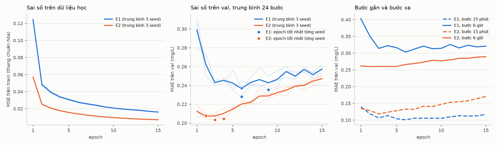
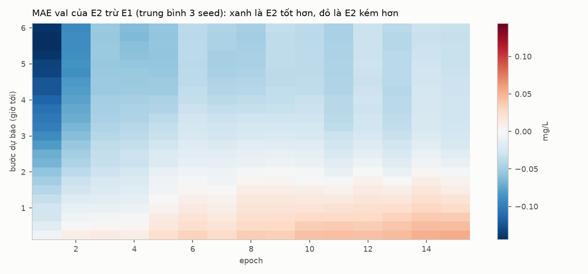
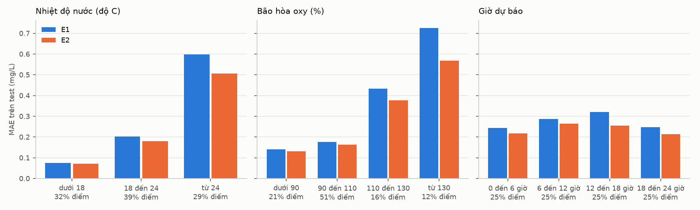
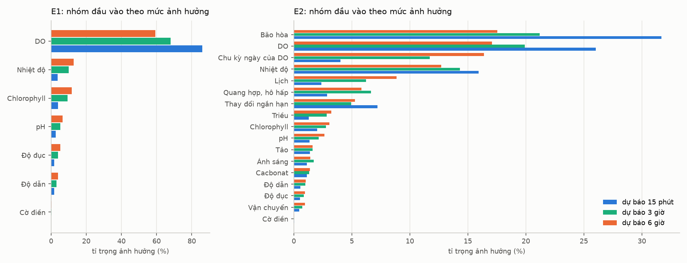
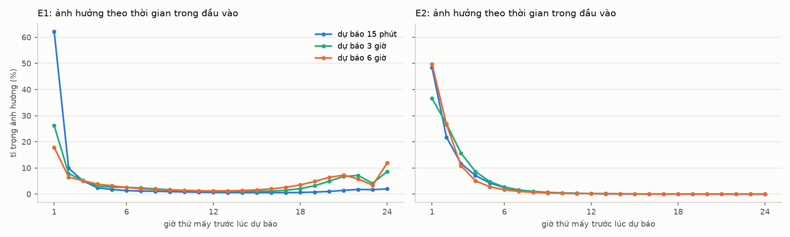
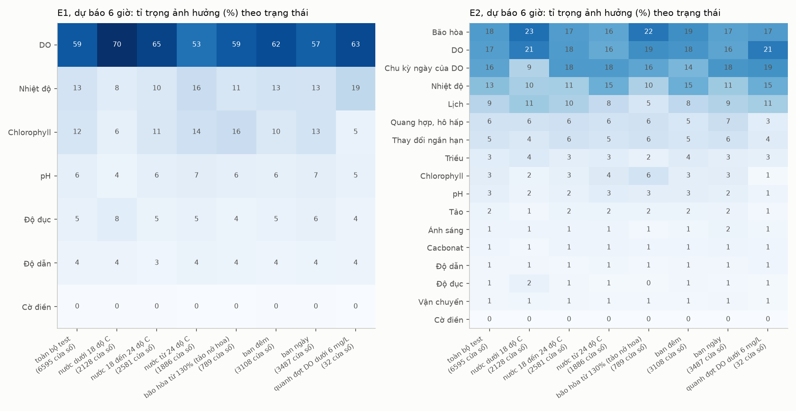
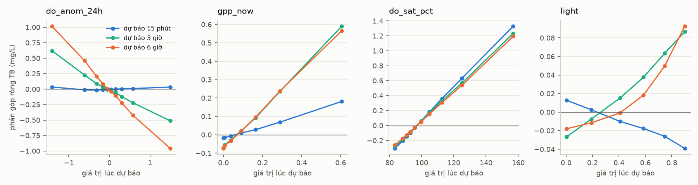
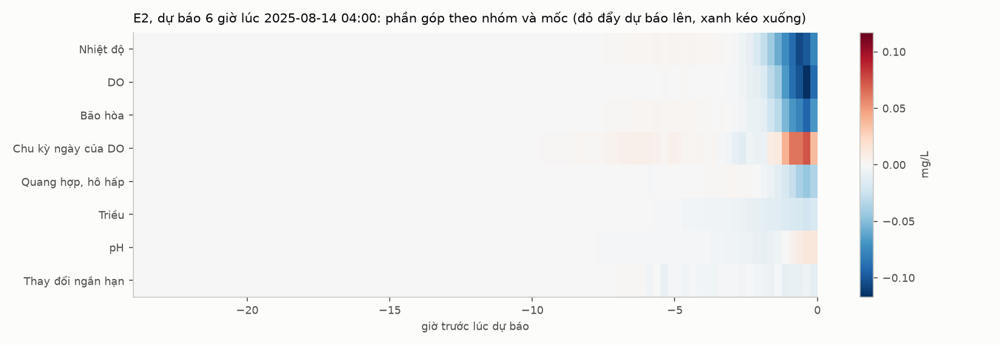
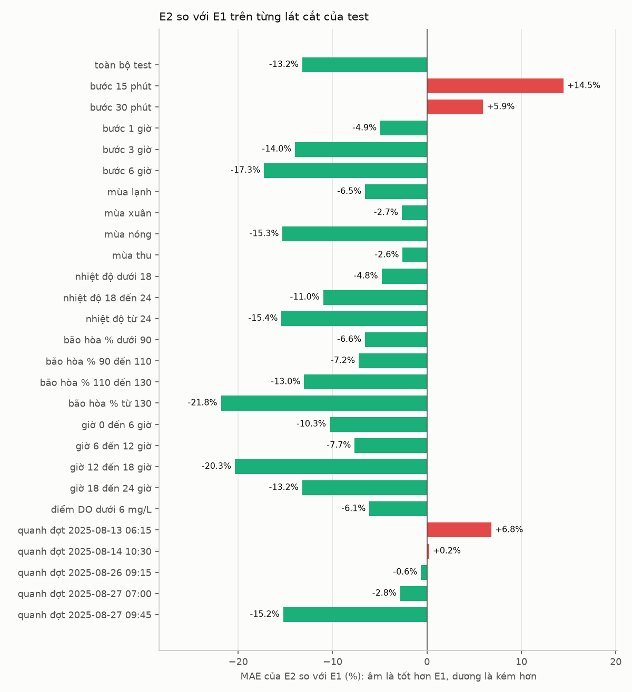

# Huấn luyện và đánh giá mô hình

Tài liệu mô tả cách biến chuỗi đã làm sạch thành mẫu học, mô hình dự báo, cách huấn luyện, cách chọn cấu hình và chấm test, kết quả trên test, và mô hình dùng các đầu vào ra sao. Mọi thí nghiệm (E1, E2, E3) dùng chung quy trình này và chỉ khác cột đầu vào, nên chênh lệch kết quả giữa các thí nghiệm là do đầu vào.

## 1. Khái niệm

| Khái niệm | Nghĩa |
|---|---|
| Mốc | Một lần đo; các mốc cách nhau 15 phút, 96 mốc mỗi ngày |
| Thời điểm dự báo | Thời điểm hiện tại của một lần dự báo; mô hình chỉ thấy các mốc trước nó |
| Cửa sổ | Một mẫu: đầu vào (đoạn quá khứ ngay trước thời điểm dự báo) và nhãn (DO đo thật ngay sau đó, dùng để tính sai số) |
| Bước dự báo | Vị trí trong nhãn: bước 1 là 15 phút tới, bước 24 là 6 giờ tới |
| Trọng số, siêu tham số | Trọng số là các số mô hình tự học từ dữ liệu; siêu tham số là thông số đặt trước khi học (số nơ-ron, tốc độ học, dropout) |
| Epoch | Một lượt học hết mọi cửa sổ huấn luyện |
| Quá khớp | Mô hình học thuộc dữ liệu huấn luyện: sai số trên dữ liệu đã học vẫn giảm nhưng trên dữ liệu mới tăng lên |
| Dừng sớm | Sau mỗi epoch đo sai số trên val; giữ trọng số của epoch tốt nhất, dừng khi nhiều epoch liền không tốt hơn |
| Seed | Số khởi tạo ngẫu nhiên (trọng số ban đầu, thứ tự mẫu). Mỗi cấu hình chạy 3 seed và báo cáo trung bình, để kết quả không phụ thuộc may rủi |
| MAE | Trung bình độ lệch tuyệt đối giữa dự báo và DO thật (mg/L) |
| RMSE | Căn bậc hai của trung bình bình phương độ lệch (mg/L); nặng hơn MAE với các lần sai lớn |
| R2 | 1 trừ tỉ số giữa tổng bình phương sai số và tổng bình phương độ lệch của DO thật quanh trung bình; bằng 1 khi dự báo đúng hoàn toàn |

## 2. Cửa sổ và cấu hình dự báo

Ví dụ với cấu hình đầu vào 24 giờ, dự báo 6 giờ: cửa sổ có thời điểm dự báo 12:00 dùng dữ liệu từ 12:00 hôm trước đến 11:45 và dự báo DO từ 12:00 đến 17:45. Cửa sổ tiếp theo có thời điểm dự báo 12:15, và cứ thế dời 15 phút một lần.

| Cấu hình | Đầu vào | Nhãn | Vai trò |
|---|---|---|---|
| 24 giờ, 6 giờ | 96 mốc | 24 mốc | Chính: dự báo trong ngày, phục vụ cảnh báo sớm vài giờ |
| 7 ngày, 24 giờ | 672 mốc | 96 mốc | Phụ: dự báo trọn một chu kỳ ngày đêm; chưa có kết quả |

Quy tắc tạo cửa sổ (scripts/common.py, hàm window_starts):
- nhãn nằm trọn trong một tập; đầu vào được lấy dữ liệu cuối của tập liền trước, vì đó là dữ liệu quá khứ;
- sai số chỉ tính trên các mốc nhãn có DO cờ 0 (đo thật, [02_DATA_CLEANING.md](02_DATA_CLEANING.md) mục 5); cửa sổ mà nhãn không có mốc DO cờ 0 nào bị bỏ, vì không có gì để tính sai số.

Số cửa sổ dùng được trên số cửa sổ có thể tạo:

| Cấu hình | Train | Val | Test |
|---|---|---|---|
| 24 giờ, 6 giờ | 189345 trên 189769 | 26185 trên 26185 | 26377 trên 26377 |
| 7 ngày, 24 giờ | 188896 trên 189121 | 26113 trên 26113 | 26305 trên 26305 |

Các cửa sổ bị bỏ đều thuộc train, có nhãn nằm gọn trong một lần đầu đo ngừng ghi dài.

## 3. Đầu vào

| Thí nghiệm | Cột đầu vào mỗi mốc | Dữ liệu |
|---|---|---|
| E1 | 6 biến đo và 6 cột cờ: 12 cột | dataset/base_splits/ |
| E2 | E1 cộng 24 đặc trưng miền ([03_DOMAIN_FEATURES_ANALYSIS.md](03_DOMAIN_FEATURES_ANALYSIS.md)): 36 cột | dataset/base_domain_splits/ |
| E3 | E2 cộng đặc trưng ngữ nghĩa suy ra từ ontology | dataset/base_semantic_splits/ (đang xây dựng) |

Mỗi cột số được chuẩn hóa: trừ trung bình, chia độ lệch chuẩn, cả hai tính trên dữ liệu huấn luyện (train; train cộng val khi huấn luyện lại, mục 6.4). Cột cờ giữ nguyên 0 và 1, để mô hình phân biệt giá trị điền với số đo thật.

## 4. Mô hình và hàm mất mát

Mô hình là mạng hồi quy LSTM (Long Short-Term Memory). LSTM đọc lần lượt 96 mốc đầu vào theo thứ tự thời gian; ở mỗi mốc nó cập nhật một bộ nhớ (trạng thái ẩn, 128 số) từ bộ nhớ cũ và các cột của mốc đó, qua các cổng quyết định giữ lại, quên đi hay thêm vào thông tin nào. Trạng thái ẩn ở mốc cuối tóm tắt cả 24 giờ quá khứ và đi qua một lớp tuyến tính ra thẳng 24 giá trị DO. Đây là dự báo trực tiếp nhiều bước: mọi bước được dự báo cùng lúc, không lấy dự báo bước trước làm đầu vào cho bước sau, nên sai số không tích lũy qua các bước.

| Thành phần | Thiết lập |
|---|---|
| Kiến trúc | LSTM 2 lớp, 128 nơ-ron ẩn, dropout 0.3 giữa hai lớp, lớp tuyến tính ra 24 giá trị |
| Số trọng số | E1 207896, E2 220184 (chỉ khác ở lớp đầu, do số cột đầu vào) |
| Hàm mất mát | Bình phương sai số trung bình, chỉ trên mốc nhãn có DO cờ 0 |

Dropout là kỹ thuật chống quá khớp: khi huấn luyện, mỗi lần ngẫu nhiên tắt 30% tín hiệu giữa hai lớp, buộc mô hình không phụ thuộc vào một vài nơ-ron; khi dự báo không tắt gì.

## 5. Huấn luyện

| Thành phần | Thiết lập |
|---|---|
| Tối ưu | AdamW, tốc độ học 0.001, weight decay 0.0001 |
| Lô | 256 cửa sổ, xáo trộn thứ tự mỗi epoch |
| Ổn định | Cắt chuẩn gradient ở 1.0 (tránh một lô có sai số lớn làm trọng số đổi quá mạnh) |
| Dừng | Tối đa 50 epoch; dừng sớm theo MAE trên val, khi 5 epoch liền không giảm quá 0.0001 mg/L |
| Lặp lại | 3 seed (0, 1, 2); cùng seed trên cùng máy cho kết quả trùng từng bit |

Mã nguồn: scripts/train.py (huấn luyện có dừng sớm), scripts/tune.py (dò siêu tham số), scripts/training_curves.py (quá trình huấn luyện, mục 6.3), scripts/final_train.py (huấn luyện lại và chấm test).

## 6. Chọn cấu hình và chấm test

### 6.1. Vai trò của ba tập

1. Mọi thông số tính từ giá trị đo (trung bình và độ lệch chuẩn để chuẩn hóa, hệ số trao đổi khí k của đặc trưng miền) chỉ tính trên dữ liệu huấn luyện, để dữ liệu dùng để chấm không ảnh hưởng gián tiếp đến mô hình. k ước lượng trên train và giữ cố định.
2. Val dùng để dừng sớm (theo dõi quá khớp) và chọn siêu tham số.
3. Test chấm đúng một lần, sau khi mọi thiết lập đã cố định. Mọi so sánh giữa các thí nghiệm và mọi phân tích ảnh hưởng của đặc trưng công bố trong tài liệu tính trên test.
4. Các thí nghiệm dùng chung cửa sổ, ranh giới tập và siêu tham số.

### 6.2. Dò siêu tham số

Lưới trên val với E1 (scripts/tune.py): tốc độ học 0.001 và 0.0003, 64 và 128 nơ-ron, dropout 0.1 và 0.3, mỗi cấu hình 3 seed. Bảng đủ: artifacts/runs/lstm_24h_6h/tuning/tuning.csv. Hai cấu hình tốt nhất:

| Tốc độ học, nơ-ron, dropout | MAE val (TB 3 seed) | Độ lệch chuẩn giữa seed | Epoch tốt nhất của 3 seed |
|---|---|---|---|
| 0.001, 128, 0.1 | 0.2320 | 0.0033 | 5, 6, 3 |
| 0.001, 128, 0.3 | 0.2336 | 0.0050 | 9, 6, 6 |

Chênh lệch MAE giữa hai cấu hình (0.0016 mg/L) nhỏ hơn độ lệch giữa các seed. Dropout 0.3 được chọn vì mô hình đạt tốt nhất muộn hơn, tức quá khớp chậm hơn. E2 và E3 dùng nguyên siêu tham số này, không dò lại, để chênh lệch giữa các thí nghiệm chỉ do đầu vào.

### 6.3. Quá trình huấn luyện

Để thấy mô hình học thế nào, mỗi thí nghiệm được huấn luyện thêm một lần đủ 15 epoch không dừng sớm (cùng seed, cùng siêu tham số, nên các epoch đầu trùng khít lần có dừng sớm), ghi sai số trên train và val sau mỗi epoch. Chỉ dùng train và val.

| Trung bình 3 seed | E1, epoch 1 | E1, epoch 6 | E1, epoch 15 | E2, epoch 1 | E2, epoch 3 | E2, epoch 15 |
|---|---|---|---|---|---|---|
| MSE trên train (thang chuẩn hóa) | 0.125 | 0.028 | 0.016 | 0.057 | 0.021 | 0.007 |
| MAE val, 24 bước | 0.299 | 0.237 | 0.257 | 0.213 | 0.208 | 0.247 |
| MAE val, bước 15 phút | 0.140 | 0.101 | 0.117 | 0.134 | 0.118 | 0.171 |
| MAE val, bước 6 giờ | 0.403 | 0.303 | 0.321 | 0.262 | 0.260 | 0.289 |

Cột epoch 6 (E1) và epoch 3 (E2) gần với số epoch dùng khi huấn luyện lại (7 và 3, mục 6.4). MAE val trung bình 3 seed thấp nhất ở epoch 6 với E1 và epoch 2 với E2 (0.2073, gần bằng epoch 3).

- Sai số trên train của cả hai giảm đều qua mọi epoch, còn sai số trên val giảm rồi tăng lại: phần tăng là quá khớp, và dừng sớm giữ trọng số ở đáy của đường val.
- E2 học nhanh hơn nhiều. Sau 1 epoch, E2 đã có MAE val 0.213, thấp hơn mức tốt nhất E1 đạt được sau 6 epoch (0.237). Bước 6 giờ của E2 gần như đạt mức cuối cùng ngay epoch 1 (0.262): các đặc trưng miền đưa sẵn thông tin về chu kỳ ngày, nên mô hình không phải tự học nó từ 24 giờ số đo (mục 8.4).
- E2 cũng quá khớp sớm hơn: từ epoch 4, sai số val của mọi bước tăng dần. Với 36 cột đầu vào, mô hình có nhiều cách hơn để học thuộc train (sai số train ở epoch 15 của E2 chưa bằng một nửa của E1).
- Đánh đổi giữa bước gần và bước xa: so epoch 6 của E1 với epoch 3 của E2, E2 kém E1 ở ba bước đầu (15 phút: 0.118 so với 0.101) và tốt hơn từ bước 1 giờ (6 giờ: 0.260 so với 0.303). Bước gần của E1 tiếp tục tốt lên đến epoch 6, còn bước gần của E2 tốt nhất ở epoch 3 rồi kém đi; học thêm không giúp E2 thu hẹp khoảng cách này, vì khi đó mọi bước của E2 đều kém đi.

Hình trên so hai mô hình ở cùng epoch: E2 tốt hơn E1 ở các bước xa trong suốt quá trình huấn luyện; ở các bước dưới 1 giờ, hai mô hình gần ngang nhau trong vài epoch đầu, rồi E2 kém hơn khi E1 tiếp tục học bám sát DO hiện tại. Số liệu: artifacts/analysis/training_curves.csv (scripts/training_curves.py).

### 6.4. Huấn luyện lại trên train cộng val

Sau khi cố định siêu tham số, mỗi thí nghiệm được huấn luyện lại trên train cộng val (2019-01-01 đến 2025-02-28), để mô hình học cả mùa nóng 2024 trước khi dự báo năm 2025. Khi đó không còn tập nào để dừng sớm, nên số epoch được cố định trước: bằng trung bình epoch tốt nhất của 3 lần huấn luyện có dừng sớm trên val, làm tròn. Ba seed dùng chung số epoch đó, trọng số giữ ở epoch cuối.

| Thí nghiệm | Epoch tốt nhất trên val (seed 0, 1, 2) | MAE val ở epoch đó | Số epoch huấn luyện lại |
|---|---|---|---|
| E1 | 9, 6, 6 | 0.2354, 0.2374, 0.2280 | 7 |
| E2 | 2, 4, 3 | 0.2079, 0.2044, 0.2035 | 3 |

E2 đạt tốt nhất trên val sớm hơn E1, như mục 6.3 đã giải thích.

### 6.5. Chấm test

Mô hình huấn luyện lại dự báo mọi cửa sổ test; MAE, RMSE, R2 tính trên các mốc nhãn có DO cờ 0, cho từng seed, rồi lấy trung bình 3 seed. scripts/final_train.py bỏ qua thí nghiệm và seed đã được chấm, để test chỉ được chấm một lần; tùy chọn --verify huấn luyện lại vào thư mục tạm để kiểm tra tái lập mà không chấm lại ([README.md](README.md) mục 6.3).

## 7. Kết quả trên test

Số liệu là trung bình 3 seed (trong ngoặc: độ lệch chuẩn giữa seed). Nguồn: artifacts/runs/lstm_24h_6h/final/test.csv, test_tb.csv; các bảng và hình còn lại trong artifacts/analysis/ (scripts/error_analysis.py).

### 7.1. Tổng quát

| Thí nghiệm | MAE (mg/L) | RMSE (mg/L) | R2 | MAE bước 15 phút | MAE bước 6 giờ |
|---|---|---|---|---|---|
| E1 | 0.2743 (0.0080) | 0.4988 (0.0189) | 0.8868 (0.0085) | 0.1270 | 0.3519 |
| E2 | 0.2381 (0.0066) | 0.4150 (0.0104) | 0.9217 (0.0040) | 0.1454 | 0.2912 |
| E3 | chưa có | | | | |

So với E1, E2 giảm MAE 13.2% và RMSE 16.8%; RMSE giảm nhiều hơn MAE nghĩa là phần giảm tập trung ở các lần sai lớn. Chênh lệch MAE giữa E1 và E2 (0.036 mg/L) lớn gấp khoảng 5 lần độ lệch chuẩn giữa các seed. Sai số trên test cao hơn trên val; lý do ở mục 7.6.

### 7.2. Theo bước dự báo

Đường đứt là mốc tham chiếu "giữ nguyên DO hiện tại": dự báo mọi bước bằng DO đo mới nhất. Mốc này không phải mô hình, chỉ cho biết một bước khó đến đâu: ở 15 phút DO gần như chưa kịp đổi, ở 6 giờ DO đã đi gần nửa chu kỳ ngày đêm.

| Bước | 15 phút | 30 phút | 1 giờ | 3 giờ | 6 giờ |
|---|---|---|---|---|---|
| Giữ nguyên DO | 0.114 | 0.151 | 0.221 | 0.452 | 0.727 |
| E1 | 0.127 | 0.149 | 0.193 | 0.288 | 0.352 |
| E2 | 0.145 | 0.158 | 0.184 | 0.248 | 0.291 |

- Ở bước 15 phút, cả hai mô hình kém mốc giữ nguyên DO; từ 30 phút (E1) và 45 phút (E2) trở đi mô hình mới tốt hơn mốc này, và ở bước 6 giờ sai số chỉ còn khoảng một nửa (E1) và hai phần năm (E2) của mốc. Giá trị của mô hình nằm ở dự báo từ 1 giờ trở lên, đúng khoảng cần cho cảnh báo sớm.
- E2 đánh đổi một phần độ chính xác ở bước rất gần lấy độ chính xác ở bước xa: kém E1 ở hai bước đầu (15 phút: 0.145 so với 0.127; 30 phút: 0.158 so với 0.149), ngang ở 45 phút, tốt hơn từ 1 giờ và giảm 17.3% ở bước 6 giờ. Phần thua (dưới 0.02 mg/L) nằm ở các bước mà cả hai mô hình đều chưa hơn mốc giữ nguyên DO; phần thắng nằm ở khoảng 1 đến 6 giờ, khoảng cần cho cảnh báo sớm. Tính trên cả 24 bước, E2 vẫn có MAE thấp hơn E1 13.2% (mục 7.1).

Nguồn: artifacts/analysis/error_by_step.csv.

### 7.3. Theo mùa

| Giai đoạn mùa (lúc dự báo) | Tỉ lệ điểm | MAE E1 | MAE E2 | Thay đổi |
|---|---|---|---|---|
| Lạnh (tháng 3 và 11) | 22.1% | 0.074 | 0.069 | -6.5% |
| Xuân (tháng 4, 5) | 22.2% | 0.104 | 0.102 | -2.7% |
| Nóng (tháng 6 đến 9) | 44.4% | 0.504 | 0.427 | -15.3% |
| Thu (tháng 10) | 11.3% | 0.096 | 0.093 | -2.6% |

Mùa nóng chiếm 44% số điểm nhưng khoảng 80% tổng sai số của cả hai thí nghiệm, và là nơi E2 cải thiện nhiều nhất. Nguồn: artifacts/analysis/error_by_season.csv.

### 7.4. Phân rã sai số theo điều kiện

Phân rã sai số trả lời câu hỏi mô hình yếu ở đâu. Mỗi điểm sai số (một cửa sổ, một bước dự báo, DO đo thật) được xếp vào nhóm theo điều kiện lúc dự báo (số đo mới nhất của đầu vào): nhiệt độ nước, phần trăm bão hòa oxy, giờ trong ngày. Với mỗi nhóm so hai tỉ lệ: tỉ lệ số điểm và tỉ lệ tổng sai số tuyệt đối. Nhóm có tỉ lệ sai số lớn hơn hẳn tỉ lệ điểm là nơi mô hình yếu; so MAE của E1 và E2 trong từng nhóm cho biết đặc trưng miền giúp ở đâu.

| Điều kiện | Nhóm | Tỉ lệ điểm | Tỉ lệ sai số E1 | MAE E1 | MAE E2 | Thay đổi |
|---|---|---|---|---|---|---|
| Nhiệt độ nước | dưới 18 độ C | 32.3% | 8.8% | 0.075 | 0.071 | -4.8% |
| | 18 đến 24 độ C | 39.1% | 28.8% | 0.202 | 0.180 | -11.0% |
| | từ 24 độ C | 28.6% | 62.4% | 0.599 | 0.506 | -15.4% |
| Bão hòa oxy | dưới 90% | 21.5% | 11.0% | 0.140 | 0.131 | -6.6% |
| | 90 đến 110% | 50.8% | 32.6% | 0.176 | 0.163 | -7.2% |
| | 110 đến 130% | 15.8% | 24.9% | 0.433 | 0.377 | -13.0% |
| | từ 130% | 11.9% | 31.6% | 0.726 | 0.568 | -21.8% |
| Giờ dự báo | 0 đến 6 giờ | 25.0% | 22.2% | 0.243 | 0.218 | -10.3% |
| | 6 đến 12 giờ | 25.0% | 26.1% | 0.287 | 0.265 | -7.7% |
| | 12 đến 18 giờ | 25.0% | 29.2% | 0.321 | 0.255 | -20.3% |
| | 18 đến 24 giờ | 24.9% | 22.4% | 0.247 | 0.214 | -13.2% |

- Điểm yếu chính của E1 là nước ấm và nước quá bão hòa: nước từ 24 độ C chiếm 29% số điểm nhưng 62% tổng sai số; bão hòa từ 130% (tảo nở hoa) chiếm 12% số điểm nhưng 32% tổng sai số.
- E2 giảm sai số ở mọi nhóm nhiệt độ và bão hòa, nhiều nhất ở đúng các nhóm E1 yếu (từ 24 độ C: 15.4%; bão hòa từ 130%: 21.8%) và khi dự báo vào buổi chiều (12 đến 18 giờ: 20.3%), lúc DO đạt đỉnh và sắp giảm.
- Tỉ lệ sai số của các nhóm gần như không đổi giữa E1 và E2 (nước từ 24 độ C vẫn chiếm 61% sai số của E2): đặc trưng miền làm giảm sai số ở mọi nơi nhưng không xóa điểm yếu ở mùa tảo nở hoa.

Nguồn: artifacts/analysis/error_by_condition.csv.

### 7.5. Quanh các đợt DO thấp

| Đối tượng | Số điểm | MAE E1 | MAE E2 |
|---|---|---|---|
| Mọi điểm có DO đo dưới 6 mg/L | 816 | 2.018 | 1.895 |
| Cửa sổ quanh đợt 2025-08-13 06:15 (2.25 giờ, thấp nhất 4.71) | 792 | 0.583 | 0.623 |
| Cửa sổ quanh đợt 2025-08-14 10:30 (1 giờ, thấp nhất 3.73) | 672 | 0.745 | 0.747 |
| Cửa sổ quanh đợt 2025-08-26 09:15 (1.25 giờ, thấp nhất 5.11) | 696 | 0.661 | 0.657 |
| Cửa sổ quanh đợt 2025-08-27 07:00 (1.25 giờ, thấp nhất 5.84) | 696 | 0.678 | 0.659 |
| Cửa sổ quanh đợt 2025-08-27 09:45 (1.25 giờ, thấp nhất 5.07) | 696 | 0.975 | 0.827 |

Cửa sổ quanh một đợt là cửa sổ có thời điểm dự báo trong đợt hoặc trong 6 giờ trước khi đợt bắt đầu. Nguồn: artifacts/analysis/error_low_do.csv.

- Ở các điểm DO dưới 6 mg/L, cả hai mô hình đều dự báo cao hơn thật, trung bình khoảng 2 mg/L (sai số có dấu bằng MAE). Hình cho thấy lý do: các mốc thấp nhất là những cú giảm ngắn trong một hoặc vài mốc 15 phút (nhiều điểm là điểm đột biến một mốc, [02_DATA_CLEANING.md](02_DATA_CLEANING.md) mục 6), trong khi cả hai mô hình dự báo một đường trơn theo nhịp ngày đêm.
- Trên các cửa sổ quanh từng đợt, E1 và E2 gần ngang nhau; E2 tốt hơn rõ ở một đợt (0.827 so với 0.975) và kém hơn ở một đợt (0.623 so với 0.583). Với 5 đợt, test không đủ để kết luận E2 cảnh báo DO thấp tốt hơn E1.

### 7.6. Vì sao sai số như vậy

| Tháng (2025) | 3 | 4 | 5 | 6 | 7 | 8 | 9 | 10 | 11 |
|---|---|---|---|---|---|---|---|---|---|
| Chênh lệch DO trong ngày (mg/L) | 0.60 | 1.00 | 1.63 | 3.09 | 5.13 | 4.78 | 2.21 | 0.68 | 0.56 |
| MAE E1 | 0.066 | 0.083 | 0.126 | 0.297 | 0.783 | 0.612 | 0.313 | 0.096 | 0.083 |
| MAE E2 | 0.063 | 0.077 | 0.126 | 0.261 | 0.603 | 0.546 | 0.290 | 0.093 | 0.076 |

- Sai số theo tháng đi cùng biên độ ngày đêm của DO: tháng 7 biên độ 5.13 mg/L thì MAE E1 0.78, tháng 11 biên độ 0.56 thì MAE 0.08. Các tháng lạnh gần như không có gì để dự báo sai; gần như toàn bộ sai số nằm ở mùa tảo nở hoa (tháng 6 đến 9; [01_DATASET_ANALYSIS.md](01_DATASET_ANALYSIS.md) mục 3.5).
- Test khó hơn val vì năm 2025 có mùa nở hoa mạnh kéo dài (chênh lệch trong ngày trung vị 1.54 mg/L, so với 1.06 của val), nên MAE trên test cao hơn trên val ở cả hai thí nghiệm (E1: 0.2743 so với 0.2336).
- E2 giảm sai số nhiều nhất ở đúng các tháng biên độ lớn (tháng 7: 23%); ở tháng 5 và các tháng lạnh, nơi E1 vốn đã sai ít, MAE đổi dưới 0.01 mg/L.
- Ở các điểm DO thấp nhất, sai số lớn vì đó là những cú tụt ngắn mà mô hình dự báo đường trơn không theo kịp (mục 7.5).

Nguồn: artifacts/analysis/error_by_month.csv.

## 8. Ảnh hưởng của đầu vào lên dự báo

Mục 7 cho biết E2 dự báo tốt hơn hay kém hơn E1 và ở hoàn cảnh nào. Mục này trả lời câu hỏi tiếp theo: mô hình dựa vào đặc trưng nào, vào thông tin ở thời điểm nào trong quá khứ, và điều đó thay đổi ra sao theo hoàn cảnh.

### 8.1. Ảnh hưởng là gì

Mỗi lần dự báo, mô hình E2 đọc một bảng 96 mốc x 36 cột = 3456 ô và trả ra 24 giá trị DO. Ảnh hưởng (phần góp) của một ô lên một giá trị dự báo là lượng mg/L mà giá trị của ô đó đẩy dự báo lên hoặc kéo xuống, so với dự báo cho một đầu vào tham chiếu ("bình thường"). Phần góp được tính cho từng lần dự báo, nên cùng một cột có thể góp nhiều ở cửa sổ này và gần như không góp ở cửa sổ khác, góp ở mốc gần lúc dự báo nhiều hơn mốc 20 giờ trước.

Yêu cầu chính với cách tính là tính đầy đủ: tổng phần góp của mọi ô bằng đúng hiệu giữa dự báo và dự báo tham chiếu. Nhờ vậy các phần góp cộng được với nhau: phần góp của một cột là tổng trên 96 mốc, của một nhóm cột là tổng trên các cột.

Trọng số của mạng không cho biết điều này. Trong LSTM, một ô đi qua các cổng phi tuyến, được cộng vào bộ nhớ, qua lớp thứ hai rồi lớp đầu ra; cùng một bộ trọng số được dùng ở cả 96 mốc nhưng tác dụng ở mỗi mốc khác nhau và còn phụ thuộc giá trị các ô khác. Vì vậy phải đo ảnh hưởng trên từng dự báo cụ thể.

### 8.2. Lý thuyết

Ví dụ một mô hình hai đầu vào f(a, b) = 2a + 3ab, tham chiếu a = 0, b = 0 (f = 0), đầu vào thật a = 1, b = 2 (f = 8). Cần chia 8 cho a và b.

Bỏ từng đầu vào không chia đúng: bỏ a mất 8, bỏ b mất 6, tổng 14 lớn hơn 8, vì phần tương tác 3ab bị tính hai lần.

Giá trị Shapley (lý thuyết trò chơi) chia công bằng: thêm lần lượt từng đầu vào theo mọi thứ tự, ghi phần dự báo tăng thêm, lấy trung bình. Thứ tự a rồi b: a thêm 2, b thêm 6. Thứ tự b rồi a: b thêm 0, a thêm 8. Trung bình a = 5, b = 3, tổng đúng bằng 8. SHAP (Lundberg và Lee 2017) dùng giá trị Shapley để giải thích dự báo của mô hình học máy.

Với 3456 ô, số thứ tự là không đếm được, nên cần cách tính xấp xỉ dựa trên đạo hàm:
- Integrated Gradients (Sundararajan và cộng sự 2017): đi theo đường thẳng từ tham chiếu tới đầu vào thật; tại nhiều điểm trên đường, đo độ dốc của dự báo theo từng ô; phần góp của ô = (giá trị thật trừ giá trị tham chiếu) x độ dốc trung bình dọc đường. Độ dốc là đạo hàm của dự báo theo đầu vào, tính bằng lan truyền ngược như khi huấn luyện, nhưng lấy theo đầu vào thay vì theo trọng số, và không sửa trọng số nào. Trong ví dụ: độ dốc theo a là 2 + 3b, b đi từ 0 đến 2 nên trung bình là 5, quãng của a là 1, được 5; độ dốc theo b là 3a, trung bình 1.5, quãng 2, được 3. Kết quả trùng giá trị Shapley, và tổng luôn bằng hiệu dự báo (tính đầy đủ).
- GradientSHAP, hay expected gradients (Erion và cộng sự 2021): tham chiếu không phải một điểm mà là nhiều cửa sổ có thật lấy ngẫu nhiên, vì cửa sổ toàn số 0 (DO bằng 0, độ dẫn bằng 0) không có ý nghĩa với sông. Mỗi cặp gồm một cửa sổ tham chiếu và một điểm ngẫu nhiên trên đường thẳng từ nó tới đầu vào thật; lấy trung bình (giá trị thật trừ giá trị tham chiếu) x độ dốc trên nhiều cặp. Phần góp đọc là: so với một cửa sổ bình thường trong quá khứ, ô này đẩy dự báo lên hay kéo xuống bao nhiêu mg/L.

### 8.3. Cách tính trong đồ án

| Thành phần | Thiết lập |
|---|---|
| Mô hình | Ba seed của E1 và của E2 sau khi huấn luyện lại trên train cộng val (mục 6.4) |
| Cửa sổ được giải thích | Cửa sổ test có thời điểm dự báo tròn giờ: 6595 cửa sổ |
| Tham chiếu | 32 cửa sổ train lấy ngẫu nhiên cho mỗi cửa sổ được giải thích; E1 và E2 dùng cùng tham chiếu |
| Giá trị dự báo được giải thích | Bước 15 phút, 3 giờ và 6 giờ tới |
| Đơn vị | mg/L (phần góp ở thang chuẩn hóa nhân độ lệch chuẩn của DO) |

Từ phần góp của từng ô, các đại lượng được gộp như sau:
- Phần góp ròng của một cột trong một cửa sổ: tổng phần góp của cột đó trên 96 mốc. Của một nhóm: tổng trên các cột của nhóm.
- Mức ảnh hưởng của một nhóm: trung bình trên các cửa sổ của độ lớn (giá trị tuyệt đối) phần góp ròng, tính bằng mg/L. Lấy độ lớn vì một nhóm có thể đẩy dự báo lên ở cửa sổ này và kéo xuống ở cửa sổ khác.
- Tỉ trọng: mức ảnh hưởng của nhóm chia tổng mức ảnh hưởng của mọi nhóm. Tỉ trọng theo thời gian (giờ thứ 1, thứ 2, ... trước lúc dự báo) tính tương tự, với phần góp ròng cộng trên 4 mốc của mỗi giờ.
- Mọi số liệu là trung bình trên ba seed.

Nhóm đầu vào: mỗi biến đo là một nhóm (DO, nhiệt độ, pH, độ dẫn, độ đục, chlorophyll), sáu cột cờ là một nhóm, và 24 đặc trưng miền chia theo cơ chế như các tiểu mục của [03_DOMAIN_FEATURES_ANALYSIS.md](03_DOMAIN_FEATURES_ANALYSIS.md) mục 4 (bão hòa, ánh sáng, quang hợp và hô hấp, chu kỳ ngày của DO, thay đổi ngắn hạn, cacbonat, tảo, vận chuyển, triều, lịch). Đọc theo nhóm thay vì từng cột vì các cột trong một nhóm tương quan chặt (ví dụ do_sat_pct và do_deficit): khi hai cột mang cùng thông tin, mô hình có thể dựa vào cột này hay cột kia, và phần góp có thể chuyển qua lại giữa chúng; tổng của nhóm thì ổn định.

Mã nguồn: scripts/attribution.py; kết quả trong artifacts/analysis/ (attr_*.csv và các hình dưới đây).

### 8.4. Kết quả

**Kiểm tra tính đầy đủ.** Với mỗi cửa sổ, tổng phần góp được so với hiệu giữa dự báo và dự báo trung bình trên 32 tham chiếu. Phần chênh còn lại là sai số do chỉ lấy 32 cặp thay vì vô số cặp.

| Thí nghiệm, bước | Tương quan | Chênh lệch TB (mg/L) | Độ lớn TB của hiệu dự báo (mg/L) |
|---|---|---|---|
| E1, 15 phút / 3 giờ / 6 giờ | 0.998 / 0.991 / 0.986 | 0.045 / 0.109 / 0.146 | 1.05 / 1.07 / 1.07 |
| E2, 15 phút / 3 giờ / 6 giờ | 0.999 / 0.997 / 0.996 | 0.041 / 0.070 / 0.086 | 1.05 / 1.07 / 1.05 |

Phần góp giải thích gần trọn hiệu dự báo; chênh lệch lớn nhất (E1, bước 6 giờ) khoảng 14% độ lớn của hiệu. Độ lệch chuẩn giữa ba seed của mức ảnh hưởng mỗi nhóm không quá 0.05 mg/L, nên thứ hạng các nhóm ổn định qua các seed. Nguồn: artifacts/analysis/attr_completeness.csv.

**Nhóm nào được dùng.**

- E1 dựa chủ yếu vào DO đo: 86% tỉ trọng ở bước 15 phút, 59% ở bước 6 giờ. Dự báo càng xa, nhiệt độ (13% ở bước 6 giờ) và chlorophyll (12%) càng được dùng nhiều.
- E2 chia ảnh hưởng cho nhiều nhóm. Ở bước 6 giờ: bão hòa 17.5%, DO 17.1%, chu kỳ ngày của DO 16.4%, nhiệt độ 12.7%, lịch 8.8%, quang hợp và hô hấp 5.8%, thay đổi ngắn hạn 5.3%, mỗi nhóm còn lại dưới 3.3%. Tổng tỉ trọng của các nhóm đặc trưng miền là 54% ở bước 15 phút và 63% ở bước 6 giờ.
- Nhóm bão hòa và nhóm DO mang cùng một thông tin, vì do_sat_pct và do_deficit được tính từ DO. Phần góp ròng của hai nhóm cùng chiều ở hầu hết cửa sổ (tương quan 0.97 đến 0.98), và mức ảnh hưởng của tổng hai nhóm ở bước 15 phút (1.01 mg/L) gần bằng mức ảnh hưởng của DO trong E1 (1.05 mg/L): ở bước rất gần, E2 dùng thông tin DO hiện tại ngang E1 nhưng qua hai nhóm cột. Nhóm nhiệt độ và nhóm bão hòa thì một phần bù trừ nhau (tương quan âm 0.39 đến âm 0.47), vì DO bão hòa giảm khi nhiệt độ tăng. Nguồn: artifacts/analysis/attr_by_group.csv (theo nhóm), attr_by_column.csv (từng cột trong 12 cột của E1 và 36 cột của E2), attr_pairs.csv (hai nhóm trùng thông tin).

**Thông tin ở thời điểm nào.**

- E1 ở bước 15 phút dựa vào giờ gần nhất (62%). Ở bước 6 giờ, 52% ảnh hưởng đến từ 12 đến 24 giờ trước, tập trung ở 18 đến 24 giờ trước (43%): đó là khoảng cùng giờ trong ngày với thời điểm được dự báo, của ngày hôm trước. E1 dự báo xa bằng cách nhìn lại DO đúng giờ đó hôm qua.
- E2 dựa gần như hoàn toàn vào 3 giờ gần nhất (79 đến 87% ở cả ba bước); các mốc cũ hơn 12 giờ góp dưới 1%. Các đặc trưng trượt 24 giờ (do_change_24h, do_std_24h, do_anom_24h, gpp_now, er_now) đã tóm tắt ngày hôm trước ngay tại mốc hiện tại, nên mô hình không cần nhìn lại các mốc cũ.

Nguồn: artifacts/analysis/attr_by_lag.csv.

**Theo trạng thái của sông.** Mỗi cửa sổ được xếp theo trạng thái lúc dự báo: nhiệt độ nước, đang nở hoa (bão hòa từ 130%), ban đêm hay ban ngày, và quanh các đợt DO dưới 6 mg/L (thời điểm dự báo trong đợt hoặc trong 6 giờ trước đợt). Trong mỗi trạng thái, tỉ trọng ảnh hưởng của các nhóm được tính lại; ô đậm là nhóm được dùng nhiều.

| Bước 6 giờ | Nước dưới 18 độ C | Nước từ 24 độ C | Nở hoa (bão hòa từ 130%) | Ban đêm | Ban ngày | Quanh đợt DO thấp |
|---|---|---|---|---|---|---|
| E1: DO | 70% | 53% | 59% | 62% | 57% | 63% |
| E1: nhiệt độ | 8% | 16% | 11% | 13% | 13% | 19% |
| E1: chlorophyll | 6% | 14% | 16% | 10% | 13% | 5% |
| E2: bão hòa và DO | 44% | 32% | 41% | 37% | 33% | 39% |
| E2: chu kỳ ngày của DO | 9% | 18% | 16% | 14% | 18% | 19% |
| E2: nhiệt độ | 10% | 15% | 10% | 15% | 11% | 15% |
| E2: quang hợp, hô hấp | 6% | 6% | 6% | 5% | 7% | 3% |

Số cửa sổ: dưới 18 độ C 2128, từ 24 độ C 1886, nở hoa 789, ban đêm 3108, ban ngày 3487, quanh đợt DO thấp 32.

- Nước lạnh: cả hai mô hình dựa nhiều nhất vào DO hiện tại (E1 70%; E2 44% qua nhóm DO và bão hòa), vì DO gần như phẳng.
- Nước ấm: E1 chuyển sang nhiệt độ và chlorophyll (16% và 14%), tức dùng biến đo gián tiếp để đoán hoạt động của tảo. E2 dùng nhóm chu kỳ ngày của DO nhiều gấp đôi so với khi nước lạnh (18% so với 9%): biên độ và vị trí của DO trong chu kỳ ngày đêm đo thẳng điều E1 phải đoán. Đây cũng là trạng thái E2 giảm sai số nhiều nhất (mục 7.4).
- Đang nở hoa: E1 dựa nhiều nhất vào chlorophyll (16%); E2 dựa vào bão hòa và DO (41%) và chu kỳ ngày (16%), chlorophyll chỉ 6%.
- Ban ngày, E2 dùng chu kỳ ngày và quang hợp nhiều hơn ban đêm; ban đêm dùng nhiệt độ nhiều hơn (15% so với 11%).
- Quanh đợt DO thấp, cả hai dùng nhiệt độ nhiều hơn bình thường (E1 19%, E2 15%). Chỉ có 32 cửa sổ tròn giờ nên các số ở cột này kém chắc chắn.

Nguồn: artifacts/analysis/attr_by_condition.csv.

**Giá trị của đặc trưng và chiều tác động.** Hình dưới chia các cửa sổ thành 10 nhóm theo giá trị của một đặc trưng lúc dự báo, rồi vẽ phần góp ròng trung bình của đặc trưng đó (cộng trên 96 mốc).

- do_anom_24h: DO cao hơn trung bình 24 giờ khoảng 1.5 mg/L kéo dự báo 6 giờ tới xuống khoảng 0.96 mg/L; thấp hơn 1.4 mg/L đẩy lên khoảng 1.0 mg/L. Ở bước 15 phút phần góp gần 0. Mô hình học được rằng DO lệch khỏi mức trung bình ngày sẽ quay về trong vài giờ, đúng nhịp ngày đêm (03 mục 4.4).
- gpp_now: quang hợp kỳ vọng càng lớn, dự báo 3 giờ và 6 giờ càng được đẩy lên (tới khoảng 0.57 mg/L ở nhóm cao nhất).
- do_sat_pct: tăng gần tuyến tính, từ âm 0.26 mg/L ở 83% đến 1.19 mg/L ở 157%; phần này phản ánh chủ yếu DO hiện tại (nhóm bão hòa và DO mang cùng thông tin).
- light: phần góp dưới 0.1 mg/L ở mọi mức; thông tin giờ trong ngày đã có trong nhóm lịch.

Chiều tác động của các đặc trưng này khớp với cơ chế cân bằng oxy (03 mục 2). Nguồn: artifacts/analysis/attr_dependence.csv. Đây là cách mô hình dùng đầu vào; nó không chứng minh quan hệ nhân quả trong sông.

**Một dự báo cụ thể.** Cửa sổ có thời điểm dự báo 2025-08-14 04:00, trước đợt DO thấp sâu nhất của test (3.73 mg/L lúc 10:30). DO lúc 03:45 là 7.64 mg/L; DO đo lúc 09:45 (bước 6 giờ) là 6.01 mg/L. Dự báo 6 giờ của E1 là 6.72, của E2 là 7.36 mg/L (trung bình ba seed).

So với một cửa sổ tham chiếu, các nhóm DO (âm 0.58 mg/L), nhiệt độ (âm 0.56) và bão hòa (âm 0.41) kéo dự báo xuống, nhóm chu kỳ ngày của DO đẩy lên (0.34); gần như toàn bộ phần góp nằm trong 3 giờ cuối. Ở cửa sổ này E2 vẫn dự báo cao hơn thật 1.35 mg/L và kém E1: phân tích ảnh hưởng chỉ ra mô hình đã dùng gì, không bảo đảm dự báo đúng. Nguồn: artifacts/analysis/attr_example.csv.

### 8.5. Giới hạn

- Các cột mang thông tin trùng nhau (DO và nhóm bão hòa, nhiệt độ và do_sat_mgl) có thể chia phần góp tùy ý giữa chúng; chỉ nên so tổng của các nhóm trùng thông tin.
- Mức ảnh hưởng đo cách mô hình đã học dùng đầu vào trên test, không đo tầm quan trọng của quá trình tự nhiên, và không chứng minh quan hệ nhân quả trong sông. Một nhóm góp ít có thể vì thông tin của nó đã có ở nhóm khác (ví dụ ánh sáng và lịch).

## 9. Đối chứng E1 và E2

Mục này gom kết quả sai số (mục 7) và ảnh hưởng của đầu vào (mục 8). Hình gom mọi lát cắt ở mục 7: thanh xanh là E2 có MAE thấp hơn E1, thanh đỏ là cao hơn (artifacts/analysis/error_summary.csv).

| | E1, dữ liệu gốc | E2, thêm đặc trưng miền |
|---|---|---|
| Mạnh | Tốt hơn E2 ở bước 15 và 30 phút; ít đầu vào, không phụ thuộc công thức hay hằng số ước lượng | MAE thấp hơn 13.2%, RMSE thấp hơn 16.8% (bớt các lần sai lớn); bước 6 giờ thấp hơn 17.3%; ổn định hơn giữa các seed (độ lệch chuẩn R2 0.004 so với 0.0085) |
| Yếu | Mùa tảo nở hoa: nước từ 24 độ C chiếm 29% số điểm nhưng 62% tổng sai số; bão hòa từ 130% MAE 0.73 mg/L | Kém E1 ở 15 phút (14.5%) và 30 phút (5.9%); quá khớp sớm (tốt nhất trên val sau 2 đến 4 epoch); hệ thống web phải tính thêm 24 đặc trưng và cần k |
| Cách dùng đầu vào | DO đo chiếm 59 đến 86% ảnh hưởng; dự báo xa bằng cách nhìn lại DO cùng giờ hôm qua; khi nước ấm chuyển sang nhiệt độ và chlorophyll | Đặc trưng miền chiếm 54 đến 63% ảnh hưởng, nhiều nhất là bão hòa và chu kỳ ngày của DO; các nhóm tảo, ánh sáng, cacbonat, vận chuyển, triều mỗi nhóm không quá 3.3%; dựa gần như chỉ vào 3 giờ gần nhất |
| Quanh đợt DO thấp | Dự báo cao hơn thật khoảng 2 mg/L ở các điểm dưới 6 mg/L | Như E1 (thấp hơn E1 6.1% ở các điểm này); tốt hơn rõ ở một đợt, kém hơn ở một đợt |

E2 khắc phục được:
- đúng điểm yếu lớn nhất của E1: nước từ 24 độ C (15.4%), bão hòa từ 130% (21.8%), buổi chiều khi DO ở đỉnh và sắp giảm (20.3%), tháng 7 (23%);
- cách dự báo xa: thay vì nhìn lại DO cùng giờ hôm qua, E2 đọc các đặc trưng đã tóm tắt 24 giờ qua tại mốc hiện tại (chu kỳ ngày của DO, bão hòa, quang hợp và hô hấp), nên dùng gần như chỉ 3 giờ gần nhất (mục 8.4); khi nước ấm, E2 dùng nhóm chu kỳ ngày của DO nhiều gấp đôi so với khi nước lạnh, đúng trạng thái sai số giảm nhiều nhất.

E2 chưa khắc phục hoặc làm kém đi:
- đánh đổi ở bước rất gần: 15 và 30 phút kém hơn E1 (dưới 0.02 mg/L), đổi lấy mức giảm 5 đến 17% từ bước 1 giờ đến 6 giờ;
- điểm yếu mùa nóng vẫn còn: nước từ 24 độ C vẫn chiếm 61% tổng sai số của E2;
- các cú tụt DO ngắn không dự báo được; với 5 đợt DO thấp, test chưa đủ để kết luận E2 cảnh báo tốt hơn E1.

## 10. Hạn chế

- Test là một năm (2025-03 đến 2025-11), có 5 đợt DO dưới 6 mg/L và không có đợt nào dưới 5 mg/L; kết quả trên các đợt DO thấp dựa trên ít trường hợp.
- Mới có kết quả cho LSTM với cấu hình 24 giờ, 6 giờ. Cấu hình 7 ngày, 24 giờ và các mô hình khác chưa được chấm.
- Siêu tham số chọn trên E1 và dùng lại cho E2; E2 đạt tốt nhất sau 2 đến 4 epoch, nên một cấu hình chống quá khớp mạnh hơn có thể hợp với E2 hơn nhưng không được dò, để giữ phép so sánh chỉ khác đầu vào.

## 11. Tài liệu tham khảo

1. Lundberg, S. M., and Lee, S.-I. (2017). A unified approach to interpreting model predictions. Advances in Neural Information Processing Systems 30, 4765-4774.
2. Sundararajan, M., Taly, A., and Yan, Q. (2017). Axiomatic attribution for deep networks. Proceedings of the 34th International Conference on Machine Learning, PMLR 70, 3319-3328.
3. Erion, G., Janizek, J. D., Sturmfels, P., Lundberg, S. M., and Lee, S.-I. (2021). Improving performance of deep learning models with axiomatic attribution priors and expected gradients. Nature Machine Intelligence, 3, 620-631.
